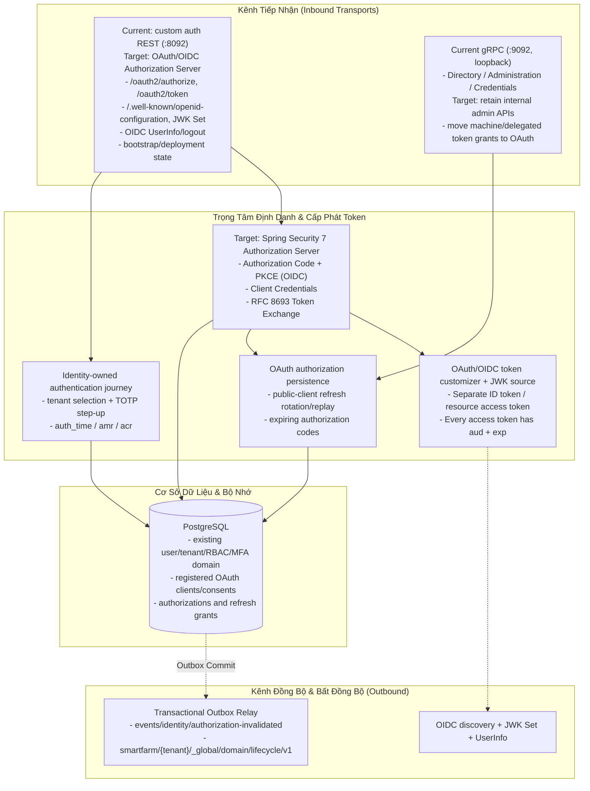

# Master Checklist — SmartFarm Identity Service

> **Phiên bản:** Cập nhật & Thống nhất toàn diện 2026-10-20
> **Ranh giới sản phẩm:** Trung tâm định danh, OAuth 2.0 Authorization Server / OIDC Provider và quyền truy cập nội bộ cho SmartFarm.
> **Nguyên tắc:** Tập trung vào các luồng cốt lõi; loại bỏ các tính năng gây phá vỡ kiến trúc hoặc over-engineering; quản lý thống nhất theo chuẩn **DONE / DOING / TODO**.

---

## 1. Ranh Giới & Cấu Trúc Tinh Giản Của Identity Service

---

## 2. Quyết Định Phạm Vi Sản Phẩm

Để bảo vệ tính toàn vẹn và tinh gọn của hệ thống, các đề xuất sau đã chính thức bị **loại bỏ** khỏi checklist:

| Hạng Mục | Quyết định |
|---|---|
| **OAuth/OIDC** | Quyết định cũ loại bỏ OAuth/OIDC đã bị thay thế. Áp dụng OAuth 2.0 Authorization Server + OIDC Provider trong Identity hiện hữu: Web cần login chuẩn/PKCE, workers cần client credentials, delegated access cần token exchange. Không tạo IDP thứ hai. Authorization Server, OIDC discovery/JWKS/UserInfo, persisted OAuth state, client credentials và authorization login/MFA journey đã bắt đầu triển khai; migration callers và release verification chưa hoàn tất. Xem [thiết kế mục tiêu và tiêu chuẩn](docs/architecture/identity-oauth2-oidc-target.md). |
| **Thay đổi cấu trúc Wire Proto v1** (Đổi string sang Enum, sửa field numbers, thêm country_code/address) | Phá vỡ tính tương thích ngược (wire descriptor compatibility) với API Gateway và các service con đang hoạt động ổn định. Giữ nguyên contract Protobuf v1. |
| **Tenant/Farm-scoped Permission Catalog Mutation** | Vi phạm quyết định kiến trúc cốt lõi [ADR-001](docs/adr/ADR-001-global-permission-catalog.md). Danh mục Permission là tài sản Platform toàn cục duy nhất. Cho phép tenant tự sửa permission sẽ phá vỡ tính nhất quán của hệ thống phân quyền RBAC. |
| **Tách biệt Database per Tenant trong Identity** | Mô hình dữ liệu của Identity là multi-tenant logic dùng chung một schema với chỉ mục `tenant_id`. Tách database vật lý cho từng tenant là over-engineering và gây lãng phí tài nguyên lớn. |
| **Tính năng Anonymize User / Sinh trắc học / WebAuthn phức tạp** | Không nằm trong phạm vi nghiệp vụ trang trại chăn nuôi ở giai đoạn này; làm phân tán nguồn lực tập trung vào luồng Token, SAGA và Outbox. |

---

## 3. Master Checklist Thống Nhất (DONE / DOING / TODO)

### ✅ DONE (Đã hoàn thành và xác nhận trong mã nguồn thực tế)

#### A. Ranh Giới Quyền Hạn & Kiến Trúc
- [x] Thống nhất Permission Catalog thuộc quyền quản lý Platform toàn cục ([ADR-001](docs/adr/ADR-001-global-permission-catalog.md)).
- [x] Thu hồi các endpoint REST quản trị thừa thãi; chuyển toàn bộ quản trị nội bộ sang 5 gRPC Services.
- [x] Kiến trúc bảo vệ phân tầng: Kiểm tra cấu trúc phân lớp cấm repository truy cập trực tiếp từ transport adapters (`TransportArchitectureGuardTest`).
- [x] Phân tách rõ ràng các thực thể `sf_account`, `sf_profile`, `sf_tenant_membership` và `sf_tenant`.

#### B. Thống Nhất Cấp Phát Token (Token Grant Facade)
- [x] Current implementation: `TokenGrantFacade` is a single issuer for custom tokens; it is not an OAuth Authorization Server.
- [x] Chuẩn hóa `TokenClaimContract`: `identity_claims_version = 1`, `sub`, `tenant_id`, `token_type`, `roles`, `scope`, `act`.
- [x] Loại bỏ phát hành token không có hạn hết: `is_async` được reserve trong protobuf, xóa khỏi issuance context/service; mọi JWT đều cần `exp` hữu hạn.
- [x] Cấp phát Service Token thông thường (`IssueServiceToken`) dựa trên Client Allowlist.
- [x] Cấp phát Delegated Service Token (`ExchangeDelegatedToken`) dựa trên việc đối soát JWT người dùng gốc, gắn thông tin ủy quyền qua claim `act`.
- [x] Khóa chặn hoàn toàn wildcard scope (`*` hoặc `SCOPE_*`) trong service token.
- [ ] Replace custom grant/token issuance with Spring Security 7 Authorization Server; every access token, including worker tokens, must have a finite expiry.

#### C. OAuth/OIDC Authorization Server (đang triển khai; chưa product-ready)
- [x] Chốt OAuth 2.0 Authorization Server + OIDC Provider trong Identity hiện hữu; không tạo service riêng, không duy trì custom legacy auth protocol.
- [x] Chốt Web Authorization Code + PKCE qua Gateway BFF; future native app Authorization Code + PKCE; worker `client_credentials`; user delegation RFC 8693.
- [x] Chốt giữ account/tenant/MFA/RBAC và internal administration gRPC; thay custom public auth/token surface.
- [x] Thêm Spring Security Authorization Server, OIDC discovery/JWKS/UserInfo, JDBC registered-client/authorization/consent stores và migration V4.
- [x] Thêm cấu hình OAuth client với audience giới hạn, Authorization Code PKCE requirement, client credentials, access token TTL hữu hạn và refresh rotation.
- [x] Thêm authorization-only browser login path để xử lý tenant/MFA mà không phát hành custom token; bổ sung `auth_time`/`amr` và OIDC profile/email claims theo scope.
- [ ] Bổ sung authorization-code + PKCE end-to-end test, login/MFA/session tests và kiểm tra interoperability OIDC; kiểm tra migration V4 trên PostgreSQL.
- [ ] Chuyển Gateway thành BFF dùng Secure/HttpOnly/SameSite session cookie; bỏ refresh token khỏi Web localStorage.
- [ ] Chuyển service clients sang client credentials và delegated grant sang RFC 8693; cập nhật downstream claim consumers (`sub=user`, `act.sub=service`).
- [ ] Sau khi clients chuyển đồng bộ, gỡ custom login/refresh/logout API và token-issuance gRPC; các compatibility surfaces này vẫn còn.

#### C. Quản Lý Phiên Refresh & Chống Tấn Công Replay
- [x] Mô hình dữ liệu JPA: Lưu hash refresh token và session trong bảng `sf_refresh_session` và `sf_refresh_token`.
- [x] Xoay vòng Refresh Token (Token Rotation): Cấp refresh token mới và thu hồi token cũ trong mỗi lần gọi.
- [x] Phát hiện sử dụng lại token cũ (`REFRESH_TOKEN_REUSE`): Thu hồi ngay toàn bộ session family trong transaction độc lập (`REQUIRES_NEW`).
- [x] Quản trị Session qua gRPC: Cài đặt đầy đủ `ListSessions`, `RevokeSession`, `RevokeAllSessions` (không để lộ raw token hash).
- [x] Tác vụ nền định kỳ dọn dẹp các session đã hết hạn.

#### D. Bootstrap & Xác Thực Đa Yếu Tố (MFA TOTP)
- [x] Bootstrap super-admin 1 lần duy nhất: Cơ chế Database Row-Locking chống race-condition khi khởi tạo đồng thời.
- [x] Bảo mật Bootstrap: Tuyệt đối không log hoặc sinh mã TOTP secret trong luồng bootstrap.
- [x] MFA Enrollment an toàn: Tách riêng luồng enrollment qua Challenge Token có thời hạn; tự động dọn dẹp các enrollment challenge hết hạn.
- [x] Mã hóa bí mật TOTP bằng khóa đối xứng 256-bit (`MfaEncryptionKeyProvider`).
- [x] Chống Replay mã TOTP và bảo vệ mã phục hồi (Recovery Codes).

#### E. Kiểm Thử & Kiểm Soát Chất Lượng
- [x] 97 unit/component test của `smartfarm-identity-service` chạy thành công trong `mvn -pl services/smartfarm-identity-service -am -Dspring.profiles.active=test test`; PostgreSQL integration tests có điều kiện riêng và không được tính là đã chạy trong lệnh này.
- [x] Bổ sung kiểm thử PostgreSQL đồng thời refresh token tại `RefreshSessionTenantIsolationIT.concurrentRefreshAllowsOneRotationAndRevokesTheFamilyOnReplay`.
- [x] Các request Bruno hiện có cho Identity: Bootstrap (`00`), Login (`01`), MFA Enrollment (`02-03`), MFA Verify (`05`), Refresh (`07`), Logout (`08`). Request submit SAGA (`11`) không kiểm thử việc phát token; async exp-less token đã bị loại bỏ.
- [x] Kịch bản SAGA đã đồng bộ với token hữu hạn và yêu cầu worker reacquire khi retry: [`bruno/ASYNC_TOKEN_AND_SAGA_TEST_SCENARIO.md`](bruno/ASYNC_TOKEN_AND_SAGA_TEST_SCENARIO.md).
- [x] Thêm PostgreSQL integration release gate để xác minh persistence/concurrency thuộc Identity bằng PostgreSQL bên ngoài.
- [ ] Chạy PostgreSQL integration release gate với database disposable trước khi chốt release.
- Runtime smoke check DB/MQTT là công cụ platform operations tại `scripts/health/identity-runtime-gate.sh`, không phải nghiệp vụ Identity hoặc Readiness Service; Readiness Service chỉ tổng hợp HTTP probes, không khởi chạy tiến trình hay test persistence Identity.

---

### 🔄 DOING (Đang triển khai & Tinh giản)

- [-] **Phát Tán Sự Kiện Authorization Invalidation Qua MQTT:**
  - Logic outbox event `AuthorizationInvalidated` đã hoàn thành.
  - Đang tối ưu hóa việc so khớp tenant ID giữa MQTT topic (`events/identity/authorization-invalidated`) và payload ở Gateway / Order service.
- [-] **Dynamic Authorization Shadow Evaluator:**
  - Bộ đánh giá quyền động gRPC (`smartfarm-security`) chạy `SHADOW`; đối chiếu tenant/invalidation và shadow decisions trước khi kích hoạt `ENFORCE`.
- [-] **Rà Soát Transaction Boundary (Open Session in View):**
  - Đã cấu hình tắt OSIV trong dev/prod; đang rà soát các transaction boundary để đảm bảo lazy-loading không gây `LazyInitializationException`.
---

### 📋 TODO (Hạng mục cần làm tiếp theo để hoàn thiện trọn vẹn)

#### So sánh hiện trạng → phần cần chốt trước production

| Mảng | Hiện trạng trong code | Cần cải thiện / xác nhận | Class / method / gate |
|---|---|---|---|
| Tích hợp resource service qua `smartfarm-security` | gRPC inbound JWT interceptor/validator tự động; Inventory, Finance, Health, Order, Reporting, Livestock dùng YAML method policy + startup coverage gate; servlet/reactive HTTP security đã auto-import opt-in; outbound token clients còn tự viết/copy | Migrate caller sang OAuth client chung khi client registrations được provision; bổ sung policy coverage tests/HTTP route policy và tenant data checks | `SmartFarmGrpcSecurityAutoConfiguration`; `GrpcMethodPolicyProperties`; `GrpcMethodPolicyCoverage`; `ServletResourceSecurity`; `ReactiveResourceSecurity`; duplicated `ServiceTokenClient`; [integration guide](docs/security/identity-service-integration.md) |
| PostgreSQL và cạnh tranh refresh | Có Flyway + `ddl-auto=validate`; IT được opt-in; đã thêm test hai refresh đồng thời | Chạy cả migration và concurrency trên DB disposable thật; chỉ chạy test mặc định chưa chứng minh được | `AbstractIdentityPostgresIT`; `SuperAdminBootstrapIT.concurrentRequestsCreateExactlyOneSuperAdmin`; `RefreshSessionTenantIsolationIT.concurrentRefreshAllowsOneRotationAndRevokesTheFamilyOnReplay`; `postgres-release-gate.sh` |
| OAuth/OIDC standards | Identity có Authorization Server/OIDC endpoints, persisted OAuth state và configured `client_credentials`; custom token APIs/gRPC còn hoạt động và callers chưa chuyển | Chứng minh PKCE/browser flow và interoperability; migrate callers trước khi gỡ legacy token surfaces | `IdentityAuthorizationServerConfiguration`; `AuthorizationLoginController`; `AuthService`; `IdentityTokenGrpcService`; Gateway BFF; Web auth |
| Delegated token semantics | Custom token contract dùng service subject và user actor, không phải RFC 8693 profile chuẩn | Token exchange với subject user, actor service, audience/scope hạn chế; migrate mọi resource-server consumer | `ServiceTokenService.issue`; `IdentityTokenGrpcService`; `TokenClaimContract`; `SmartFarmJwtValidator.validate`; Gateway/Order/Reporting clients |
| OIDC browser session | SPA refresh token hiện lưu trong `localStorage`; Gateway chỉ proxy password JSON | Gateway BFF: authorization-code callback, server-side tokens, HttpOnly/Secure/SameSite session; không lưu refresh token trong trình duyệt | `AuthProxyController`; `apps/smartfarm-web/src/lib/api.ts`; `apps/smartfarm-web/src/lib/auth.tsx`; Gateway security |
| Access-token lifetime/claims | JWT validator đòi `exp` hữu hạn; service tokens có thể không có tenant; async exp-less issuance đã bị xóa. OAuth access token customizer yêu cầu audience đơn | Migrate resource consumers sang chuẩn OAuth claims/token profiles; xác minh audience contract trên từng resource server | `SmartFarmJwtValidator.validate`; `IdentityAuthorizationServerConfiguration`; `TokenService`; resource-server consumers |
| gRPC transport | Listener loopback là mặc định; client Gateway cùng host | Giữ loopback với topology hiện tại. Chỉ triển khai TLS/mTLS khi tách host; không mở bind trước negative tests | `application-prod.yml`; cấu hình gRPC client Gateway |
| Secrets | Prod nhận DB/RSA/MFA/client config từ environment/path; không có tích hợp Vault riêng | Inject bằng secret manager ở deployment; xác nhận permission private key, `kid`/JWKS rotation và MFA key rotation | `MfaEncryptionKeyProvider` constructor/decodeKey; `TokenService`; `ServiceTokenSettings` |
| Brute-force / abuse | Login lockout + MFA attempt limit; registration mặc định tắt | Bổ sung rate limit phân tán tại Gateway/edge; không giới hạn theo IP bên Identity vì request cùng host bị quy về IP Gateway | `AuthService.login`; `MfaChallengeService.verifyTotp/verifyRecoveryCode`; Gateway ingress |
| Quyền động | Shadow evaluator có mặt nhưng chưa enforce | So khớp tenant/invalidation, giải quyết shadow divergence, rollout và rollback rồi mới bật enforce | `IdentityGrpcDynamicAuthorizationEvaluator.evaluate`; `IdentityAuthorizationSynchronizer.run` |
| Logout/revoke JWT | Logout thu hồi refresh family; access JWT vẫn dùng đến `exp` | Chấp nhận giới hạn với TTL ngắn hoặc triển khai revocation nếu sản phẩm yêu cầu logout tức thời | `AuthService.logout`; `AuthService.rotate`; `TokenService` |

- [ ] **Chạy PostgreSQL release gate — `AbstractIdentityPostgresIT`, `SuperAdminBootstrapIT.concurrentRequestsCreateExactlyOneSuperAdmin`, `RefreshSessionTenantIsolationIT.concurrentRefreshAllowsOneRotationAndRevokesTheFamilyOnReplay`:**
  - Cấp database disposable có quyền tạo schema; export `IDENTITY_IT_POSTGRES_URL`, `IDENTITY_IT_POSTGRES_USER`, `IDENTITY_IT_POSTGRES_PASSWORD`, sau đó chạy `services/smartfarm-identity-service/scripts/postgres-release-gate.sh`.
  - Gate kiểm tra Flyway migrate + Hibernate validate, bootstrap lock, refresh rotation/replay và tenant isolation trên PostgreSQL thật. Schema `it_identity` được giữ lại để kiểm tra; tuyệt đối không dùng production DB.
- [ ] **Hoàn tất migration OAuth/OIDC — theo [thiết kế mục tiêu](docs/architecture/identity-oauth2-oidc-target.md):**
  - Đã có nền tảng protocol/persistence/configured grants trong Identity, nhưng chưa có PKCE/login end-to-end, Gateway BFF/Web cookie, RFC 8693, caller/resource-server migration hoặc PostgreSQL runtime verification.
  - Tiếp tục theo thứ tự: hoàn thiện protocol/login tests; verify migration; Gateway BFF/Web cookie; service client credentials; RFC 8693; resource-server claim/audience contracts; rồi mới gỡ custom auth/token endpoints và issuance gRPC.
  - Đây là thay thế sạch trong dự án đang phát triển: không giữ legacy auth/token compatibility layer, không cần chuyển token cũ. Giữ domain account/MFA/RBAC/admin và event outbox.
  - OAuth 2.1 hiện là Internet-Draft, không ghi là RFC. Dùng RFC 9700, OAuth 2.0, OIDC Core và các RFC extension đã công bố làm chuẩn.
- [ ] **Chuẩn hóa integration starter cho resource modules — theo [hướng dẫn đánh giá hiện trạng và đích tích hợp](docs/security/identity-service-integration.md):**
  - Đã chuyển method mappings của sáu service sang config YAML; `require-explicit-policy` đối chiếu method registry để fail startup khi RPC thiếu phân loại hoặc policy stale. HTTP servlet/reactive starter hiện auto-import opt-in.
  - Còn cần reusable Identity OAuth client/token cache, outbound credential/deadline integration, configurable HTTP route-to-authority policy, và reusable security test kit.
  - Không đưa data tenant isolation hoặc business ownership policy vào Identity/common: từng resource module vẫn enforce tại query/command và khai báo operation authority do Identity catalog cấp.
- [ ] **Giữ gRPC private hoặc bật TLS/mTLS trước cross-host — `application-prod.yml`, Gateway gRPC client configuration:**
  - Trạng thái hiện tại: REST/gRPC bind loopback mặc định, phù hợp Gateway cùng host; không mở bind cross-host chỉ để kiểm thử.
  - Nếu tách host, cấu hình TLS/mTLS, xác minh client identity và kiểm tra negative case (thiếu/sai certificate) trước khi đổi bind address.
- [ ] **Secret injection và rotation — `application-prod.yml`, `MfaEncryptionKeyProvider` constructor/decodeKey, `TokenService` key loading, `ServiceTokenSettings` validation:**
  - Prod đọc DB, RSA key paths, MFA key và client list từ cấu hình ngoài; môi trường triển khai phải inject qua secret manager, không commit hoặc đặt secret thật trong YAML.
  - Chốt file permission cho RSA private key, xoay `kid`/JWKS và quy trình đổi MFA key (đổi key làm mất khả năng giải mã enrollment cũ).
- [ ] **Chống abuse tại ingress — `AuthService.login`, MFA challenge flow và Gateway edge:**
  - Hiện có lockout theo tài khoản, giới hạn lần thử MFA, public registration tắt mặc định; chưa có distributed IP/device throttling, CAPTCHA, email verification hay password reset.
  - Bổ sung throttling tại Gateway/edge tin cậy: Identity chỉ nhận request qua loopback proxy nên IP limiter tại Identity sẽ gom mọi người dùng vào cùng IP; không tiết lộ email có tồn tại qua phản hồi.
- [ ] **Chuyển Dynamic Authorization sang Enforce có kiểm soát — `IdentityAuthorizationSynchronizer.run`, `IdentityGrpcDynamicAuthorizationEvaluator`, `SMARTFARM_GRPC_AUTHORIZATION_MODE`:**
  - Đối chiếu shadow decisions, tenant ID giữa MQTT topic/payload và audit divergence; chỉ bật `ENFORCE` khi đã đóng sai khác và có rollout/rollback.
- [ ] **Release sign-off cho logout và thu hồi — `AuthService.logout`, `TokenService`:**
  - JWT đã phát vẫn dùng được đến `exp` sau logout/disable; xác nhận TTL tối đa 15 phút phù hợp hoặc bổ sung cơ chế revocation ngắn hạn trước khi tuyên bố logout tức thời.
