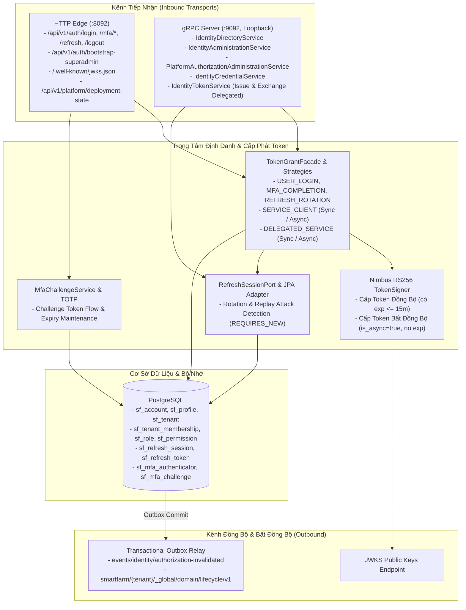

# Master Checklist — SmartFarm Identity Service

> **Phiên bản:** Cập nhật & Thống nhất toàn diện 2026-10-16  
> **Ranh giới sản phẩm:** Trung tâm định danh và cấp phát token nội bộ cho hệ thống Microservices SmartFarm.  
> **Nguyên tắc:** Tập trung vào các luồng cốt lõi; loại bỏ các tính năng gây phá vỡ kiến trúc hoặc over-engineering; quản lý thống nhất theo chuẩn **DONE / DOING / TODO**.

---

## 1. Ranh Giới & Cấu Trúc Tinh Giản Của Identity Service

---

## 2. Các Hạng Mục Đã Loại Bỏ (Pruned & Rejected Items)

Để bảo vệ tính toàn vẹn và tinh gọn của hệ thống, các đề xuất sau đã chính thức bị **loại bỏ** khỏi checklist:

| Hạng Mục Đề Xuất | Lý Do Loại Bỏ (Tránh Phá Vỡ Cấu Trúc Dự Án) |
|---|---|
| **Biến Identity thành OAuth2/OIDC Server đầy đủ** (PKCE, Discovery, Authorize Code, Browser SSO) | Identity là service nội bộ cấp phát JWT cho Gateway và các Microservices nội bộ; không phải IDP công cộng. Việc nhúng đầy đủ OAuth2/OIDC gây phình to mã nguồn, phức tạp hóa triển khai và tạo lỗ hổng tấn công không cần thiết. |
| **Thay đổi cấu trúc Wire Proto v1** (Đổi string sang Enum, sửa field numbers, thêm country_code/address) | Phá vỡ tính tương thích ngược (wire descriptor compatibility) với API Gateway và các service con đang hoạt động ổn định. Giữ nguyên contract Protobuf v1. |
| **Tenant/Farm-scoped Permission Catalog Mutation** | Vi phạm quyết định kiến trúc cốt lõi [ADR-001](docs/adr/ADR-001-global-permission-catalog.md). Danh mục Permission là tài sản Platform toàn cục duy nhất. Cho phép tenant tự sửa permission sẽ phá vỡ tính nhất quán của hệ thống phân quyền RBAC. |
| **Tách biệt Database per Tenant trong Identity** | Mô hình dữ liệu của Identity là multi-tenant logic dùng chung một schema với chỉ mục `tenant_id`. Tách database vật lý cho từng tenant là over-engineering và gây lãng phí tài nguyên lớn. |
| **Tính năng Anonymize User / Sinh trắc học / WebAuthn phức tạp** | Không nằm trong phạm vi nghiệp vụ trang trại chăn nuôi ở giai đoạn này; làm phân tán nguồn lực tập trung vào luồng Token, SAGA và Outbox. |

---

## 3. Master Checklist Thống Nhất (DONE / DOING / TODO)

### ✅ DONE (Đã hoàn thành và xác nhận trong mã nguồn thực tế)

#### A. Ranh Giới Quyền Hạn & Kiến Trúc
- [x] Thống nhất Permission Catalog thuộc quyền quản lý Platform toàn cục ([ADR-001](docs/adr/ADR-001-global-permission-catalog.md)).
- [x] Thu hồi các endpoint REST quản trị thừa thãi; chuyển toàn bộ quản trị nội bộ sang 5 gRPC Services.
- [x] Kiến trúc bảo vệ phân tầng: Kiểm tra cấu trúc phân lớp cấm repository truy cập trực tiếp từ transport adapters (`TransportArchitectureGuardTest`).
- [x] Phân tách rõ ràng các thực thể `sf_account`, `sf_profile`, `sf_tenant_membership` và `sf_tenant`.

#### B. Thống Nhất Cấp Phát Token (Token Grant Facade)
- [x] `TokenGrantFacade` là điểm duy nhất phát hành mọi loại token trong hệ thống.
- [x] Chuẩn hóa `TokenClaimContract`: `identity_claims_version = 1`, `sub`, `tenant_id`, `token_type`, `roles`, `scope`, `act`.
- [x] **Hỗ trợ Token Bất Đồng Bộ (`is_async = true`):**
  - Khai báo claim `is_async` trong `TokenClaimContract`.
  - Cập nhật `SmartFarmJwtValidator`: chấp nhận token async không có hạn hết (`exp = null`), bắt buộc `exp` với token sync thông thường.
  - Hỗ trợ cấp phát token async qua `TokenContext`, `TokenService`, `ServiceTokenService` và gRPC `IdentityTokenGrpcService`.
- [x] Cấp phát Service Token thông thường (`IssueServiceToken`) dựa trên Client Allowlist.
- [x] Cấp phát Delegated Service Token (`ExchangeDelegatedToken`) dựa trên việc đối soát JWT người dùng gốc, gắn thông tin ủy quyền qua claim `act`.
- [x] Khóa chặn hoàn toàn wildcard scope (`*` hoặc `SCOPE_*`) trong service token.

#### C. Quản Lý Phiên Refresh & Chống Tấn Công Replay
- [x] Mô hình dữ liệu JPA: Lưu hash refresh token và session trong bảng `sf_refresh_session` và `sf_refresh_token`.
- [x] Xoay vòng Refresh Token (Token Rotation): Cấp refresh token mới và thu hồi token cũ trong mỗi lần gọi.
- [x] Phát hiện sử dụng lại token cũ (`REFRESH_TOKEN_REUSE`): Thu hồi ngay toàn bộ session family trong transaction độc lập (`REQUIRES_NEW`).
- [x] Quản trị Session qua gRPC: Cài đặt đầy đủ `ListSessions`, `RevokeSession`, `RevokeAllSessions` (không để lộ raw token hash).
- [x] Tác vụ nền định kỳ dọn dẹp các session đã hết hạn.

#### D. Bootstrap & Xác Thực Đa Yếu Tố (MFA TOTP)
- [x] Bootstrap super-admin 1 lần duy nhất: Cơ chế Database Row-Locking chống race-condition khi khởi tạo đồng thời.
- [x] Bảo mật Bootstrap: Tuyệt đối không log hoặc sinh mã TOTP secret trong luồng bootstrap.
- [x] MFA Enrollment an toàn: Tách riêng luồng enrollment qua Challenge Token có thời hạn; tự động dọn dẹp các enrollment challenge hết hạn.
- [x] Mã hóa bí mật TOTP bằng khóa đối xứng 256-bit (`MfaEncryptionKeyProvider`).
- [x] Chống Replay mã TOTP và bảo vệ mã phục hồi (Recovery Codes).

#### E. Kiểm Thử & Kiểm Soát Chất Lượng
- [x] Toàn bộ 95 test case của `smartfarm-identity-service` và 60 test case của `smartfarm-security` chạy thành công 100% (`BUILD SUCCESS`).
- [x] Kịch bản kiểm thử Bruno đầy đủ cho Identity: Bootstrap (`00`), Login (`01`), MFA Enrollment (`02-03`), MFA Verify (`05`), Refresh (`07`), Logout (`08`), Async Token (`11`).
- [x] Tài liệu kịch bản kiểm thử thủ công và tự động hóa: [`bruno/ASYNC_TOKEN_AND_SAGA_TEST_SCENARIO.md`](bruno/ASYNC_TOKEN_AND_SAGA_TEST_SCENARIO.md).

---

### 🔄 DOING (Đang triển khai & Tinh giản)

- [-] **Phát Tán Sự Kiện Authorization Invalidation Qua MQTT:**
  - Logic outbox event `AuthorizationInvalidated` đã hoàn thành.
  - Đang tối ưu hóa việc so khớp tenant ID giữa MQTT topic (`events/identity/authorization-invalidated`) và payload ở Gateway / Order service.
- [-] **Dynamic Authorization Shadow Evaluator:**
  - Bộ đánh giá quyền động gRPC (`smartfarm-security`) đang chạy chế độ Shadow để ghi nhận audit log trước khi kích hoạt Enforcing.
- [-] **Rà Soát Transaction Boundary (Open Session in View):**
  - Đã cấu hình tắt OSIV trong dev/prod; đang rà soát các transaction boundary để đảm bảo lazy-loading không gây `LazyInitializationException`.

---

### 📋 TODO (Hạng mục cần làm tiếp theo để hoàn thiện trọn vẹn)

- [ ] **Release Gate trên PostgreSQL Thực Tế:**
  - Chạy bộ kiểm thử tích hợp Flyway validate, concurrent bootstrap row-lock và concurrent refresh rotation trực tiếp trên PostgreSQL container độc lập (thay cho profile H2 test).
- [ ] **Cấu Hình Bảo Mật Kênh Truyền gRPC TLS / mTLS:**
  - Hiện tại gRPC bind trên loopback (`127.0.0.1`).
  - Thiết lập chứng chỉ TLS và mTLS cho gRPC khi triển khai liên máy chủ (cross-host deployment) giữa Gateway và Identity.
- [ ] **Inject Production Secrets Qua Secret Manager:**
  - Thay thế các secret cấu hình mặc định ở profile dev bằng biến môi trường hoặc Vault/Secret Manager trong môi trường Production (`IDENTITY_MFA_ENCRYPTION_KEY`, `JWT private key`, `client secrets`).
- [ ] **Tự Động Hóa Kiểm Thử CI/CD:**
  - Tích hợp runner tự động cho bộ collection Bruno CLI (`bru run bruno --env local`) vào pipeline CI/CD sau khi khởi động docker hạ tầng.
