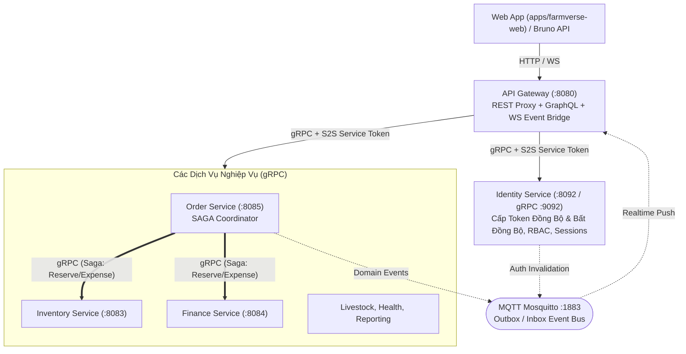

# FarmVerse Platform — Nền Tảng Quản Lý Nông Trại Chăn Nuôi

> **Mô hình:** Monorepo Maven đa module + Web SPA Client  
> **Công nghệ:** Java 17, Spring Boot 4.1.1, Spring gRPC 1.1.1, Spring WebFlux, React 19, Mosquitto MQTT, PostgreSQL 17  
> 📖 **Cổng điều hướng tài liệu toàn dự án:** [`docs/index.md`](./docs/index.md)

---

## 1. Tổng Quan Kiến Trúc Tinh Giản

Hệ thống được thiết kế theo kiến trúc **Microservices phân tầng**, kết nối đồng bộ qua **gRPC** và bất đồng bộ qua **MQTT Broker**:



---

## 2. Bảng Ma Trận Công Nghệ (Tech Stack Matrix)

| Phân Vùng | Module | Công Nghệ Chính | Giao Thức & Cổng | Vai Trò |
|---|---|---|:---:|---|
| **Web Frontend** | `apps/farmverse-web` | React 19, TypeScript, Vite, Tailwind CSS | HTTP `:5173` | Giao diện quản trị trang trại và đơn hàng |
| **Edge Gateway** | `platform/api-gateway` | Spring WebFlux, Spring for GraphQL, Spring Security | HTTP `:8080` | Ingress duy nhất: REST proxy, GraphQL, WebSocket bridge |
| **Core Security** | `services/identity-service` | Spring Boot 4, Spring gRPC, Spring Security, JPA | HTTP `:8092` / gRPC `:9092` | Trung tâm định danh, cấp phát token (Sync/Async), MFA, RBAC |
| **Business Services** | `farmverse-{order, inventory, finance, livestock, health, reporting}-service` | Spring Boot 4, Spring gRPC, Spring Data JPA, Flyway | gRPC `:9091–:9097` | Thực thi nghiệp vụ chăn nuôi, tồn kho, hạch toán, SAGA |
| **Shared Libs** | `libs/farmverse-{common-kernel, security, proto, messaging}` | Java 17, Protobuf v3, Nimbus JWT | — | Thư viện dùng chung cấu hình bảo mật, hợp đồng proto, event contracts |
| **Hạ Tầng Dev** | Docker Compose (`compose.yaml`) | PostgreSQL 17, Mosquitto 2, Redis 8 | `:5432`, `:1883`, `:6379` | Cơ sở dữ liệu và message broker cho môi trường cục bộ |

---

## 3. Kiến Trúc Cơ Sở Dữ Liệu

- **Mục tiêu kiến trúc chuẩn (Target / Production):** **Database-per-service** (Mỗi microservice sở hữu cơ sở dữ liệu và schema độc lập, không chia sẻ kết nối hay khóa ngoại liên service).
- **Môi trường phát triển cục bộ (Development):** Để thuận tiện và tiết kiệm tài nguyên máy phát triển, tất cả service đang kết nối chung vào 1 PostgreSQL instance (`jdbc:postgresql://localhost:5432/farmverse`). Dữ liệu được phân tách theo tiền tố bảng riêng biệt (`sf_*`, `order_*`, `inv_*`, `fin_*`...).

---

## 4. Danh Mục Cổng Mạng Môi Trường Dev

| Dịch Vụ | Module | HTTP Port | gRPC Port | Ghi Chú |
|---|---|:---:|:---:|---|
| **API Gateway** | `platform/api-gateway` | **8080** | — | Cổng Ingress công khai duy nhất |
| **Web Frontend** | `apps/farmverse-web` | **5173** | — | Giao diện Web SPA React |
| **Identity** | `services/identity-service` | 8092 | 9092 | gRPC bind loopback |
| **Livestock** | `services/livestock-service` | 8081 | 9091 | Quản lý đàn & nhiệm vụ |
| **Inventory** | `services/inventory-service` | 8083 | 9093 | Quản lý kho & giữ hàng |
| **Finance** | `services/payment-service` | 8084 | 9094 | Thu chi & hạch toán |
| **Order** | `services/order-service` | 8085 | 9095 | Vận hành đơn & điều phối SAGA |
| **Reporting** | `services/reporting-service` | 8086 | 9096 | Kết xuất dữ liệu báo cáo |
| **Health** | `services/health-service` | 8087 | 9097 | Khám chữa & tiêm phòng |

---

## 5. Hướng Dẫn Bắt Đầu Nhanh (Quick Start)

### 1. Khởi động hạ tầng nền tảng (Docker)
```bash
docker compose up -d         # Khởi động PostgreSQL 17 (:5432), Mosquitto (:1883), Redis (:6379)
```

### 2. Biên dịch toàn bộ dự án
```bash
mvn clean compile -DskipTests
```

### 3. Khởi chạy các service cốt lõi (Terminal riêng biệt)
```bash
# 1. Identity Service
mvn -f services/identity-service/pom.xml spring-boot:run

# 2. Order Service
mvn -f services/order-service/pom.xml spring-boot:run

# 3. API Gateway
mvn -f platform/api-gateway/pom.xml spring-boot:run

# 4. Web Frontend (tùy chọn)
cd apps/farmverse-web && npm run dev
```

---

## 6. Kịch Bản Kiểm Thử & Kiểm Soát Nghiệm Thu

> ⚠️ **Quy tắc kiểm thử:** Không chạy service ngầm để test thật mà sử dụng kịch bản kiểm thử qua Bruno hoặc giao diện Web.

- **Bộ request Bruno:** Mở thư mục `bruno/` bằng Bruno App và chọn environment `local`.
- **Kiến trúc bảo mật & Checklist Master (TODO / DOING / DONE):** Xem tại [`docs/security/security-architecture.md`](./docs/security/security-architecture.md).

---

## 7. Giấy Phép & Bản Quyền
- Bản quyền thuộc về **Vu Ha Trong** (2026) theo giấy phép PolyForm Strict License 1.0.0. Xem [`LICENSE`](./LICENSE) và [`COPYRIGHT`](./COPYRIGHT).
