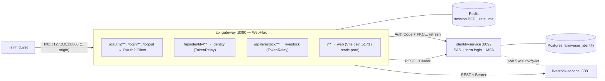
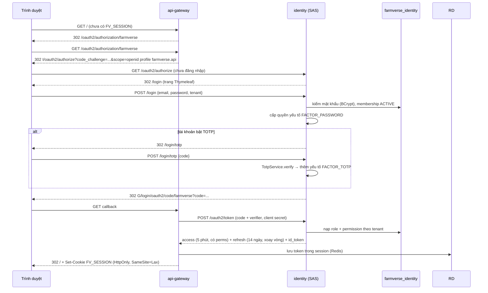
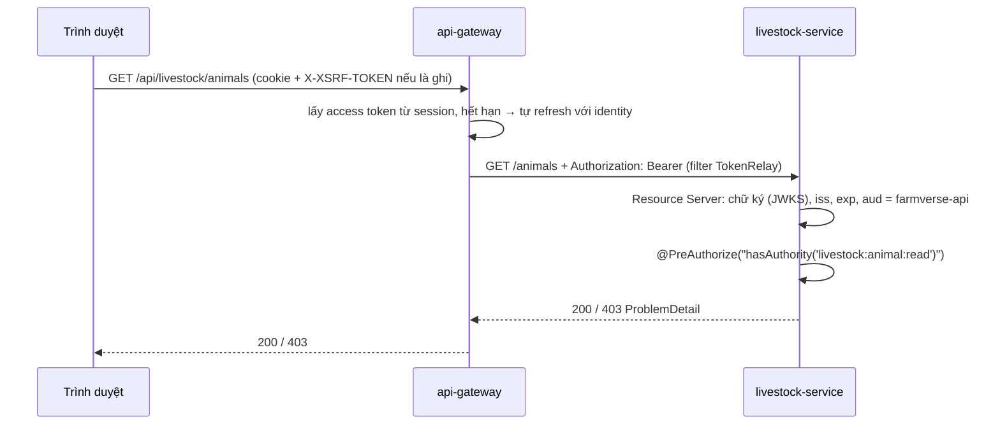
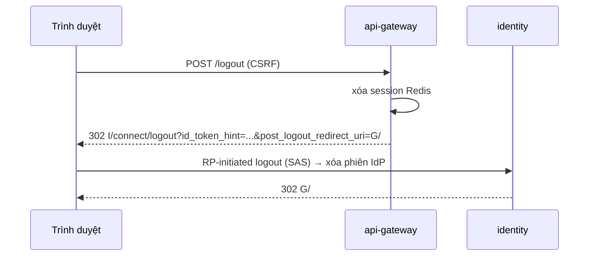
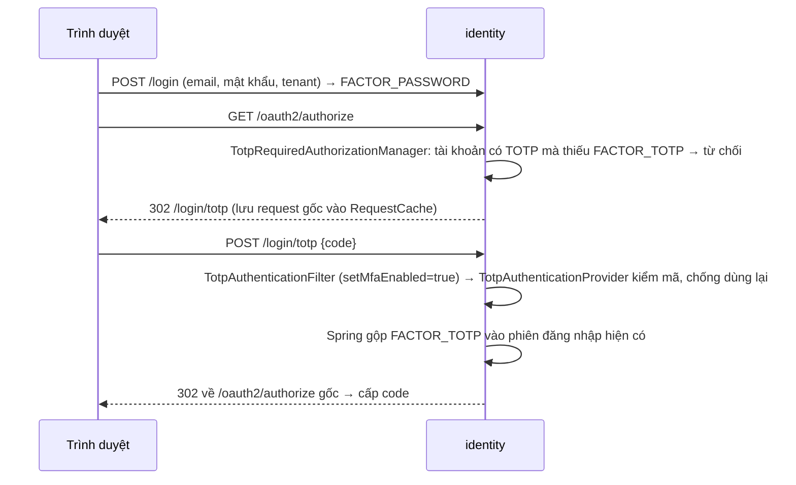

# Cấp 1 — API Gateway (BFF) + Identity (Spring Authorization Server)

> Trạng thái: **ĐÃ DUYỆT 2026-10-27** (làm thẳng trên `main`). Thay đổi khi duyệt: Flyway gom về 2 file gốc; **MFA/TOTP tạm dừng** vì Spring Security 7.1.2 không có factor TOTP (chỉ PASSWORD, OTT, WEBAUTHN, ...) — chờ chọn hướng.
>
> **Cấp 1 xong (code)**: identity, livestock (REST animals + tasks), gateway BFF, web. Test Java xanh. Web chưa chạy được `npm run build` trên máy này vì `npm` không tải được gói (lỗi chứng chỉ TLS).
> Thuộc: `content/thiet-ke-farmverse-msa.md` (mục 3, 5, 6.1, 9). Nhánh làm: `feat/farmverse-level-1` (tách từ `feat/farmverse-level-0`).

## 1. Phạm vi

| Trong cấp 1 | Ngoài cấp 1 (cấp sau) |
|---|---|
| `platform/api-gateway` viết lại bằng Spring Cloud Gateway (BFF) | farm-service mới (cấp 1b, tài liệu riêng) |
| `services/identity-service` dọn về SAS chuẩn + REST quản trị | RabbitMQ, outbox, event identity (cấp 2) |
| Web: đăng nhập qua BFF, chỉ giữ cookie | REST cho inventory / order / reporting (đến cấp của từng service) |
| Livestock: resource server REST đầu tiên để chứng minh Token Relay | Config server, Eureka (cấp 3) |

Hệ quả đã biết: các service nghiệp vụ hiện **chỉ có gRPC**, gateway mới chỉ định tuyến REST. Vì vậy sau cấp 1, các trang Inventory / Orders / Reports trên web **tạm ẩn** cho tới khi service đó có REST ở cấp của nó.

## 2. Kiến trúc cấp 1



Ghi chú:
- **Một origin cho trình duyệt** (`localhost:8080`): gateway chuyển cả trang web lẫn API. Không CORS, cookie đơn giản.
- **Gateway mở ở `127.0.0.1:8080`, identity ở `localhost:8092`**: SAS không nhận redirect URI có host `localhost` (RFC 8252 yêu cầu IP loopback). Hai host khác nhau nên cookie không đè nhau; vẫn đặt tên riêng `FV_SESSION` / `FV_IDP_SESSION` cho rõ.
- Trình duyệt chỉ thấy identity ở trang đăng nhập (redirect sang `:8092`). Mọi API đi qua gateway.

## 3. Luồng

### 3.1 Đăng nhập + MFA (Spring Security 7 MFA)



Ghi chú:
- MFA dùng cơ chế có sẵn của Spring Security 7.1.2: `@EnableMultiFactorAuthentication` + quyền yếu tố. Đã thấy các class này trong jar `spring-security-config-7.1.2` (`EnableMultiFactorAuthentication`, `AllRequiredFactorsAuthorizationManager`). Chi tiết API sẽ đọc từ jar khi code, không đoán.
- Chỉ phần **kiểm mã TOTP** là tự viết (`TotpService` đã có; Base32 chuyển sang `commons-codec`).
- Tenant chọn ở trang login. Đổi tenant = đăng xuất rồi đăng nhập lại (cấp 1). Đổi tenant không cần đăng nhập lại để dành cho bài học sau.

### 3.2 Gọi API qua Token Relay



### 3.3 Đăng xuất



Ghi chú: đổi quyền có hiệu lực trong ≤ 5 phút (TTL access token). Khóa tài khoản = thu hồi refresh token qua `OAuth2AuthorizationService` → lần refresh sau thất bại → người dùng bị đăng xuất.

## 4. Identity sau khi dọn

### 4.1 Cấu trúc package (hexagonal nhẹ)

```
com.htv.farmverse.identity
  account/       domain, application (AccountService, PasswordPolicy → Bean Validation), adapter/in/rest, adapter/out/jpa
  tenant/        domain, application, adapter
  authorization/ role, permission, assignment (domain + application + REST)
  mfa/           TotpService, authenticator, recovery codes
  oauth2/        cấu hình SAS: client, token customizer (perms), JWK, userinfo
  login/         Thymeleaf form login + bước TOTP (thay HTML viết tay)
  bootstrap/     SuperAdminSeeder (1 ApplicationRunner + UNIQUE)
  config/        SecurityFilterChain (2 chuỗi: SAS và app)
```

### 4.2 Giữ / bỏ

| Giữ, chỉnh | Bỏ hẳn |
|---|---|
| `IdentityAuthorizationServerConfiguration` (JDBC client/authorization/consent) | `token/**` (TokenService, grant, session, refresh replay) |
| `OAuth2TokenCustomizer`: thêm `perms`, `roles`, `tenant_id`; aud cố định `farmverse-api` | `api/AuthController` (`/auth/*`), `oauth2/AuthService` 1071 dòng |
| Entity account / tenant / membership / role / permission | `grpc/**`, `IdentityGrpcSecurityConfiguration`, `ServiceTokenSettings` |
| `TotpService`, recovery code, `MfaEncryption` → `Encryptors.stronger` | `messaging/**` (lệnh MQTT, outbox MQTT) — event làm lại ở cấp 2 |
| Migration V1, V4 (bảng OAuth2) | `authorization/version/**` (phân quyền động) |
| `PermissionCollectService` (đăng ký permission qua API) | `bootstrap/` lock + bootstrap token; V2, V5 → migration mới drop bảng |
| | `administration/**` dạng gRPC → thay bằng REST |

JWK: đọc cặp khóa PEM bằng `RsaKeyConverters` của Spring Security, dựng `JWKSource` trong `oauth2/`. Không còn `TokenService`.

### 4.3 REST quản trị (thay GraphQL của gateway cũ)

| Nhóm | Endpoint | Quyền |
|---|---|---|
| Hồ sơ tôi | `GET/PATCH /me`, `POST /me/password`, `POST /me/mfa/totp`, `POST /me/mfa/totp/confirm`, `DELETE /me/mfa`, `POST /me/mfa/recovery-codes` | đã đăng nhập |
| Người dùng | `GET/POST /users`, `POST /users/{id}/{enable,disable,unlock,reset-mfa}`, `POST /users/{id}/membership/{enable,disable,suspend}`, `GET /users/{id}/authorization` | `identity:user:*` |
| Role | `GET/POST/PUT/DELETE /roles`, `PUT/DELETE /roles/{code}/permissions/{perm}` | `identity:role:*` |
| Permission | `GET/POST/PUT/DELETE /permissions` | `identity:role:*` |

Lỗi trả `ProblemDetail`, field `code` = `SF-IDENTITY-xxx`. Phân trang `Pageable`.

### 4.4 Client OAuth2 (khai trong `application.yml`, lưu JDBC lúc khởi động)

| client_id | Loại | Grant | Ghi chú |
|---|---|---|---|
| `farmverse-gateway` | confidential, `client_secret_basic` | `authorization_code` + PKCE, `refresh_token` | redirect `http://127.0.0.1:8080/login/oauth2/code/farmverse`; scope `openid profile email farmverse.api` |
| `farmverse-service` | confidential | `client_credentials` | dành cho cấp 2 (order → payment); khai trước, chưa dùng |

## 5. Gateway mới

| Thành phần | Dùng |
|---|---|
| Định tuyến | `spring-cloud-starter-gateway-server-webflux`, route khai trong `application.yml` |
| BFF login | `spring-boot-starter-oauth2-client` (reactive), `oauth2Login()` |
| Gửi token xuống | filter `TokenRelay=` |
| Session | `spring-boot-starter-session-data-redis` (reactive), cookie `FV_SESSION` |
| Rate limit | `RequestRateLimiter` + Redis, key theo user (`sub`) |
| CSRF | `CookieServerCsrfTokenRepository.withHttpOnlyFalse()`; web gửi `X-XSRF-TOKEN` |
| `/bff/me` | trả `sub`, tên, tenant, perms từ id/access token cho web (không trả token) |

Bỏ toàn bộ gateway cũ: GraphQL, WebSocket, `DomainEventBus`, gRPC client, `ServiceTokenClient`, `AuthProxyController`, các `*DevController`, `GatewayCorrelationWebFilter` (Micrometer Tracing lo), `farmverse-security` reactive.

## 6. Web

- Bỏ `accessToken`/`refreshToken`, bỏ `localStorage`. `fetch` dùng `credentials: 'same-origin'` + header CSRF.
- `Login.tsx`, `Bootstrap.tsx` bỏ: nút "Đăng nhập" chỉ chuyển tới `/oauth2/authorization/farmverse`.
- `auth.tsx`: hỏi `GET /bff/me`; 401 → chuyển trang đăng nhập.
- `Profile.tsx`, `admin/Users.tsx`, `admin/Authorization.tsx`: GraphQL → REST mục 4.3.
- Inventory / Orders / Reports: ẩn menu tới cấp tương ứng.
- Vite chạy `:5173`; người dùng mở `http://127.0.0.1:8080` (gateway chuyển tiếp, kể cả HMR websocket).

## 7. Livestock làm resource server mẫu

- Thêm `spring-boot-starter-oauth2-resource-server` + `issuer-uri: http://localhost:8092` + kiểm `aud`.
- Một `JwtAuthenticationConverter`: `perms` → authority, `roles` → `ROLE_*`.
- REST tối thiểu: `GET /animals`, `GET /animals/{id}`, `POST /animals` (gọi service sẵn có).
- Bỏ phần `farmverse-security` servlet auto-config khỏi livestock. Các service khác giữ nguyên tới cấp của chúng.

## 8. Kiểm chứng (Definition of Done)

| Test | Loại |
|---|---|
| Discovery `/.well-known/openid-configuration` + JWKS trả đúng issuer | `@SpringBootTest` identity |
| Auth Code + PKCE end-to-end (MockMvc): login → (TOTP) → code → token có `perms`, `aud=farmverse-api` | identity |
| Thiếu bước TOTP khi tài khoản bật MFA → không cấp code | identity |
| Client credentials cấp token `token_type=service` | identity |
| REST quản trị: 401 / 403 / 200 theo quyền | identity `@WebMvcTest` |
| Gateway: chưa login → 302; có session → TokenRelay gắn Bearer (WireMock thay downstream) | gateway `@SpringBootTest` |
| Livestock: token sai `aud` → 401; thiếu quyền → 403 | livestock |
| Postgres thật cho identity | Testcontainers `*IT` |
| `npm run build` web | build |

## 9. Hạ tầng dev

- `compose.yaml`: Redis bật `requirepass`, chỉ bind `127.0.0.1`.
- Database `farmverse_identity` (Flyway tạo bảng). Dữ liệu dev cũ bỏ.
- Cổng: gateway 8080, identity 8092, livestock 8081, web 5173.

## 10. Rủi ro

- **Bảo mật**: client secret gateway và mật khẩu Redis chỉ để giá trị dev trong `application-dev.yml`; prod lấy từ biến môi trường.
- **Web mất tạm 3 trang** (Inventory, Orders, Reports) tới cấp 2–3.
- **Migration identity**: bỏ V2, V5 bằng migration mới `V6__drop_bootstrap_lock.sql` (không sửa file đã chạy).
- **API MFA của Spring Security 7** mới; nếu không đủ cho bước TOTP tùy biến, phương án dự phòng: `AuthenticationFilter` riêng cho bước TOTP trên chuỗi form login (vẫn thuần Spring Security). Sẽ báo trước khi đổi hướng.

## 11. Thứ tự làm (mỗi bước build xanh, một commit)

1. Identity: xóa phần bỏ, sửa cấu hình SAS + JWK + customizer, Thymeleaf login + MFA.
2. Identity: REST quản trị + test.
3. Livestock: resource server + REST mẫu.
4. Gateway: viết lại (route, oauth2Login, TokenRelay, session Redis, CSRF, `/bff/me`, rate limit).
5. Web: auth qua BFF, đổi GraphQL → REST, ẩn trang chưa có.
6. Compose, scripts, docs (`docs/patterns/bff.md`, `docs/patterns/oidc-sas.md`).

## 12. Bổ sung: MFA bằng TOTP (đã chốt 2026-10-27)

Dựng trên hạ tầng MFA của Spring Security 7.1.2, thêm **factor tùy biến `FACTOR_TOTP`**
(`FactorGrantedAuthority.withFactor("TOTP")`). Chỉ phần kiểm mã RFC 6238 là tự viết.



| Phần | Cách làm |
|---|---|
| Lưu secret | bảng `user_totp`, mã hóa AES-GCM bằng `Encryptors.delux` (Spring Security Crypto) |
| Base32 | `commons-codec` |
| Đăng ký | `POST /me/mfa/totp` (trả `otpauth://` URI) → `POST /me/mfa/totp/confirm {code}` |
| Tắt | `DELETE /me/mfa/totp` kèm mã hiện tại |
| Admin reset | `POST /users/{id}/mfa/reset` (`identity:user:manage`) |
| Chống dò | mã sai tính vào bộ đếm khóa tạm tài khoản; mỗi bước 30 giây chỉ dùng một lần |
| Chưa làm | mã khôi phục (recovery code) |

## 13. Cấp 1b: farm-service

Miền: trang trại → chuồng (barn). Bài học: **Hexagonal + DDD aggregate + multi-tenant `@TenantId`**.

| Lớp | Nội dung |
|---|---|
| `domain` | `Farm` (aggregate root, giữ danh sách `Barn`, luật: mã chuồng không trùng trong farm, sức chứa > 0) — không import Spring |
| `application` | `FarmService` (use case), port `FarmRepository` |
| `adapter/out/jpa` | entity JPA có `@TenantId`; Hibernate tự thêm `tenant_id` vào mọi câu truy vấn |
| `adapter/in/rest` | `GET/POST /farms`, `GET/PUT /farms/{id}`, `POST /farms/{id}/barns` |
| quyền | `farm:farm:read`, `farm:farm:write` |
| gateway | route `/api/farm/**` → `:8082` |
