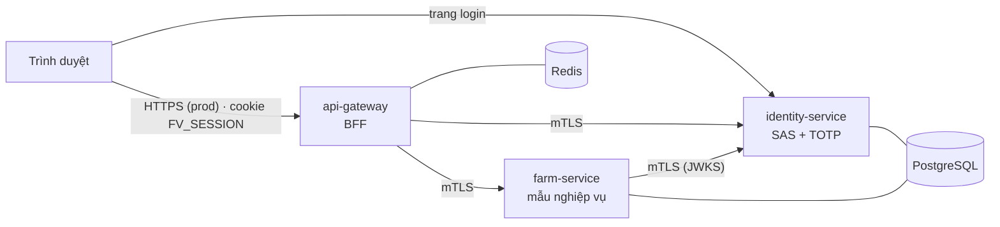

# Kế hoạch hoàn thiện nền tảng (thay lộ trình cấp 2–5)

> Trạng thái: **ĐÃ DUYỆT 2026-10-27** — xóa cả livestock. **Bước A, B xong.**
> Quyết định của anh (2026-10-27): bỏ cấp 3, 4, 5. Chỉ thêm **mTLS** cho bảo mật. Không mở rộng nghiệp vụ
> cho tới khi **identity, gateway, giao diện** đạt 10/10 về công nghệ và design pattern. Sau đó mới mở rộng
> từng miền nghiệp vụ một.

## 1. Phạm vi giữ lại

| Giữ | Vai trò |
|---|---|
| `services/identity-service` | OIDC provider, tenant, role, permission, TOTP |
| `platform/api-gateway` | BFF, TokenRelay, CSRF, rate limit |
| `services/farm-service` | service nghiệp vụ **mẫu** (hexagonal + `@TenantId`) — khuôn cho các miền sau |
| `libs/farmverse-starter-service` | claim, converter JWT, kiểm audience, `ApiProblem`, (thêm) cấu hình mTLS client |
| `apps/farmverse-web` | giao diện |

## 2. Đề xuất xóa hẳn

Toàn bộ dưới đây là code cũ chưa chuyển sang kiến trúc mới, hoặc thuộc cấp đã bỏ. Xóa bằng `git rm` (lấy lại được từ git).

| Xóa | Lý do |
|---|---|
| `services/inventory-service`, `order-service`, `payment-service`, `health-service`, `reporting-service` | còn gRPC + MQTT + thư viện bảo mật cũ; làm lại khi tới miền đó |
| `services/livestock-service` | đã chốt xóa; làm lại sau theo khuôn farm-service |
| `libs/farmverse-security`, `libs/farmverse-messaging`, `libs/farmverse-proto` | chỉ các service ở trên dùng |
| `libs/farmverse-common-kernel` | gộp phần còn dùng vào `farmverse-starter-service`, bỏ hằng số cũ (`authorization_version`, `act`…) |
| `libs/smartfarm-*`, `services/smartfarm-*`, `platform/smartfarm-*` (thư mục rác chỉ có `target/`) | không thuộc git |
| `compose.yaml`: mosquitto, rabbitmq | không còn service dùng (compose chỉ còn postgres + redis, mỗi service một database) |
| `bruno/`, `docs/` của các service bị xóa; `scripts/smoke`, `scripts/health` dựa trên API cũ | viết lại theo API mới |
| Thiết kế cấp 2–5 trong `content/thiet-ke-farmverse-msa.md` | thay bằng tài liệu này |

## 3. mTLS (thêm mới)

Mục tiêu: mọi gọi **giữa service** đều mã hóa và hai bên chứng minh danh tính bằng chứng chỉ.
Trình duyệt **không** dùng chứng chỉ client.

| Chặng | Kiểu TLS | Ghi chú |
|---|---|---|
| Trình duyệt → gateway | TLS một chiều (prod, ở edge) | dev: `http://127.0.0.1:8080` |
| Trình duyệt → identity (trang login) | TLS một chiều | browser không có cert client |
| gateway → identity (`/oauth2/token`, `/oauth2/jwks`, `/userinfo`, `/api/**`) | **mTLS bắt buộc** | identity `client-auth: want` + filter chặn các đường back-channel nếu không có cert hợp lệ |
| gateway → farm | **mTLS bắt buộc** | farm `client-auth: need` |
| farm → identity (`/oauth2/jwks`) | **mTLS bắt buộc** | decoder JWT dùng `RestClient` có SSL bundle |

Công nghệ — chỉ dùng Spring, không thêm sản phẩm ngoài:

| Việc | Cách làm |
|---|---|
| Khai chứng chỉ | Spring Boot **SSL bundles** (`spring.ssl.bundle.pem.<tên>`), PEM, tự nạp lại khi file đổi (`reload-on-update`) |
| Server bật mTLS | `server.ssl.bundle` + `server.ssl.client-auth` |
| Gateway gọi xuống | `spring.cloud.gateway.server.webflux.httpclient.ssl.ssl-bundle`; một `WebClient` gắn cert cho đổi code, refresh, JWKS id_token. Đăng ký client tĩnh (không discovery) để gateway khởi động độc lập với identity |
| Resource server lấy JWKS | `NimbusJwtDecoder.withJwkSetUri(...).restOperations(...)` với `RestTemplate` dựng từ `SslBundle.createSslContext()` (`MtlsClients`) |
| Ai được gọi | `ServiceIdentityFilter` kiểm SAN `spiffe://farmverse/<service>` (farm: chỉ gateway; identity back-channel: gateway, farm) |
| Probe | actuator tách cổng riêng không TLS, chỉ loopback (identity `:9092`, farm `:9082`) |
| CA dev | `scripts/generate-dev-mtls.sh` (openssl): 1 CA + 1 cert/service, hạn 30 ngày, SAN `localhost`, `127.0.0.1` |
| Prod | CA thật / cert-manager cấp file PEM; service chỉ đọc file |

Kiểm chứng: test gọi farm **không có cert → bắt tay TLS thất bại**; cert lạ (CA khác) → thất bại; cert gateway → 200.

## 4. Tiêu chí 10/10 — identity

| # | Tiêu chí | Hiện trạng | Việc cần làm |
|---|---|---|---|
| I1 | Luồng OIDC chuẩn (code + PKCE, refresh xoay vòng, revoke, RP logout) | có, test code+PKCE | test refresh, revoke, logout |
| I2 | MFA đầy đủ | TOTP có, **thiếu mã khôi phục** | recovery code (băm, dùng 1 lần), sinh lại |
| I3 | Chống dò mật khẩu | khóa theo tài khoản | thêm giới hạn theo IP cho `/login`, `/login/totp` (Bucket theo IP, in-memory) |
| I4 | Nhật ký bảo mật | chưa | lắng nghe `AuthenticationSuccess/FailureEvent`, `AuthorizationDeniedEvent` + sự kiện đổi role/khóa → log có cấu trúc (JSON) |
| I5 | Xoay khóa ký | 1 khóa | JWKS nhiều khóa: khóa mới ký, khóa cũ vẫn công bố tới hết hạn token; quy trình trong runbook |
| I6 | Lỗi API thống nhất | ProblemDetail cho lỗi nghiệp vụ | 401/403/validation cũng trả ProblemDetail + `code` |
| I7 | Tài liệu API | chưa | springdoc OpenAPI cho REST quản trị |
| I8 | Test trên PostgreSQL thật | chỉ H2 | `*IT` Testcontainers chạy Flyway + luồng login (chạy được khi có Docker) |
| I9 | Mã sạch | còn hằng số cũ ở common-kernel | gom vào starter, bỏ phần chết |
| I10 | Trang login / TOTP | HTML tối giản | giao diện thống nhất với web, a11y, thông báo rõ |

## 5. Tiêu chí 10/10 — gateway

| # | Tiêu chí | Việc cần làm |
|---|---|---|
| G1 | BFF đúng chuẩn | test đăng nhập end-to-end với identity giả (WireMock / test server) |
| G2 | Lỗi thống nhất | 401, 403, 429, 502, 504 trả ProblemDetail JSON cho `/api/**`, `/bff/**` |
| G3 | Timeout + chịu lỗi | connect/response timeout cho từng route; Spring Cloud CircuitBreaker (Resilience4j) trả 503 nhanh khi service sập |
| G4 | Header bảo mật | CSP, `X-Content-Type-Options`, `Referrer-Policy`, HSTS (prod) cho trang web |
| G5 | Rate limit | theo user cho `/api/**`; theo IP cho `/oauth2/authorization/**` |
| G6 | Session | test với Redis thật (Testcontainers); timeout phiên, đăng xuất xóa sạch |
| G7 | mTLS xuống service | mục 3 |
| G8 | Quan sát | `traceparent` + request id trong log (Micrometer Tracing, không cần server tracing) |

## 6. Tiêu chí 10/10 — giao diện

| # | Tiêu chí | Việc cần làm |
|---|---|---|
| W1 | Build xanh, không lỗi type | `npm run build` (cần sửa lỗi chứng chỉ npm trên máy) |
| W2 | Giao diện thống nhất | bỏ hẳn chủ đề cũ (Mộc Linh, FarmWorldScene 3D) → bộ giao diện FarmVerse gọn |
| W3 | Trạng thái đầy đủ | loading / rỗng / lỗi (đọc `code` của ProblemDetail) / 401 tự chuyển đăng nhập |
| W4 | Truy cập (a11y) | nhãn form, focus, tương phản, điều hướng bàn phím |
| W5 | Tiếng Việt nhất quán | gom chuỗi hiển thị vào một chỗ |
| W6 | Test | Vitest + Testing Library cho `api.ts`, `auth.tsx`, form chính |
| W7 | Chỉ hiển thị việc người dùng được làm | ẩn nút theo permission (đã có), xử lý 403 gọn |

## 7. Cần anh chốt

1. **livestock-service**: (a) xóa hẳn, làm lại sau như một miền mới theo khuôn farm-service *(đề xuất)*; hay (b) giữ và dọn ngay (bỏ kiểu proto + outbox MQTT).
2. Đồng ý xóa danh sách mục 2?

## 8. Thứ tự làm (mỗi bước build xanh, commit thẳng `main`)

| Bước | Việc |
|---|---|
| A | Xóa theo mục 2, gom common-kernel vào starter, dọn compose / scripts / docs |
| B | mTLS (mục 3) + test |
| C | Identity I1–I10 |
| D | Gateway G1–G8 |
| E | Giao diện W1–W7 |
| — | **Cổng chất lượng**: tự chấm lại bảng 4–6, đủ 10/10 mới mở miền nghiệp vụ tiếp theo |
