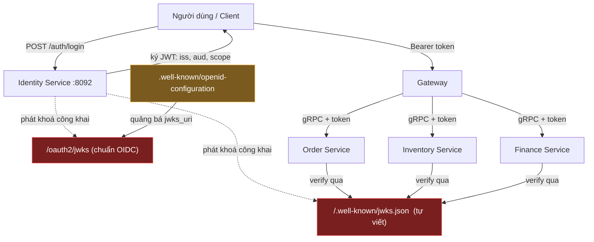

# Sơ đồ — Kiến trúc tổng thể luồng token

Dán vào mermaid.live hoặc công cụ hỗ trợ Mermaid để render ra ảnh quay video.

## Luồng cấp và kiểm token (có đánh dấu điểm bất cập)

## Chú thích điểm bất cập trên sơ đồ

- **JW1 vs JW2 (đỏ)** — Tập 04: hai endpoint JWKS. Mọi service verify qua
  JW1 (tự viết), nhưng discovery quảng bá JW2 (chuẩn). Service mới theo
  discovery sẽ lấy khoá JW2.
- **iss / aud** — Tập 03: `iss` phải khớp từng ký tự giữa ID (ký) và các
  service (kiểm), nhưng đọc từ hai tên biến env khác nhau ở prod.
- **Các service verify** — Tập 01, 02: nếu service thiếu khối `jwt` hoặc
  prod để giá trị rỗng, nó không khởi động được.

## Bảng: ai đọc biến env nào (prod)

| Thành phần | Vai trò | Biến issuer đọc |
|------------|---------|-----------------|
| Identity | Ký token | `IDENTITY_ISSUER` |
| Order / Health / Inventory / Finance / Reporting | Kiểm token | `SMARTFARM_JWT_ISSUER` |

Hai cột phải cùng giá trị, nhưng hai tên biến → dễ lệch (Tập 03).
