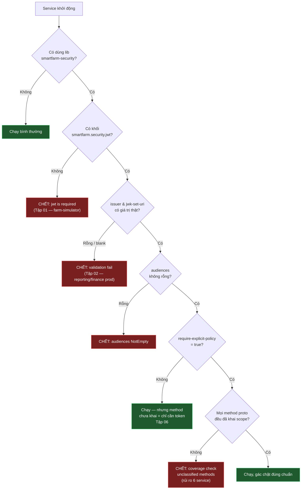

# Sơ đồ — Luồng lỗi lúc khởi động (boot)

Cây quyết định: vì sao một service dùng lib security chết lúc khởi động.

## Đọc sơ đồ
- 3 nhánh đỏ bên trái (F1, F2, F3) là lỗi chặn boot do thiếu/rỗng cấu hình JWT.
- F4 là lỗi chặn boot do gRPC: bật kiểm chặt mà quên khai một method proto.
- OK2 (vàng-xanh) là trạng thái "chạy nhưng lỏng" của identity — không chết,
  nhưng không gác theo quyền.
