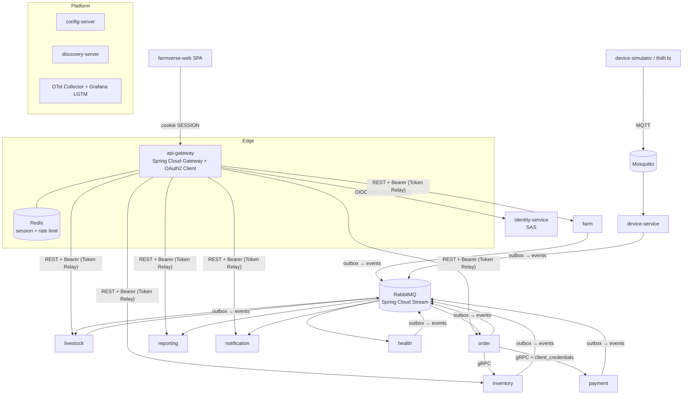
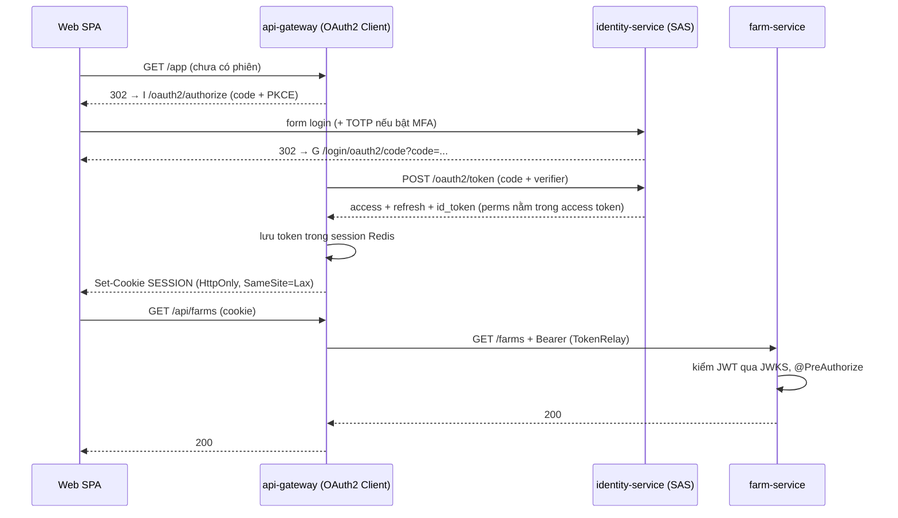
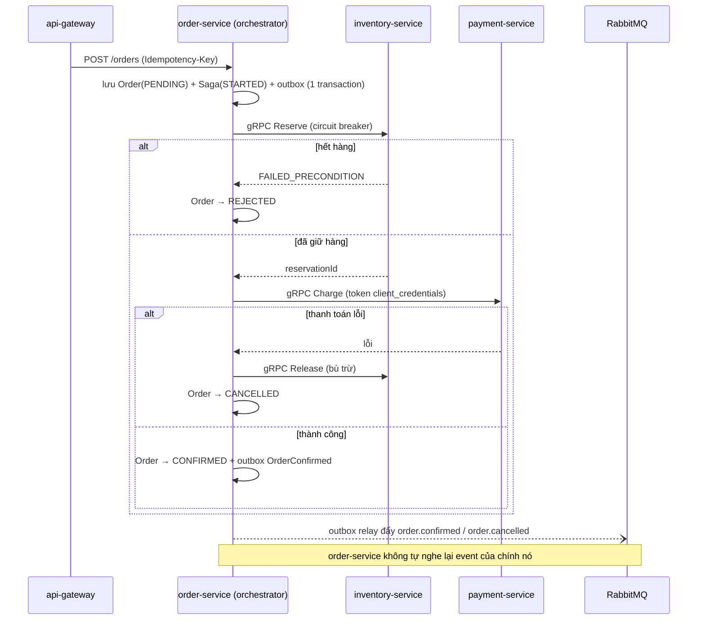
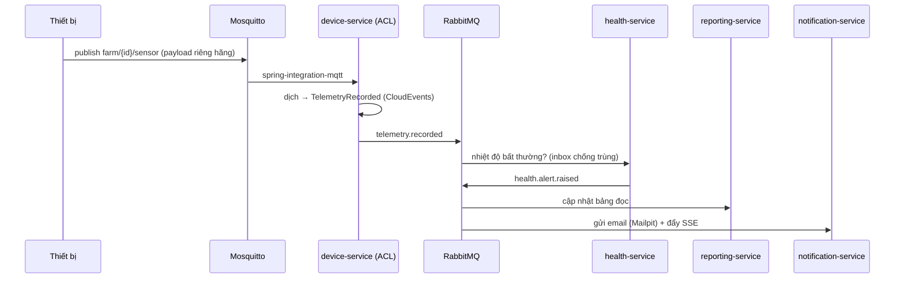

# FarmVerse — Hệ sinh thái học Microservices (MSA)

> Trạng thái: **ĐÃ DUYỆT 2026-10-27** — tên `farmverse`, RabbitMQ, Spring Boot 4.1.2 + Spring Cloud 2025.1.4, ưu tiên tự triển khai bằng hệ sinh thái Spring.
> Cấp 0 (đổi tên, parent pom, BOM, broker) đã xong trên nhánh `feat/farmverse-level-0`.
> Thay cho: `content/thiet-ke-chuan-keycloak.md` (không dùng Keycloak) và bản nháp modular monolith trước đó.

## 1. Mục tiêu và nguyên tắc

Dự án là **phòng thí nghiệm MSA**: mỗi service là một bài học, mỗi pattern có đúng một "nhà".

Nguyên tắc (khác với bản audit "xóa tối đa"):

1. **Phức tạp có chủ đích.** Mỗi pattern phải ghi rõ: nó giải bài toán gì, ở service nào, đo bằng test nào. Không có lý do học → không đưa vào.
2. **Thư viện chuẩn trước.** Dùng Spring Boot / Spring Cloud / Spring Security trước. Chỉ tự viết khi mục tiêu là học cơ chế bên trong, và đánh dấu `[tự viết để học]`.
3. **Mỗi pattern một chỗ.** Không lặp outbox 4 lần, không 2 hệ token. Code dùng chung đi qua starter riêng.
4. **Học theo cấp độ.** Hệ thống chạy được ở mọi cấp; cấp sau thêm pattern, không đập cấp trước.
5. **Ưu tiên hệ sinh thái Spring.** Thứ gì Spring làm được thì tự triển khai bằng Spring (SSL bundles, Spring Cloud Stream, outbox polling) thay cho sản phẩm ngoài (Debezium, service mesh).
6. **Không Keycloak.** Máy chủ định danh tự dựng bằng Spring Authorization Server (SAS) — bản thân đó là một bài học OAuth2/OIDC.

## 2. Đổi tên

| Hạng mục | Cũ | Mới (đề xuất) |
|---|---|---|
| Tên dự án | smartfarm-platform-maven-starter | **farmverse** |
| groupId | `com.htv.smartfarm` | `com.htv.farmverse` |
| Tiền tố artifact | `smartfarm-` | `farmverse-` |
| Package gốc | `com.htv.smartfarm.*` | `com.htv.farmverse.<service>.*` |

Tên khác có thể chọn: `agrimesh`, `farmhub-msa`. Đổi thư mục repo trên máy là việc của anh (không tự làm).

## 3. Bản đồ service (bounded context)

| # | Service | Miền nghiệp vụ | Bài học chính | Cấp |
|---|---|---|---|:-:|
| 1 | `api-gateway` | Cửa vào duy nhất | API Gateway, BFF giữ token phía server, rate limit, Token Relay | 1 |
| 2 | `identity-service` | Tài khoản, tenant, role, MFA | OAuth2/OIDC với SAS, PKCE, client_credentials, token exchange | 1 |
| 3 | `farm-service` | Trang trại, chuồng, khu | Hexagonal + DDD aggregate, multi-tenant `@TenantId` | 1 |
| 4 | `livestock-service` | Vật nuôi, công việc, lịch | Domain event, Saga choreography | 1 |
| 5 | `inventory-service` | Kho, lô, tồn | **Event Sourcing** + snapshot `[tự viết để học]` | 2 |
| 6 | `order-service` | Đơn hàng | **Saga orchestration**, Idempotency-Key, outbox | 2 |
| 7 | `payment-service` | Hóa đơn, thanh toán (đổi tên từ finance) | Compensation, gRPC server, giả lập cổng thanh toán | 2 |
| 8 | `health-service` | Hồ sơ thú y | Consumer idempotent (inbox), cảnh báo từ telemetry | 2 |
| 9 | `device-service` | Thiết bị IoT, telemetry | MQTT → RabbitMQ bridge, Anti-Corruption Layer, backpressure | 3 |
| 10 | `reporting-service` | Báo cáo | **CQRS read model** từ RabbitMQ, materialized view | 3 |
| 11 | `notification-service` | Email, thông báo realtime | Event-driven fan-out, SSE qua gateway | 3 |
| 12 | `config-server` | — | Spring Cloud Config tập trung | 3 |
| 13 | `discovery-server` | — | Service Discovery (Eureka) + client-side load balancing | 3 |
| — | `tools/device-simulator` | — | Giả lập thiết bị (đổi từ `farm-simulator`) | 3 |
| — | `apps/farmverse-web` | SPA React | Login qua BFF, chỉ giữ cookie | 1 |

## 4. Kiến trúc tổng thể



Ghi chú:
- **Database per service**: mỗi service một database Postgres riêng (cùng một container Postgres ở môi trường dev, mỗi DB một user).
- **Đồng bộ**: REST từ gateway vào; gRPC giữa các service khi cần trả lời ngay (order → inventory, payment).
- **Bất đồng bộ**: RabbitMQ (topic exchange) cho domain event, qua Spring Cloud Stream Rabbit binder; dead-letter queue cho message lỗi. MQTT chỉ dành cho thiết bị ở biên.
- Định dạng event: **CloudEvents JSON**, schema lưu trong `farmverse-contracts`.

## 5. Bản đồ pattern (pattern → nhà duy nhất)

| Nhóm | Pattern | Nhà | Công nghệ | Tự viết? |
|---|---|---|---|:-:|
| Biên | API Gateway, BFF, Token Relay | api-gateway | Spring Cloud Gateway, `spring-boot-starter-oauth2-client` | Không |
| Biên | Rate limiting | api-gateway | `RequestRateLimiter` + Redis | Không |
| Bảo mật | OIDC Provider, PKCE, refresh, revoke | identity-service | `spring-boot-starter-security-oauth2-authorization-server` | Không |
| Bảo mật | Service-to-service token | order → payment | grant `client_credentials`, `OAuth2AuthorizedClientManager` | Không |
| Bảo mật | MFA TOTP | identity-service | bước xác thực bổ sung trên form login | Có (TOTP nhỏ) |
| Bảo mật | Resource server | mọi service | `spring-boot-starter-oauth2-resource-server` + `issuer-uri` | Không |
| Dữ liệu | Database per service | mọi service | Postgres + Flyway riêng | Không |
| Dữ liệu | Multi-tenancy | farm, livestock, inventory | Hibernate `@TenantId` | Không |
| Nhất quán | Transactional Outbox | starter `farmverse-starter-outbox` | polling publisher → Spring Cloud Stream `StreamBridge` | Có, 1 bản |
| Nhất quán | Idempotent consumer (Inbox) | cùng starter | bảng `inbox` + khóa `event_id` | Có, 1 bản |
| Nhất quán | Saga orchestration | order-service | bảng trạng thái saga + bước bù trừ | Có `[học]` |
| Nhất quán | Saga choreography | livestock → inventory (xuất thức ăn) | RabbitMQ event | Không |
| Nhất quán | Idempotency-Key API | order-service | header + bảng khóa | Có (nhỏ) |
| Mô hình | DDD aggregate, Hexagonal | farm, order | package `domain / application / adapter` | — |
| Mô hình | Event Sourcing + snapshot | inventory-service | bảng `stock_event` + `stock_snapshot` | Có `[học]` |
| Mô hình | CQRS read model | reporting-service | projection từ RabbitMQ vào bảng đọc | Có (projection) |
| Tích hợp | Anti-Corruption Layer | device-service | dịch payload thiết bị → event chuẩn | Có (mapper) |
| Chịu lỗi | Circuit breaker, retry, timeout, bulkhead | order, reporting, gateway | Spring Cloud CircuitBreaker + Resilience4j | Không |
| Vận hành | Externalized config | config-server | Spring Cloud Config (git) | Không |
| Vận hành | Service discovery | discovery-server | Eureka + Spring Cloud LoadBalancer | Không |
| Quan sát | Tracing, metrics, logs | mọi service | Micrometer + `spring-boot-starter-opentelemetry` → Grafana LGTM | Không |
| Quan sát | Health / readiness | mọi service | Actuator probes (bỏ readiness-service) | Không |
| Kiểm thử | Integration test | mọi service | Testcontainers (Postgres, RabbitMQ) | Không |
| Kiểm thử | Contract test | order ↔ payment (gRPC), gateway ↔ farm | test hợp đồng tự viết trên Testcontainers + proto chung (Spring Cloud Contract không có trong train 2025.1.4) | Có |
| Hạ tầng | mTLS giữa service | cấp 5 | Spring Boot SSL bundles + gRPC TLS, CA dev tạo bằng script | Có `[học]` |
| Thông báo | Retry + dead-letter | mọi consumer | Spring Cloud Stream Rabbit DLQ | Không |

Những thứ đang có sẽ **bỏ hẳn** vì đã có chuẩn thay: `TokenService` tự cấp token, `ServiceTokenService`, ký HMAC MQTT, Internal CA tự viết, phân quyền động + watermark, read model tự nghe event của chính order, `readiness-service`, 4 bản outbox.

## 6. Luồng chính

### 6.1 Đăng nhập qua BFF (SPA không cầm token)



Ghi chú: refresh token không bao giờ tới trình duyệt. Thay `localStorage` hiện tại.

### 6.2 Đặt hàng — Saga orchestration



Ghi chú: saga dùng **một** bảng trạng thái + một worker `@Scheduled` để chạy lại bước dở. Không có checkpoint/claim/terminal-intent như bản cũ.

### 6.3 Telemetry → cảnh báo (choreography + ACL + CQRS)



## 7. Công nghệ và nguồn version

| Thành phần | Nguồn version | Đã kiểm |
|---|---|:-:|
| Spring Boot 4.1.1, Spring Security 7.1.1, SAS starter, OAuth2 client/resource server | Boot BOM | ✅ có trong `spring-boot-dependencies-4.1.1.pom` |
| Spring AMQP 4.1.2, `spring-boot-starter-amqp`; Spring Cloud Stream Rabbit 5.0.4 | Boot BOM / Spring Cloud BOM | ✅ probe build |
| Spring gRPC 1.1.1 (`starter-grpc-server/client`) | Boot BOM | ✅ |
| `spring-boot-starter-opentelemetry`, Micrometer Tracing 1.7.1 | Boot BOM | ✅ |
| Spring Integration MQTT 7.1.1 | Boot BOM (import) | ✅ |
| Testcontainers 2.0.5 | Boot BOM | ✅ |
| **Spring Cloud 2025.1.4** (Gateway 5.0.4, Config 5.0.6, Eureka 5.0.3, CircuitBreaker 5.0.3, Stream 5.0.4) | Spring Cloud BOM | ✅ probe build với Boot 4.1.2 (resolve + compile) |
| Spring Cloud Contract | — | ❌ không có trong train 2025.1.4 → bỏ |
| ArchUnit (kiểm luật hexagonal) | ngoài BOM | ❌ cần hỏi/tra trước khi thêm |

Hạ tầng dev (`compose.yaml`): Postgres, RabbitMQ (management), Redis, Mosquitto; thêm dần Mailpit, `grafana/otel-lgtm` theo cấp.

## 8. Cấu trúc repo đích

```
farmverse/
  pom.xml                         parent: Boot BOM + Spring Cloud BOM, khai module
  platform/
    api-gateway/  config-server/  discovery-server/
  services/
    identity-service/  farm-service/  livestock-service/  health-service/
    device-service/  inventory-service/  order-service/  payment-service/
    reporting-service/  notification-service/
  libs/
    farmverse-contracts/          proto gRPC + schema CloudEvents + hằng claim/permission
    farmverse-starter-outbox/     outbox + inbox (bản duy nhất)
    farmverse-starter-service/    mặc định chung: resource server, ProblemDetail, tracing
  tools/device-simulator/
  apps/farmverse-web/
  infra/  compose.yaml  k8s/ (cấp 5)
  docs/
    learning-path.md              lộ trình theo cấp
    patterns/<pattern>.md         mỗi pattern 1 trang: vấn đề, nhà, cách chạy thử, test chứng minh
    adr/                          quyết định kiến trúc
```

Quy ước bên trong mỗi service (hexagonal):

```
com.htv.farmverse.<svc>/
  domain/        aggregate, value object, domain event (không import Spring)
  application/   use case, port (interface) — chỉ tạo interface khi có ≥ 2 adapter hoặc cần thay trong test
  adapter/in/    REST, gRPC, RabbitMQ consumer
  adapter/out/   JPA, gRPC client, RabbitMQ publisher (StreamBridge)
  config/
```

## 9. Lộ trình theo cấp

| Cấp | Nội dung | Chạy được gì | Bằng chứng |
|:-:|---|---|---|
| 0 ✅ | Đổi tên, parent pom Boot 4.1.2 + Spring Cloud BOM, RabbitMQ trong compose, xóa readiness-service | `mvn -B test` xanh | build |
| 1 ✅ | gateway (BFF) + identity (SAS) + livestock + web login (farm-service dời sang 1b) | Đăng nhập, CRUD trang trại/vật nuôi | IT login PKCE, 401/403 |
| 2 | RabbitMQ + starter outbox/inbox; inventory (event sourcing), order (saga), payment, health | Đặt hàng có bù trừ | IT saga thành công/thất bại, consumer chạy 2 lần không trùng |
| 3 | device + simulator, reporting (CQRS), notification, config-server, discovery, Resilience4j | Telemetry → cảnh báo → email | IT end-to-end bằng Testcontainers |
| 4 | Tracing đầy đủ, contract test, dead-letter + replay | Thấy trace xuyên service trên Grafana | contract test xanh |
| 5 | mTLS bằng Spring SSL bundles, Kubernetes (kind/k3d), HPA | Deploy lên kind/k3d | probe + mTLS bật |

## 10. Chuyển từ code hiện tại

| Hiện tại | Đi đâu |
|---|---|
| `services/smartfarm-identity-service` | Giữ entity account/membership/tenant/role/permission, TOTP, SAS config. **Xóa** `token/**`, `AuthController` `/auth/*`, gRPC identity, lệnh MQTT, bootstrap lock |
| `apps/smartfarm-gateway` | Viết lại thành `platform/api-gateway` (Spring Cloud Gateway). Bỏ GraphQL, `DevController`, `ServiceTokenClient` |
| livestock, health, inventory, order | Giữ entity + migration nghiệp vụ, chuyển vào cấu trúc hexagonal. Order: bỏ read model, saga cũ |
| finance | Đổi tên thành `payment-service` |
| reporting | Đổi thành consumer RabbitMQ (CQRS). Bỏ gRPC plaintext |
| `libs/smartfarm-security` | Bỏ 6 auto-config, interceptor tự viết, HMAC, dynamic authz. Phần còn lại vào `farmverse-starter-service` |
| `libs/smartfarm-messaging` | Bỏ (MQTT chỉ còn ở device-service qua Spring Integration) |
| `libs/smartfarm-proto`, `common-kernel` contracts | Gộp vào `farmverse-contracts` |
| `platform/smartfarm-readiness-service` | Xóa (Actuator probes thay) |
| `platform/smartfarm-farm-simulator` | Thành `tools/device-simulator` |

## 11. Rủi ro

- **Dữ liệu**: đổi package và database-per-service làm migration hiện tại không dùng lại nguyên vẹn. An toàn nếu dữ liệu dev có thể xóa.
- **Tài nguyên máy**: đủ stack (RabbitMQ, Redis, Grafana, 13 JVM) cần khoảng 8–12 GB RAM (ước lượng). Mỗi cấp có profile compose riêng để chỉ bật phần cần học.
- **Bảo mật**: gateway giữ token trong Redis → Redis phải có mật khẩu, chỉ bind mạng nội bộ compose.

## 12. Quyết định đã chốt

| Câu hỏi | Chốt |
|---|---|
| Tên | `farmverse`, groupId `com.htv.farmverse` |
| Broker | RabbitMQ + Spring Cloud Stream |
| Version | Spring Boot 4.1.2 + Spring Cloud 2025.1.4 |
| Phần sai chuẩn | Xóa hết, viết lại bằng hệ sinh thái Spring |
