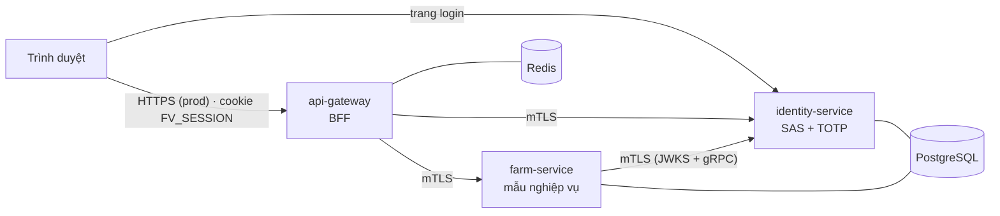
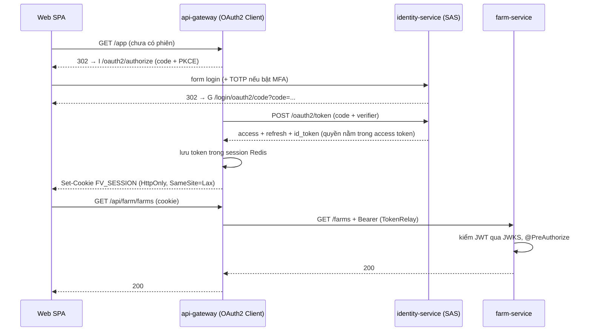
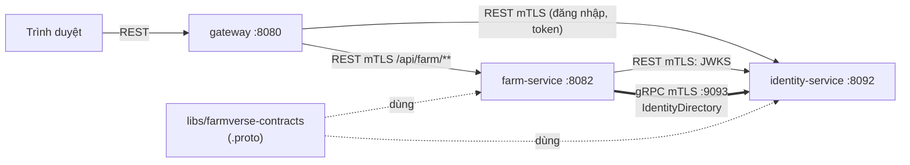

> Tài liệu **thiết kế** của FarmVerse: mục tiêu, kiến trúc, mTLS, gRPC và các quyết định đã chốt.
> Phần tiến độ, roadmap và tiêu chí chấm điểm đã bỏ. Muốn đọc mã theo luồng: [docs/code-walkthrough.md](../docs/code-walkthrough.md).
> Hướng dẫn kỹ thuật theo chủ đề ở `docs/` (mỗi pattern một trang).

## Mục lục

1. Mục tiêu và nguyên tắc
2. Module
3. Kiến trúc và luồng đăng nhập
4. mTLS giữa service
5. gRPC giữa service
6. Quyết định đã chốt
7. Ngoài phạm vi

## 1. Mục tiêu và nguyên tắc

FarmVerse là **phòng thí nghiệm microservices để học**: Spring Boot 4.1.2 + Spring Cloud 2025.1.4, groupId `com.htv.farmverse`.

1. **Spring trước.** Thứ gì Spring làm được thì dùng Spring (SSL bundles, Authorization Server, Gateway). Tự viết chỉ khi mục tiêu là học, và phải ghi rõ.
2. **Không Keycloak.** Máy chủ định danh tự dựng bằng Spring Authorization Server (SAS).
3. **Thiết kế trước, code sau.** Thay đổi lớn: viết vào tài liệu này, được duyệt, rồi mới code.
4. **Mỗi pattern một chỗ**, mỗi pattern có test chứng minh.
5. **Version do BOM quản.** Không ghi tay.
6. **Mỗi thay đổi nhỏ**: build xanh, test xanh, hoàn tác được bằng `git revert`.

## 2. Module

| Module | Cổng | Vai trò |
|---|---|---|
| `platform/api-gateway` | 8080 | BFF: đăng nhập OIDC thay trình duyệt, TokenRelay, CSRF, rate limit theo user |
| `services/identity-service` | 8092 (quản trị 9092, gRPC 9093) | OIDC provider (SAS), tenant, role, permission, TOTP, REST quản trị |
| `services/farm-service` | 8082 (quản trị 9082) | Service nghiệp vụ **mẫu**: hexagonal + `@TenantId`. Khuôn cho miền sau |
| `libs/farmverse-starter-service` | — | Claim, converter JWT, kiểm audience, `ApiProblem`, cấu hình mTLS client |
| `libs/farmverse-contracts` | — | Hợp đồng gRPC (`.proto`), sinh mã lúc build |
| `apps/farmverse-web` | 5173 (dev) | Giao diện React |
| Hạ tầng dev (`compose.yaml`) | — | PostgreSQL (mỗi service một database), Redis (phiên BFF + rate limit) |

Quy ước trong mỗi service (hexagonal):

```
com.htv.farmverse.<svc>/
  domain/        aggregate, value object (không import Spring)
  application/   use case, port (interface)
  adapter/in/    REST (và gRPC khi có)
  adapter/out/   JPA (và gRPC client khi có)
  config/
```

Chỉ tạo interface (port) khi có từ 2 adapter trở lên hoặc cần thay trong test.

## 3. Kiến trúc và luồng đăng nhập



- **Database per service**; tenant tách bằng claim `tenant_id` trong JWT + Hibernate `@TenantId`.
- **Phân quyền**: quyền nằm trong JWT, kiểm bằng `@PreAuthorize` theo permission.
- **Trình duyệt không giữ token**: gateway giữ token trong Redis, trình duyệt chỉ có cookie HttpOnly.
- Chi tiết pattern: `docs/patterns/bff.md`, `oidc-sas.md`, `hexagonal-multitenant.md`.

### 3.1 Đăng nhập qua BFF



Refresh token không bao giờ tới trình duyệt. Luồng chi tiết kèm class: [docs/code-walkthrough.md](../docs/code-walkthrough.md) và [docs/architecture/authentication-flow.md](../docs/architecture/authentication-flow.md).

## 4. mTLS giữa service

Mọi gọi **giữa service** đều mã hóa và hai bên chứng minh danh tính bằng chứng chỉ. Trình duyệt không dùng chứng chỉ client.

| Chặng | Kiểu TLS | Ghi chú |
|---|---|---|
| Trình duyệt → gateway | TLS một chiều (prod, ở edge) | dev: `http://127.0.0.1:8080` |
| Trình duyệt → identity (trang login) | TLS một chiều | trình duyệt không có cert client |
| gateway → identity (token, JWKS, userinfo, API) | **mTLS** | identity `client-auth: want` + `ServiceIdentityFilter` chặn đường máy-gọi-máy nếu không có cert hợp lệ |
| gateway → farm | **mTLS** | farm `client-auth: need` |
| farm → identity (JWKS, gRPC) | **mTLS** | decoder JWT và channel gRPC dùng chung SSL bundle |

| Việc | Cách làm (đều của Spring) |
|---|---|
| Khai chứng chỉ | SSL bundle `farmverse` (PEM), `reload-on-update` |
| Danh tính service | `ServiceIdentityFilter` (REST) / `ServiceIdentityInterceptor` (gRPC) kiểm SAN `spiffe://farmverse/<service>` |
| Probe | actuator tách cổng riêng, không TLS, chỉ loopback |
| Cert dev | `scripts/generate-dev-mtls.sh` (1 CA + 1 cert/service, hạn 30 ngày) |
| Bật/tắt | prod luôn bật (`prod` kéo theo `mtls`). Dev mặc định tắt; bật bằng `SPRING_PROFILES_ACTIVE=dev,mtls` trên cả ba service |
| Prod | CA thật hoặc cert-manager cấp file PEM; service chỉ đọc file |

Chi tiết và bằng chứng test: `docs/patterns/mtls.md`.

## 5. gRPC giữa service

gRPC chỉ cho **service gọi service**. Trình duyệt đi REST qua gateway; gateway không proxy gRPC ra ngoài. Hợp đồng ở module riêng `libs/farmverse-contracts`, code Java sinh lúc build, không commit.

Ca dùng đầu tiên: **farm gán người phụ trách**. Farm hỏi identity "người này có phải thành viên đang hoạt động cùng tổ chức" qua `IdentityDirectory.GetMember` trước khi ghi.



Bảo mật ba lớp:

| Lớp | Cơ chế | Trả lời |
|---|---|---|
| 1. Đường truyền | mTLS, chung CA và cert với REST | Bên kia có phải máy FarmVerse? |
| 2. Danh tính service | SAN `spiffe://farmverse/<service>`, chỉ cho `farm` | Service nào gọi hàm nào? |
| 3. Ngữ cảnh tenant | Farm chuyển tiếp access token của người dùng; identity lấy tenant từ token (không tin `tenant_id` trong request) | Gọi thay cho tenant nào? |

Nguyên tắc biên proto: proto **không** là domain. Mỗi bên có một `MemberMapper` đổi proto ↔ record; chỉ mapper import lớp sinh ra. Deadline 2s mỗi lời gọi; gọi gRPC **ngoài** transaction DB. Identity lỗi khi ghi thì từ chối (503), không đoán; khi đọc thì giảm cấp.

Chi tiết, quy ước tương thích và test: `docs/patterns/grpc.md`. Luồng kèm class: [docs/code-walkthrough.md](../docs/code-walkthrough.md) mục 3.3.

## 6. Quyết định đã chốt

| Câu hỏi | Chốt |
|---|---|
| Tên, groupId | `farmverse`, `com.htv.farmverse` |
| Phiên bản | Spring Boot 4.1.2 + Spring Cloud 2025.1.4 |
| Định danh | Spring Authorization Server, không Keycloak |
| Phạm vi | Chỉ identity + gateway + farm + web + starter + contracts |
| MFA | TOTP tự viết nhỏ, vì Spring Security 7.1.2 chưa có factor TOTP |
| Flyway | Gom về baseline, chỉ xóa-tạo (dữ liệu dev bỏ được) |
| gRPC: hợp đồng | Module riêng `libs/farmverse-contracts`, có test khóa hợp đồng |
| gRPC: ngữ cảnh tenant | Chuyển tiếp access token của người dùng (ADR-0014) |
| gRPC: schema farm | Thêm `manager_user_id` thẳng vào `V1` |
| gateway ↔ service | REST; chỉ service ↔ service dùng gRPC |

Lý do từng quyết định bảo mật: `docs/architecture/adr/`.

## 7. Ngoài phạm vi (đã bỏ)

Các phần sau từng nằm trong thiết kế cũ và **không còn là kế hoạch**: inventory/event sourcing, order/saga, payment, health, device/MQTT, reporting/CQRS, notification, config-server, discovery, RabbitMQ, outbox/inbox, Kubernetes, `livestock-service` và các service/lib legacy đã xóa. Khi cần mở lại, viết thiết kế mới vào tài liệu này, không khôi phục bản cũ (lấy từ lịch sử git nếu cần tham khảo).
