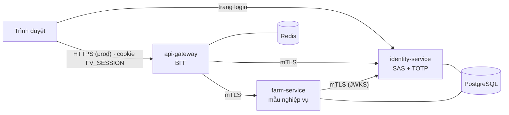
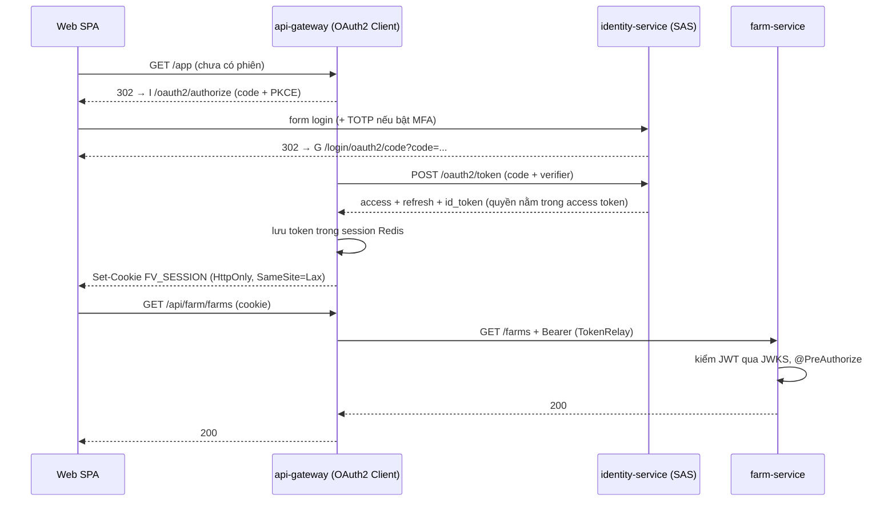
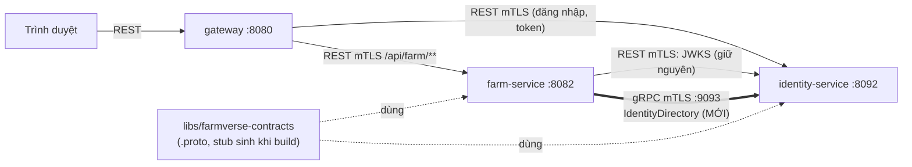
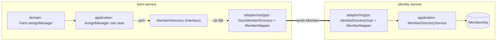
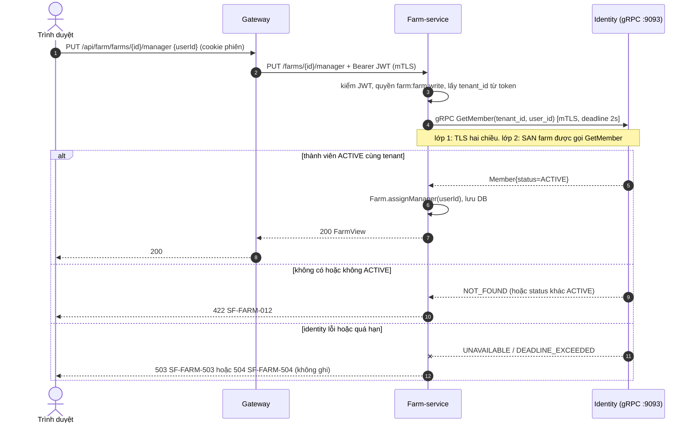

# FarmVerse — Tài liệu thiết kế (bản duy nhất)

> Đây là **tài liệu thiết kế duy nhất** của dự án. Mọi quyết định, hiện trạng, kế hoạch và việc chờ duyệt nằm ở đây.
> Tài liệu cũ (`ke-hoach-hoan-thien`, `thiet-ke-farmverse-msa`, `thiet-ke-grpc`) đã gộp vào đây và bị xóa.
> Cập nhật lần cuối: 2026-11-04. Mục có nhãn **[CHỜ DUYỆT]** chưa được làm.
> Hướng dẫn kỹ thuật theo chủ đề nằm ở `docs/` (mỗi pattern một trang), không lặp lại ở đây.

## Mục lục

1. Mục tiêu và nguyên tắc
2. Hiện trạng và phạm vi
3. Kiến trúc và luồng đăng nhập
4. mTLS giữa service
5. Tiêu chí 10/10 và tiến độ
6. gRPC giữa các service **[CHỜ DUYỆT]**
7. Lộ trình và thứ tự làm
8. Quyết định đã chốt và việc cần chốt
9. Ngoài phạm vi (đã bỏ)

## 1. Mục tiêu và nguyên tắc

FarmVerse là **phòng thí nghiệm microservices để học**: Spring Boot 4.1.2 + Spring Cloud 2025.1.4, groupId `com.htv.farmverse`.

1. **Hoàn thiện nền tảng trước, mở rộng sau.** Identity, gateway, giao diện phải đạt 10/10 (mục 5) rồi mới thêm miền nghiệp vụ. Ngoại lệ phải được duyệt riêng.
2. **Spring trước.** Thứ gì Spring làm được thì dùng Spring (SSL bundles, Authorization Server, Gateway). Tự viết chỉ khi mục tiêu là học, và phải ghi rõ.
3. **Không Keycloak.** Máy chủ định danh tự dựng bằng Spring Authorization Server (SAS).
4. **Thiết kế trước, code sau.** Thay đổi lớn: viết vào tài liệu này, được duyệt, rồi mới code.
5. **Mỗi pattern một chỗ**, mỗi pattern có test chứng minh. Không lặp lại cùng một cơ chế ở nhiều nơi.
6. **Version do BOM quản.** Không ghi tay. Cái nào không tra được bằng build thật thì dừng và hỏi.
7. **Mỗi thay đổi nhỏ**: build xanh, test xanh, hoàn tác được bằng `git revert`.

## 2. Hiện trạng và phạm vi

### 2.1 Module đang có

| Module | Cổng | Vai trò |
|---|---|---|
| `platform/api-gateway` | 8080 | BFF: đăng nhập OIDC thay trình duyệt, TokenRelay, CSRF, rate limit theo user |
| `services/identity-service` | 8092 (quản trị 9092) | OIDC provider (SAS), tenant, role, permission, TOTP, REST quản trị |
| `services/farm-service` | 8082 (quản trị 9082) | Service nghiệp vụ **mẫu**: hexagonal + `@TenantId`. Khuôn cho miền sau |
| `libs/farmverse-starter-service` | — | Claim, converter JWT, kiểm audience, `ApiProblem`, cấu hình mTLS client |
| `apps/farmverse-web` | 5173 (dev) | Giao diện React |
| Hạ tầng dev (`compose.yaml`) | — | PostgreSQL (mỗi service một database), Redis (phiên BFF + rate limit) |

Chưa có: gRPC, CI, observability tập trung. Test chạy được không cần Docker (H2); test PostgreSQL/Redis thật cần Docker (chưa có ở máy dev hiện tại).

### 2.2 Lệch cần xử lý (phát hiện khi rà ngày 2026-11-04)

| # | Lệch | Trạng thái |
|---|---|---|
| S1 | `.env.production.example` còn biến của kiến trúc cũ | **Đã sửa (2026-11-04, M2)**: chỉ còn tên biến thật của 3 service |
| S2 | Mật khẩu Redis dev | **Đã chốt và sửa (2026-11-04, M3)**: luôn có mật khẩu, `compose.yaml` và gateway cùng đọc `REDIS_PASSWORD` |
| S3 | `services/identity-service/README.md` là bản cũ gần như toàn bộ (endpoint `/api/v1/auth/*`, gRPC admin đều đã xóa) | Đã gắn cảnh báo; viết lại là việc riêng (mục 7) |

## 3. Kiến trúc và luồng đăng nhập



- **Database per service**; tenant tách bằng claim `tenant_id` trong JWT + Hibernate `@TenantId`.
- **Phân quyền**: quyền nằm trong JWT, kiểm bằng `@PreAuthorize` theo permission.
- **Trình duyệt không giữ token**: gateway giữ token trong Redis, trình duyệt chỉ có cookie HttpOnly.
- Chi tiết pattern: `docs/patterns/bff.md`, `oidc-sas.md`, `hexagonal-multitenant.md`.

Quy ước trong mỗi service (hexagonal):

```
com.htv.farmverse.<svc>/
  domain/        aggregate, value object (không import Spring)
  application/   use case, port (interface)
  adapter/in/    REST (và gRPC khi có)
  adapter/out/   JPA (và gRPC client khi có)
  config/
```

Chỉ tạo interface (port) khi có từ 2 adapter trở lên hoặc cần thay trong test.

### 3.1 Đăng nhập qua BFF



Refresh token không bao giờ tới trình duyệt.

## 4. mTLS giữa service

Mọi gọi **giữa service** đều mã hóa và hai bên chứng minh danh tính bằng chứng chỉ. Trình duyệt không dùng chứng chỉ client.

| Chặng | Kiểu TLS | Ghi chú |
|---|---|---|
| Trình duyệt → gateway | TLS một chiều (prod, ở edge) | dev: `http://127.0.0.1:8080` |
| Trình duyệt → identity (trang login) | TLS một chiều | trình duyệt không có cert client |
| gateway → identity (token, JWKS, userinfo, API) | **mTLS** | identity `client-auth: want` + `ServiceIdentityFilter` chặn đường máy-gọi-máy nếu không có cert hợp lệ |
| gateway → farm | **mTLS** | farm `client-auth: need` |
| farm → identity (JWKS) | **mTLS** | decoder JWT dùng client có SSL bundle |

| Việc | Cách làm (đều của Spring) |
|---|---|
| Khai chứng chỉ | SSL bundle `farmverse` (PEM), `reload-on-update` |
| Danh tính service | `ServiceIdentityFilter` kiểm SAN `spiffe://farmverse/<service>`; farm cho phép `gateway`, identity cho phép `gateway,farm` |
| Probe | actuator tách cổng riêng, không TLS, chỉ loopback |
| Cert dev | `scripts/generate-dev-mtls.sh` (1 CA + 1 cert/service, hạn 30 ngày) |
| Bật/tắt | prod luôn bật (`prod` kéo theo `mtls`). Dev mặc định tắt; bật bằng `SPRING_PROFILES_ACTIVE=dev,mtls` trên cả ba service |
| Prod | CA thật hoặc cert-manager cấp file PEM; service chỉ đọc file |

Chi tiết và bằng chứng test: `docs/patterns/mtls.md`.

## 5. Tiêu chí 10/10 và tiến độ

Trạng thái: ✅ đã có trong code (có test) · 🟡 một phần · ⬜ chưa làm · ❓ chưa rà lại.
Cột trạng thái dựa trên code và test hiện có ngày 2026-11-04; cần tự chấm lại trước khi tuyên bố đạt.

### 5.1 Identity

| # | Tiêu chí | Trạng thái | Còn lại |
|---|---|:-:|---|
| I1 | OIDC chuẩn (code + PKCE, refresh, revoke, RP logout) | 🟡 | Có test code+PKCE và vòng đời token; rà lại test revoke và logout |
| I2 | MFA đầy đủ (TOTP + mã khôi phục) | ✅ | — (MFA bằng factor TOTP của Spring Security chưa có từ 7.1.2, nên đang dùng bản tự viết nhỏ) |
| I3 | Chống dò mật khẩu (khóa tài khoản + giới hạn theo IP) | ✅ | Giới hạn IP đang trong bộ nhớ, đúng với một instance; nhiều instance cần Redis |
| I4 | Nhật ký bảo mật (đăng nhập, từ chối, đổi role, khóa tài khoản) | ✅ | — |
| I5 | Xoay khóa ký (JWKS nhiều khóa) | ✅ | Runbook: `docs/operations/key-rotation.md` |
| I6 | Lỗi API thống nhất (ProblemDetail + `code`) | ✅ | — |
| I7 | Tài liệu API (springdoc, chỉ bật ở dev) | ✅ | `docs/operations/identity-api.md` |
| I8 | Test trên PostgreSQL thật | ✅ | `PostgresFlowsIT`: Flyway + validate, SAS JDBC, luồng OIDC/token/TOTP chạy lại trên PostgreSQL 17 |
| I9 | Mã sạch (bỏ phần chết) | ✅ | Module cũ đã xóa |
| I10 | Trang login / TOTP thống nhất giao diện | ✅ | — |

### 5.2 Gateway

| # | Tiêu chí | Trạng thái | Việc cần làm |
|---|---|:-:|---|
| G1 | BFF đúng chuẩn | ✅ | Luồng đăng nhập HTTP thật với identity giả: PKCE, state, nonce, đổi id phiên (`LoginSessionSecurityTest`), qua edge TLS (`ForwardedHeadersTest`) |
| G2 | Lỗi thống nhất: 401, 403, 429, 502, 503, 504 trả ProblemDetail có `code` | ✅ | `GatewayProblems`, `DownstreamErrorHandler`, `RateLimitProblemFilter`; test `GatewayErrorProblemsTest` (2026-11-04) |
| G3 | Timeout và chịu lỗi theo route; circuit breaker trả 503 nhanh | 🟡 | Timeout mọi profile (connect 3s, response 10s, quá hạn → 504) ✅. Circuit breaker ⬜: cần thêm `spring-cloud-starter-circuitbreaker-reactor-resilience4j` |
| G4 | Header bảo mật (CSP, nosniff, Referrer-Policy, HSTS ở prod) | ✅ | ADR-0010, `SecurityHeadersTest`, thử trên Chrome |
| G5 | Rate limit: theo user cho `/api/**`; theo IP cho `/oauth2/authorization/**` và callback | ✅ | `LoginRateLimitFilter` (20/phút/IP, Redis), `GatewayRedisIT` |
| G6 | Session: test với Redis thật; timeout; đăng xuất xóa sạch | ✅ | `GatewayRedisIT`: TTL, namespace, đổi id phiên, Redis treo → 503, ACL user |
| G7 | mTLS xuống service | ✅ | Mục 4 |
| G8 | Quan sát: `traceparent` + request id trong log | ⬜ | Micrometer Tracing |

### 5.3 Giao diện

| # | Tiêu chí | Trạng thái | Việc cần làm |
|---|---|:-:|---|
| W1 | `npm run build` xanh, không lỗi type | ✅ | `tsc -b --noEmit` + `vite build` xanh (2026-11-04) |
| W2 | Giao diện thống nhất, bỏ chủ đề cũ (Mộc Linh, FarmWorldScene) | ✅ | Thương hiệu FarmVerse, cùng bảng màu với trang đăng nhập identity; bỏ cảnh 3D và `three` (JS 248 kB, hết cảnh báo chunk > 500 kB); bỏ 30 class CSS chết. Chưa có chế độ tối (identity có) |
| W3 | Loading / rỗng / lỗi (đọc `code` của ProblemDetail) / 401 tự chuyển đăng nhập | ✅ | `QueryState` (tải → lỗi có thử lại → rỗng → dữ liệu) ở Farms, Users, Authorization, Profile, TOTP; `describeError` đổi `status`+`code` thành câu tiếng Việt, lỗi theo ô (400), mã lỗi; lỗi hạ tầng không lộ chi tiết; 401 về màn đăng nhập (đã có) |
| W4 | Truy cập (nhãn form, focus, tương phản, bàn phím) | ✅ | axe-core 4.14 (WCAG 2.1 A/AA + best-practice) trên 6 trang: 10 → 0 phần tử vi phạm; hộp thoại `<dialog>` gốc (focus vào hộp, Escape, trả focus); hỏi xác nhận 6 thao tác khó hoàn tác; link bỏ qua; tiêu đề tab theo trang; gợi ý nối `aria-describedby`. Chưa kiểm bằng trình đọc màn hình thật |
| W5 | Tiếng Việt nhất quán, gom chuỗi vào một chỗ | ✅ | Mọi chuỗi giao diện nằm trong `src/i18n/vi.ts` (object `vi`, `statusLabel`), không thêm thư viện; thuật ngữ thống nhất (vai trò, quyền, tổ chức, xác thực hai bước); `npm run check:i18n` chặn chữ tiếng Việt ngoài `vi.ts`; CI có job `web` (typecheck, check:i18n, build). Chưa hỗ trợ ngôn ngữ thứ hai |
| W6 | Test (Vitest + Testing Library) cho `api.ts`, `auth.tsx`, form chính | ✅ | Vitest 5.1 + jsdom, 27 test: `api.ts` (CSRF, Idempotency-Key, query, 204, ApiError, 401), `describeError`, `AuthProvider`/`hasPermission`, `useConfirm` (focus, Escape), trang Trang trại (quyền đọc/ghi, lỗi 400 theo ô, xóa chuồng phải xác nhận). `fetch` giả lập qua `src/test/http.ts`; `<dialog>` bù cho jsdom ở `src/test/setup.ts`. Job CI `web` chạy `npm test` |
| W7 | Chỉ hiển thị việc người dùng được làm (ẩn nút theo permission, xử lý 403) | ✅ | Ẩn menu/nút theo permission (một danh sách nav); 403 giữa phiên hiện "không có quyền", không có nút thử lại. Chưa có hộp xác nhận cho Xóa / Reset 2FA |

### 5.4 Farm-service (khuôn nghiệp vụ)

| # | Tiêu chí | Trạng thái |
|---|---|:-:|
| F1 | Hexagonal, tách tenant bằng `@TenantId`, có test cô lập tenant | ✅ |
| F2 | Khóa lạc quan `@Version`; tranh chấp ghi trả 409 `SF-FARM-010`; trùng mã đồng thời trả 409 `SF-FARM-011` | ✅ (2026-11-04, chưa commit) |
| F3 | Test đồng thời thật trên PostgreSQL | ✅ |

**Cổng chất lượng:** tự chấm lại bảng 5.1-5.4; đủ 10/10 mới mở miền nghiệp vụ tiếp theo (trừ ngoại lệ được duyệt ở D7).

## 6. gRPC giữa các service **[CHỜ DUYỆT]**

Chưa có dòng code gRPC nào. Mức tin cậy các điều kiện kỹ thuật:

| Mục | Trạng thái | Bằng chứng |
|---|---|---|
| Boot 4.1.2 có sẵn starter gRPC | Đã kiểm | `~/.m2` có `spring-boot-starter-grpc-server`, `-client`, `-server-test`, `-client-test`, `spring-grpc-core` |
| Plugin sinh code proto | Đã kiểm một phần | `io.github.ascopes:protobuf-maven-plugin` 5.1.8, 5.1.9 có trong `~/.m2`; bản do Boot BOM quản **chưa kiểm** |
| Tên thuộc tính `spring.grpc.*`, API `GrpcSecurity` | Chưa kiểm lại | Xác minh bằng probe build ở bước P1 |
| Trộn mTLS và JWT trong một chuỗi bảo mật gRPC | Chưa kiểm | Chỉ cần nếu chọn D3-B |

Hiện chỉ có một lời gọi service → service là farm → identity lấy JWKS (HTTP, mTLS).

### 6.1 Phạm vi và nguyên tắc

- gRPC chỉ cho **service gọi service**. Trình duyệt đi REST qua gateway. Gateway không proxy gRPC ra ngoài.
- Cần **một ca dùng có thật**, nếu không gRPC chỉ là đồ trang trí. Mục 6.2 chọn ca đó.
- Proto **không** là domain model. Proto chỉ sống ở rìa (adapter). Mapper đổi qua lại.
- Mỗi bước build xanh, test xanh, hoàn tác được bằng `git revert`.
- Không nâng major version, không đổi API REST hiện có.

### 6.2 Ca dùng đầu tiên: farm gán người phụ trách

Nghiệp vụ nhỏ nhưng đủ dạy hợp đồng, mTLS, deadline, retry, ánh xạ lỗi, giảm cấp, test.

| Chức năng | Gọi gRPC | Khi identity lỗi |
|---|---|---|
| `PUT /farms/{id}/manager {userId}`: người đó phải là thành viên ACTIVE của **cùng tenant** | `GetMember` (unary) | **Từ chối ghi**, trả 503 `SF-FARM-503`. Ghi phải đúng, không đoán |
| `GET /farms`, `GET /farms/{id}`: hiện tên người phụ trách | `BatchGetMembers` (unary, tối đa 100) | **Giảm cấp**: vẫn trả danh sách, `managerName` rỗng, vẫn có `managerUserId` |

Ảnh hưởng schema (cần bạn duyệt riêng, D1): thêm cột `manager_user_id varchar(36)` (nullable) vào bảng `farm` trong `V1__farm_schema.sql`.
Theo quy ước "gom baseline, chỉ xóa-tạo" của dự án thì sửa thẳng V1. Nếu bạn muốn giữ lịch sử thì thêm `V2__farm_manager.sql`. Cột nullable nên bản cũ vẫn đọc được.

Để dành (không làm bây giờ): `FarmCatalog.GetBarn` (farm phục vụ service tương lai), `WatchMembership` (streaming, xóa cache khi tài khoản bị khóa).

### 6.3 Kiến trúc



Mũi tên đậm là phần mới. Cổng gRPC `9093` không đụng cổng quản trị `9092` / `9082`.

#### 6.3.1 Phân lớp (không để Protobuf lọt vào domain)



| Quy tắc | Nội dung |
|---|---|
| Port ở lõi | Farm khai `MemberDirectory` (trả `MemberInfo` là record của farm, không phải proto). Domain không biết gRPC tồn tại |
| Mapper | Mỗi bên có một `MemberMapper` (proto ↔ record). Mapper là nơi duy nhất `import` lớp sinh ra |
| Identity | Thêm service ứng dụng chỉ-đọc `MemberDirectoryService` trả record, không trả entity `Membership` (tránh lazy-load lọt ra rìa) |
| Pattern dùng | Ports & Adapters (đã có), Adapter + Mapper cho biên proto. **Không** thêm Factory/Strategy/Facade: chưa có vấn đề nào cần chúng |

### 6.4 Hợp đồng proto (phác thảo, chốt khi code)

Module mới `libs/farmverse-contracts`, chỉ chứa `.proto`. Code Java **sinh khi build**, không commit.

```proto
syntax = "proto3";
package farmverse.identity.v1;
option java_multiple_files = true;
option java_package = "com.htv.farmverse.contracts.identity.v1";

service IdentityDirectory {
  rpc GetMember(GetMemberRequest) returns (Member);
  rpc BatchGetMembers(BatchGetMembersRequest) returns (BatchGetMembersResponse);
}

message GetMemberRequest { string tenant_id = 1; string user_id = 2; }
message BatchGetMembersRequest { string tenant_id = 1; repeated string user_ids = 2; } // tối đa 100
message BatchGetMembersResponse { repeated Member members = 1; }

message Member {
  string user_id = 1;
  string display_name = 2;
  MemberStatus status = 3;
}

enum MemberStatus {
  MEMBER_STATUS_UNSPECIFIED = 0;
  MEMBER_STATUS_ACTIVE = 1;
  MEMBER_STATUS_SUSPENDED = 2;
  MEMBER_STATUS_DISABLED = 3;
}
```

So với bản cũ, bỏ `roles` khỏi `Member`: farm chưa cần, và "tối thiểu dữ liệu" là quy tắc.

Quy ước tương thích (ghi vào `docs/patterns/grpc.md`):

1. Thư mục theo phiên bản `farmverse/identity/v1/`. Thay đổi phá vỡ thì tạo `v2` và chạy song song.
2. Không đổi, không dùng lại số field. Field bỏ thì khai `reserved`.
3. Enum luôn có `..._UNSPECIFIED = 0`. Bên nhận phải chịu được giá trị lạ.
4. Không trả email, hash, secret.
5. Lô (batch) có giới hạn: quá 100 thì `INVALID_ARGUMENT`.
6. Chỉ **thêm** field/rpc. Khóa bằng test (mục 6.7.4).

### 6.5 Bảo mật

| Lớp | Cơ chế | Trả lời câu hỏi |
|---|---|---|
| 1. Đường truyền | mTLS. Server `spring.grpc.server.ssl.bundle=farmverse`, `client-auth=REQUIRE`; client channel dùng cùng bundle. **Dùng chung CA và chứng chỉ với REST**, không tạo hệ khóa mới | Bên kia có phải máy FarmVerse? |
| 2. Danh tính service | Đọc SAN `spiffe://farmverse/<service>` từ chứng chỉ, ánh xạ thành authority `SERVICE_FARM`. Mỗi rpc khai authority được phép. Danh sách cho phép: **chỉ `farm`** | Service nào được gọi hàm nào? |
| 3. Ngữ cảnh tenant | Xem D3 | Gọi thay cho tenant nào? |

Thêm vào đó:

- **Validation** ở biên: `tenant_id`, `user_id` không rỗng, đúng định dạng id; batch ≤ 100. Sai thì `INVALID_ARGUMENT`.
- **Reflection** của server gRPC mặc định bật (theo bản cũ, cần xác minh). Prod phải tắt; dev bật cho `grpcurl`.
- **Không log** nội dung request có tên hay id người dùng ở mức INFO; chỉ log tên rpc, mã trạng thái, thời gian.
- Dev không bật `mtls`: gRPC chạy plaintext trên `127.0.0.1`. Dev có `mtls` và prod: bắt buộc mTLS. Prod không cho phép plaintext (test cấu hình chặn).

**Mô hình đe dọa còn lại (D3-A):** identity tin farm khi farm gửi `tenant_id`. Nếu farm bị chiếm, kẻ đó hỏi được thành viên của mọi tenant. Giảm thiểu: farm chỉ lấy `tenant_id` từ JWT đã kiểm; chỉ farm được gọi; dữ liệu trả về tối thiểu; có nhật ký audit. Phương án D3-B (chuyển tiếp JWT người dùng) đóng lỗ này, đổi lại phức tạp hơn và chưa kiểm khả thi.

### 6.6 Sơ đồ tuần tự: gán người phụ trách



Giao dịch: gọi gRPC **ngoài** transaction DB (use case gọi trước, rồi mới mở `@Transactional` để lưu). Không giữ kết nối DB trong lúc chờ mạng.

Đồng thời: lưu qua `Farm` có `@Version`, tranh chấp trả 409 `SF-FARM-010` (đã có từ bản vá gần nhất).

### 6.7 Lỗi, chịu lỗi, quan sát, kiểm thử

#### 6.7.1 Ánh xạ lỗi gRPC → REST (ở adapter farm)

| gRPC | REST | `code` |
|---|---|---|
| `NOT_FOUND` | 422 | `SF-FARM-012` |
| `INVALID_ARGUMENT` | 400 | `SF-VALIDATION-001` |
| `PERMISSION_DENIED`, `UNAUTHENTICATED` | 500, ghi log (lỗi cấu hình nội bộ, không đổ cho người dùng) | `SF-FARM-500` |
| `UNAVAILABLE` | 503 khi ghi; giảm cấp khi đọc | `SF-FARM-503` |
| `DEADLINE_EXCEEDED` | 504 khi ghi; giảm cấp khi đọc | `SF-FARM-504` |

Phía identity: ném `StatusRuntimeException` qua một `GrpcExceptionHandler` (có sẵn trong `spring-grpc-core`, xác minh ở P1). Không để lộ stack trace; mã nghiệp vụ đặt trong trailing metadata `x-error-code`.

#### 6.7.2 Chịu lỗi phía client

| Thiết lập | Giá trị đề xuất | Lý do |
|---|---|---|
| Deadline mặc định | 2 giây | Không chờ vô hạn |
| Retry | Chỉ rpc đọc (idempotent), tối đa 2 lần, chỉ `UNAVAILABLE`, cấu hình qua service-config | Ghi không retry |
| Giảm cấp | Đọc: bỏ tên. Ghi: từ chối | Mục 6.2 |
| Health | Server bật health gRPC; client bật health của channel | Tắt máy êm |

Chưa dùng circuit breaker (Resilience4j đã bỏ). Một lời gọi thì deadline + retry giới hạn là đủ.

#### 6.7.3 Quan sát

Bật observation của Spring gRPC (server và client) để có metric và span qua Micrometer. Gắn trace id đầu-cuối khi làm mục G8 (gateway) của kế hoạch hoàn thiện. Mỗi lời gọi ghi: tên rpc, trạng thái, thời gian, **không** ghi dữ liệu người dùng.

#### 6.7.4 Kiểm thử

| # | Test | Chứng minh |
|---|---|---|
| T1 | In-process (starter test): `GetMember` ACTIVE / SUSPENDED / không tồn tại; khác tenant → `NOT_FOUND` | Logic và cô lập tenant |
| T2 | mTLS thật bằng cert của `generate-dev-mtls.sh`: không cert → đứt; cert gateway → `PERMISSION_DENIED`; cert farm → thành công | Hai lớp bảo mật |
| T3 | Farm với identity tắt: ghi trả 503; đọc danh sách vẫn 200 với `managerName` rỗng | Giảm cấp |
| T4 | Deadline: server chậm hơn 2s → 504 | Deadline có tác dụng |
| T5 | Mapper: proto ↔ record, giá trị enum lạ không làm sập | Tương thích |
| T6 | Khóa hợp đồng: so danh sách field/số hiệu của proto với bản chuẩn trong repo | Chặn sửa nhầm số field |
| T7 | Prod không cho plaintext (kiểm cấu hình) | Không hạ bảo mật nhầm |
| T8 | Hai request gán người phụ trách đồng thời → một thắng, một 409 | Đồng thời |

Test chạy trên H2/in-process như hiện nay (máy này không có Docker). Test PostgreSQL thật vẫn thuộc bước CI riêng.

### 6.8 Thứ tự làm gRPC

| Bước | Việc | Điều kiện qua | Hoàn tác |
|---|---|---|---|
| P1 | Probe build: `libs/farmverse-contracts`, proto mẫu, sinh stub bằng plugin do BOM quản; xác minh thuộc tính `spring.grpc.*` và API bảo mật bằng build thật | Build xanh, stub sinh ra; bảng đầu mục 6 được cập nhật | Xóa module |
| P2 | Identity: `MemberDirectoryService`, `adapter/in/grpc`, mapper, mTLS + authority theo rpc, health, reflection theo profile | T1, T2, T5, T7 xanh | Tắt `spring.grpc.server`, xóa adapter |
| P3 | Farm: cột `manager_user_id`, `Farm.assignManager`, port `MemberDirectory`, adapter gRPC client, 2 REST, ánh xạ lỗi, giảm cấp | T3, T4, T8 xanh; test cũ vẫn xanh | Xóa adapter, giữ cột nullable |
| P4 | Tài liệu: `docs/patterns/grpc.md`, cập nhật `docs/patterns/mtls.md` và `docs/operations/local-development.md` (cổng 9093) | Link không gãy | Revert |

## 7. Lộ trình và thứ tự làm

Mỗi bước: build xanh, test xanh, hoàn tác bằng `git revert`. Commit do bạn quyết định.

| Bước | Việc | Điều kiện qua |
|:-:|---|---|
| 1 | Chốt S2 (Redis mật khẩu) và S1 (`.env.production.example`); đồng bộ `local-development.md` | Bạn duyệt |
| 2 | CI (GitHub Actions) chạy build + test — **đã có** `.github/workflows/ci.yml`, chờ lần chạy đầu. Thêm test khóa hợp đồng gRPC khi có | Xanh trên nhánh |
| 3 | Gateway G2, G3, G4, G5(IP), G8 | Test từng mục |
| 4 | gRPC P1-P4 (mục 6.8), **nếu** D7 được duyệt | Theo bảng 6.8 |
| 5 | Giao diện W1-W7 (rà trạng thái ❓ trước) | `npm run build` + Vitest xanh |
| 6 | Test cần Docker: I8, G6, F3 (chạy ở CI hoặc máy có Docker) | Xanh |
| 7 | Viết lại README identity theo hiện trạng | Không còn câu sai |
| — | Tự chấm lại bảng mục 5 | Đủ 10/10 thì mở miền mới |

Bài học thiết kế nên nắm theo từng bước: cô lập tenant (F1), ProblemDetail RFC 9457, khóa lạc quan so với ràng buộc unique ở DB, hợp đồng proto tương thích ngược, deadline cho mọi lời gọi mạng, mTLS (máy nào) khác authority (hàm nào) khác tenant (của ai).

## 8. Quyết định đã chốt và việc cần chốt

### 8.1 Đã chốt

| Câu hỏi | Chốt |
|---|---|
| Tên, groupId | `farmverse`, `com.htv.farmverse` |
| Phiên bản | Spring Boot 4.1.2 + Spring Cloud 2025.1.4 |
| Định danh | Spring Authorization Server, không Keycloak |
| Phạm vi | Chỉ identity + gateway + farm + web + starter. Bỏ cấp 2-5 (mục 9) |
| MFA | TOTP tự viết nhỏ, vì Spring Security 7.1.2 chưa có factor TOTP |
| Flyway | Gom về baseline, chỉ xóa-tạo, không giữ lịch sử migration (dữ liệu dev bỏ được) |
| Nhánh | Làm thẳng trên `main`, không tạo nhánh |

### 8.2 Cần bạn chốt

| # | Câu hỏi | Đề xuất |
|---|---|---|
| D1 | Cột `manager_user_id` cho farm: sửa thẳng `V1` hay thêm `V2`? (đổi schema) | `V1`, theo quy ước gom baseline |
| D2 | Tạo `libs/farmverse-contracts` (chỉ proto) hay để proto trong từng service? | Module riêng: một nguồn sự thật, có test khóa hợp đồng |
| D3 | Ngữ cảnh tenant trong gRPC: A mTLS + `tenant_id` do farm gửi / B chuyển tiếp JWT người dùng / C token `client_credentials` | A trước, ghi rõ mô hình đe dọa (mục 6.5) |
| D4 | Ca dùng gRPC đầu tiên là "farm gán người phụ trách"? | Có |
| D5 | Gateway → service giữ REST, chỉ service ↔ service dùng gRPC? | Có |
| D6 | "Một cổng công khai `/idp`" (từng nằm trong tài liệu cũ đã xóa): làm không, và khi nào? | Tách thành thiết kế riêng khi cần. gRPC không phụ thuộc nó vì đi mạng nội bộ |
| D7 | gRPC là mở rộng, nhưng cổng chất lượng chưa đạt. Cho làm trước (một ca dùng) không? | Xin ngoại lệ có giới hạn |
| D8 | Redis dev có mật khẩu không (S2)? | **Đã chốt: có** (M3) |

## 9. Ngoài phạm vi (đã bỏ)

Các phần sau từng nằm trong thiết kế cũ và **không còn là kế hoạch**: cấp 2-5 (inventory/event sourcing, order/saga, payment, health, device/MQTT, reporting/CQRS, notification, config-server, discovery, RabbitMQ, outbox/inbox, OpenTelemetry đầy đủ, Kubernetes), `livestock-service` và các service/lib legacy đã xóa ở bước A. Khi cần mở lại, viết thiết kế mới vào tài liệu này, không khôi phục bản cũ (lấy lại từ lịch sử git nếu cần tham khảo).
