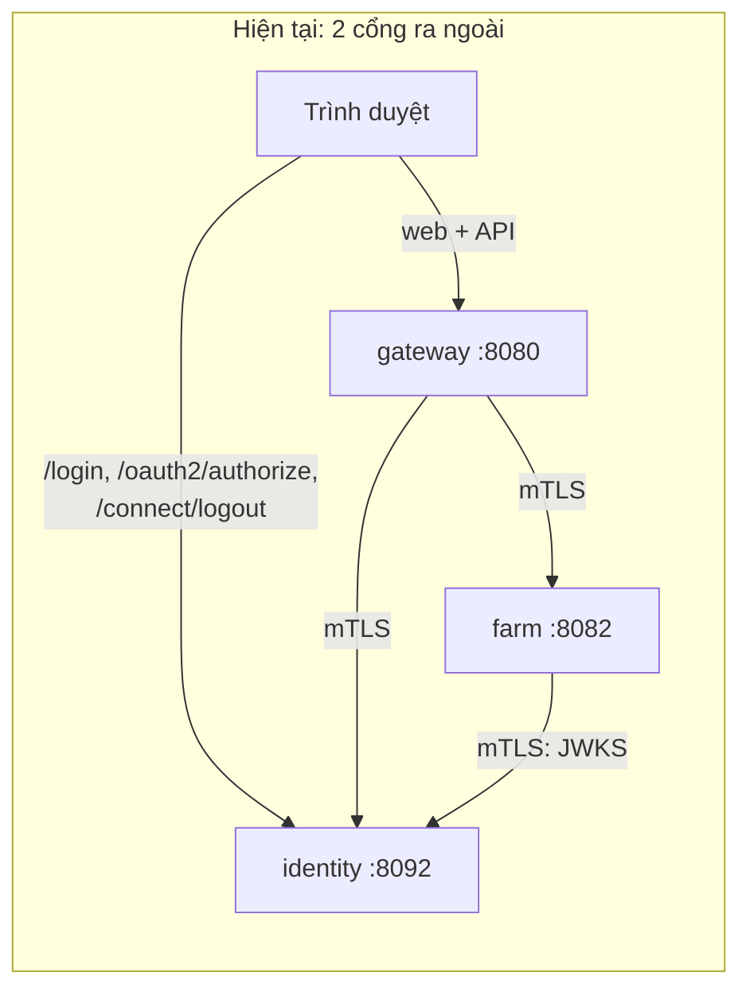
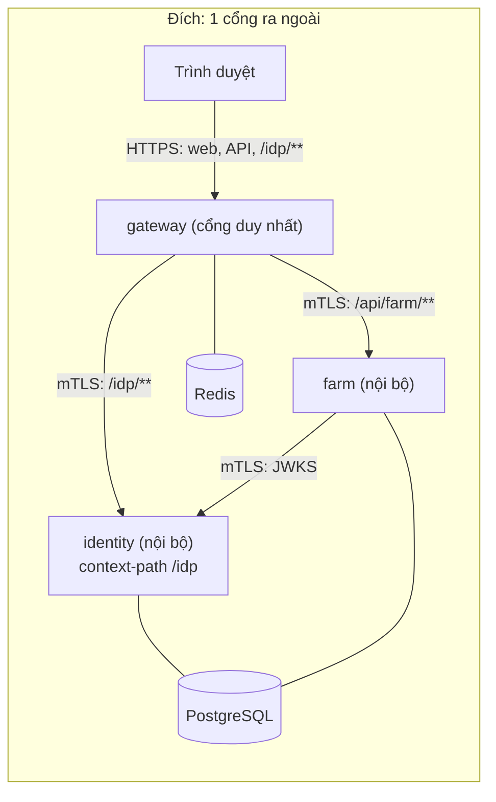
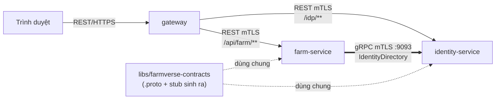
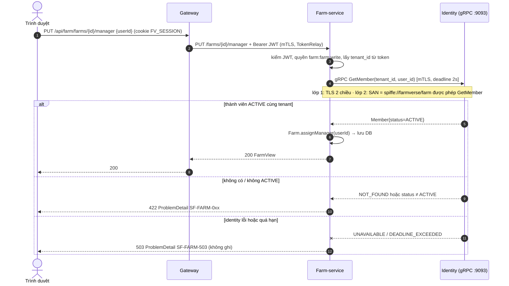

# Thiết kế: chỉ public gateway (một cổng) + thêm gRPC giữa các service

> Trạng thái: **CHỜ DUYỆT**. Chưa sửa code nào theo tài liệu này.
> Hai việc độc lập, làm theo thứ tự: **(A) gom về một cổng** trước, **(B) gRPC** sau.
> Mục 0 ghi những gì đã kiểm chứng bằng Maven thật và những gì chưa.

## 0. Cơ sở và mức tin cậy

Đã kiểm trong kho Maven cục bộ `~/.m2` và BOM của Spring Boot 4.1.2 (không đoán):

| Mục | Kết quả |
|---|---|
| Starter gRPC có sẵn trong Boot 4.1.2 | `spring-boot-starter-grpc-server`, `-client`, `-server-test`, `-client-test` |
| Version do BOM quản (không ghi tay) | grpc-java `1.84.1`, protobuf-java `4.36.2`, `spring-grpc-core` `1.1.2`, `protobuf-maven-plugin` `5.1.11` (groupId `io.github.ascopes`, có trong `pluginManagement` của Boot) |
| Thuộc tính server (đọc từ `spring-configuration-metadata.json` trong jar) | `spring.grpc.server.port`, `.address`, `.ssl.bundle`, `.ssl.client-auth` (NONE / OPTIONAL / REQUIRE), `.reflection.enabled` (**mặc định bật**), `.health.enabled`, `.observation.enabled`, `.inprocess.name`, `.servlet.enabled` (mặc định tắt) |
| Thuộc tính client (đọc từ lớp `GrpcClientProperties$Channel`) | `spring.grpc.client.channel.<tên>.{target, ssl.bundle, ssl.enabled, default.deadline, service-config.method (retry), health, keepalive}` |
| Bảo mật gRPC có sẵn trong `spring-grpc-core` 1.1.2 | server: `GrpcSecurity` (`preauth`, `oauth2ResourceServer`, `httpBasic`, `authorizeRequests`), `SslContextPreAuthenticationExtractor` (lấy danh tính từ chứng chỉ mTLS), `GrpcExceptionHandler`. Client: `BearerTokenAuthenticationInterceptor` + `TokenRelayTokenSupplier` / `ClientCredentialsTokenSupplier`, `DefaultDeadlineSetupClientInterceptor` |

**Chưa kiểm chứng, sẽ xác minh bằng build thật khi code** (mỗi mục có test chặn):

1. `GrpcSecurity` có ghép được `preauth` (mTLS) cùng `oauth2ResourceServer` (JWT) trong một chuỗi hay không. Chỉ cần nếu chọn phương án B ở mục 9.
2. Cách `SslContextPreAuthenticationExtractor` đọc SAN `spiffe://farmverse/<service>`. Có thể phải viết một `X509PrincipalExtractor` riêng (constructor có nhận).
3. Cấu hình `protobuf-maven-plugin` 5.1.11 cho Boot 4 (goal, nguồn proto). Sẽ dùng probe build trước, theo bài học cũ.
4. SAS (Spring Authorization Server) chạy dưới `context-path=/idp` với issuer có đường dẫn. Nhiều khả năng ổn, nhưng cần test.

---

## PHẦN A. Chỉ public gateway

### A1. Hiện trạng và đích

Hiện nay trình duyệt nói chuyện trực tiếp với hai nơi: gateway (web, API) và identity (trang login, đăng xuất).
Hệ quả đã gặp: hai origin (`127.0.0.1:8080` và `localhost:8092`), cookie phải đặt tên riêng, SAS từ chối `localhost`,
identity phải mở mTLS kiểu `want` và tự tách đường "trình duyệt" khỏi đường "máy gọi".





Identity và farm không còn cổng nào mở ra ngoài mạng nội bộ (prod: không publish port, chỉ ClusterIP / mạng riêng).

### A2. Quyết định chính

| # | Quyết định | Lý do |
|---|---|---|
| A-1 | Identity chạy dưới **`server.servlet.context-path: /idp`**. Gateway route `Path=/idp/**` sang identity, **không viết lại đường dẫn** | Cookie phiên identity tự có `Path=/idp`. Redirect của Spring Security tự mang `/idp`. Không đụng đường của gateway: gateway đã dùng `/login/oauth2/code/farmverse` và `/oauth2/authorization/**`, nên **không thể** map `/login` hay `/oauth2/**` thẳng sang identity (đụng nhau) |
| A-2 | **Issuer công khai** = `<địa chỉ gateway>/idp`, ví dụ dev `http://127.0.0.1:8080/idp` | Token, discovery, `post_logout_redirect_uri` đều dùng một địa chỉ mà trình duyệt thấy được |
| A-3 | Gateway tách hai loại địa chỉ: **công khai** (trình duyệt đi: `authorization`, `end_session`, `issuer`) và **nội bộ** (gateway tự gọi: `token`, `jwks`) | Gateway đã khai client OIDC tĩnh, nên tách được mà không cần discovery |
| A-4 | Identity bật `server.forward-headers-strategy: framework`, chỉ tin header `X-Forwarded-*` vì chỉ gateway (có chứng chỉ hợp lệ) nói chuyện được | Redirect tuyệt đối phải mang địa chỉ công khai, không lộ địa chỉ nội bộ |
| A-5 | Identity chuyển sang mTLS **`client-auth: need`** cho mọi kết nối | Trình duyệt không còn tới identity, nên bỏ chế độ `want` |
| A-6 | `ServiceIdentityFilter` của identity đổi thành **bảng quyền theo đường** thay vì "đường máy / đường trình duyệt" | Xem A4 |
| A-7 | **Giới hạn đăng nhập theo IP chuyển lên gateway** (Redis, `RequestRateLimiter`, key là IP khách) | Xem A5, đây là hệ quả bắt buộc |
| A-8 | Gateway **không bật CSRF của riêng nó cho `/idp/**`** | Form login của identity có CSRF token của identity. Gateway chặn thì mọi `POST /idp/login` bị 403 |

### A3. Sơ đồ tuần tự: đăng nhập qua một cổng

```mermaid
sequenceDiagram
    autonumber
    actor U as Trình duyệt
    participant G as Gateway (BFF)
    participant I as Identity (/idp)
    participant R as Redis

    U->>G: GET /oauth2/authorization/farmverse
    G->>G: tạo state + PKCE, lưu vào session
    G-->>U: 302 → {public}/idp/oauth2/authorize?...&code_challenge=...
    U->>G: GET /idp/oauth2/authorize?...
    Note over G,I: route /idp/** : mTLS, thêm X-Forwarded-Host/Proto/Port
    G->>I: GET /idp/oauth2/authorize?...
    I-->>G: 302 → /idp/login (chưa có phiên identity)
    G-->>U: 302 → {public}/idp/login
    U->>G: GET /idp/login
    G->>I: GET /idp/login
    I-->>U: 200 form (qua gateway), Set-Cookie FV_IDP_SESSION; Path=/idp
    U->>G: POST /idp/login (email, mật khẩu, _csrf của identity)
    Note over G: bỏ qua CSRF của gateway cho /idp/**; rate limit theo IP khách
    G->>I: POST /idp/login
    opt tài khoản bật TOTP
        I-->>U: 302 /idp/login/totp → người dùng nhập mã
    end
    I-->>U: 302 → {public}/idp/oauth2/authorize (có phiên)
    U->>G: GET /idp/oauth2/authorize
    G->>I: GET /idp/oauth2/authorize
    I-->>U: 302 → {gateway}/login/oauth2/code/farmverse?code=...&state=...
    U->>G: GET /login/oauth2/code/farmverse?code=...
    G->>I: POST /idp/oauth2/token (mTLS, code + code_verifier) [địa chỉ NỘI BỘ]
    I-->>G: access_token, refresh_token, id_token
    G->>I: GET /idp/oauth2/jwks (mTLS, nội bộ) để kiểm id_token
    G->>R: lưu token trong WebSession
    G-->>U: 302 → / , Set-Cookie FV_SESSION (chỉ cookie này)
```

Điểm cần nhớ: **hai cookie cùng host nhưng khác đường dẫn và khác tên** (`FV_SESSION` Path=`/`, `FV_IDP_SESSION` Path=`/idp`), nên không đè nhau.

### A4. Đăng xuất qua một cổng

```mermaid
sequenceDiagram
    autonumber
    actor U as Trình duyệt
    participant G as Gateway
    participant I as Identity (/idp)

    U->>G: POST /logout (form, _csrf) [điều hướng thật, không dùng fetch]
    G->>G: xóa WebSession (Redis)
    G-->>U: 302 → {public}/idp/connect/logout?id_token_hint=...&post_logout_redirect_uri={public}/
    U->>G: GET /idp/connect/logout?...
    G->>I: GET /idp/connect/logout?... (mTLS)
    I->>I: kiểm id_token_hint, sid, redirect đã đăng ký; hủy phiên SSO
    I-->>U: 302 → {public}/?state=...
```

Lỗi "đăng xuất xong bấm đăng nhập không hỏi mật khẩu" đã sửa ở commit `f41f65e` (web gửi form thật). Thiết kế này giữ nguyên cách đó.

### A5. Bảng quyền theo đường ở identity (thay `ServiceIdentityFilter` hai chế độ)

Danh tính lấy từ SAN `spiffe://farmverse/<service>` trong chứng chỉ (đã có).

| Đường (sau context-path `/idp`) | gateway | farm | Ghi chú |
|---|:-:|:-:|---|
| `/login`, `/login/totp`, `/oauth2/authorize`, `/connect/logout`, `/css/**`, `/.well-known/**` | có | không | gateway chuyển tiếp thay trình duyệt |
| `/oauth2/token`, `/oauth2/revoke`, `/oauth2/introspect`, `/userinfo` | có | không | |
| `/oauth2/jwks` | có | **có** | farm kiểm chữ ký JWT |
| `/users`, `/roles`, `/permissions`, `/tenants`, `/me` | có | không | qua route `/api/identity/**` |
| actuator | cổng riêng (đã có) | | không đi qua gateway |

Nguyên tắc ít quyền nhất: farm chỉ lấy được JWKS.

### A6. Hệ quả bắt buộc phải xử lý (hại nếu bỏ sót)

| # | Vấn đề | Xử lý |
|---|---|---|
| 1 | **Mọi người dùng thành một IP** trong mắt identity (là IP gateway). `LoginRateLimitFilter` hiện tại sẽ chặn cả hệ thống sau 10 lần đăng nhập mỗi phút | Chuyển giới hạn lên gateway (A-7). Gateway lấy IP khách qua `XForwardedRemoteAddressResolver` với số proxy tin cậy cấu hình (prod có load balancer phía trước). Bộ đếm Redis cũng chính xác khi chạy nhiều instance, điều mà bộ đếm trong bộ nhớ hiện tại không làm được |
| 2 | **Giả mạo `X-Forwarded-For` / `X-Forwarded-Host`** từ khách | Gateway xóa các header này từ ngoài vào rồi tự đặt lại; chỉ tin proxy phía trước theo danh sách cấu hình |
| 3 | **CSRF kép**: gateway chặn `POST /idp/login` | A-8, loại `/idp/**` khỏi kiểm CSRF của gateway. Identity vẫn tự kiểm CSRF của nó (cookie `SameSite=Lax` + token trong form) |
| 4 | **Cùng origin với web**: XSS ở web ở gần trang đăng nhập hơn | CSP chặt cho `/idp/**` (trang chỉ cần `'self'`, đã không có script), `X-Frame-Options: DENY`, header bảo mật ở gateway (mục G4 của kế hoạch). Cookie `FV_SESSION` vẫn `HttpOnly` |
| 5 | **Mọi token cũ mất hiệu lực** khi đổi `iss` | Chấp nhận (dự án học tập, đã đồng ý xóa dữ liệu dev). Ghi vào runbook |
| 6 | **Lỗ actuator** của gateway (`/actuator/gateway/**` đang `permitAll` ở cổng 8080) | Phải vá **trước hoặc cùng** bước này: tách cổng quản trị như identity và farm. Khi gateway là cổng duy nhất, lỗ này thành lỗ công khai duy nhất |
| 7 | Gateway thành điểm duy nhất: sập là mất cả đăng nhập | Đã đúng với BFF hiện nay. Chạy nhiều instance + session Redis (đã có) |
| 8 | Cấu hình `iss` / `jwk-set-uri` / `redirect-uri` / `post-logout-redirect-uri` / `context-path` / route phải khớp nhau | Một bảng cấu hình duy nhất trong tài liệu vận hành + một test khởi động kiểm khớp (xem A8) |

### A7. Lợi và hại (tóm tắt để duyệt)

| | Lợi | Hại |
|---|---|---|
| Bảo mật | Một bề mặt ra ngoài. REST quản trị của identity không ai ngoài chạm tới. Một chỗ đặt TLS, CSP, rate limit, WAF | Gateway là điểm tập trung rủi ro. Trang đăng nhập cùng origin với web |
| Vận hành | Một chứng chỉ công khai, một tên miền. Hết lỗi `localhost` khác `127.0.0.1`, hết trò đặt tên cookie né nhau | Phải giữ bộ cấu hình địa chỉ công khai và nội bộ khớp nhau |
| mTLS | Đơn giản hơn (identity chỉ `need`), bảng quyền theo đường rõ ràng | Đổi `ServiceIdentityFilter` và test mTLS |
| Công việc | | Đợt sửa vừa: identity (context-path, forward headers, filter), gateway (route, cấu hình địa chỉ, CSRF, rate limit), web (không đổi), test, docs |

**Kết luận: nên làm.** Chi phí chấp nhận được và nhiều lỗi thực tế biến mất.

### A8. Các file sẽ đổi

| Module | Đổi gì |
|---|---|
| `services/identity-service` | `application*.yml`: `context-path: /idp`, `forward-headers-strategy: framework`, `issuer` công khai, mTLS `need`. `MtlsConfiguration` + `ServiceIdentityFilter` thành bảng quyền theo đường. `LoginRateLimitFilter`: bỏ hoặc chỉ giữ làm lớp phụ. Test: đổi đường dẫn |
| `platform/api-gateway` | `application*.yml`: route `identity-ui` (`Path=/idp/**`, thứ tự trước route `web`), route `identity-api` thêm `PrefixPath=/idp` sau `StripPrefix=2`. `GatewayOidcProperties`: tách `issuer` công khai và `internal-url`. `SecurityConfiguration`: loại `/idp/**` khỏi CSRF, header bảo mật, rate limit theo IP, vá actuator. Test mới |
| `services/farm-service` | `issuer-uri` công khai, `jwk-set-uri` trỏ `.../idp/oauth2/jwks` nội bộ |
| `scripts`, `docs`, `compose.yaml` | Địa chỉ mới, bỏ publish port của identity và farm ở prod |
| `apps/farmverse-web` | **Không đổi** (đã dùng đường tương đối `/oauth2/authorization/farmverse` và `/logout`) |

### A9. Kiểm chứng (test chặn hồi quy)

| Test | Chứng minh |
|---|---|
| Gateway → identity (identity giả có context-path `/idp`) | Route `/idp/**` chuyển đúng, `POST /idp/login` không bị CSRF của gateway chặn |
| Identity | Redirect của `/oauth2/authorize` chưa đăng nhập là địa chỉ **công khai** (`.../idp/login`), không lộ địa chỉ nội bộ |
| Identity | Gọi trực tiếp không chứng chỉ → đứt TLS. farm gọi `/idp/users` → 403. farm gọi `/idp/oauth2/jwks` → 200 |
| Gateway | 11 lần `POST /idp/login` cùng IP khách → 429; IP khác vẫn qua. `X-Forwarded-For` giả từ ngoài bị bỏ |
| Gateway | `/actuator/gateway/routes` từ cổng công khai → không truy cập được |
| Khớp cấu hình | Test khởi động: `iss` trong token = issuer công khai; `jwks_uri` trong discovery = địa chỉ công khai |
| Luồng đầy đủ | Đăng nhập → gọi API → đăng xuất → đăng nhập lại **phải hỏi mật khẩu** |

---

## PHẦN B. gRPC giữa các service

### B1. Phạm vi và nguyên tắc

- gRPC chỉ cho **service gọi service**. Trình duyệt vẫn đi REST qua gateway. Gateway **không** proxy gRPC ra ngoài.
- Hiện chỉ có 3 service và gần như không có lời gọi nội bộ nào (farm chỉ lấy JWKS). Nên cần **một trường hợp dùng có thật** để gRPC không thành đồ trang trí.
- Dùng đúng thứ Boot 4.1.2 có sẵn. Không thêm BOM ngoài (bài học cũ về `spring-grpc` ngoài).

### B2. Trường hợp dùng đầu tiên (đề xuất)

**Farm gán người phụ trách (manager) cho trang trại, kiểm với identity.**

| Chức năng | Gọi gRPC | Hành vi khi identity lỗi |
|---|---|---|
| `PUT /farms/{id}/manager {userId}`: kiểm người đó là thành viên **ACTIVE** của **cùng tenant** | `IdentityDirectory.GetMember` (unary) | **Từ chối** ghi, trả 503 ProblemDetail `SF-FARM-503` (ghi phải đúng, không đoán) |
| `GET /farms`: hiện tên người phụ trách | `IdentityDirectory.BatchGetMembers` (unary, tối đa 100) | **Giảm cấp**: vẫn trả danh sách, `managerName` rỗng, chỉ hiện `managerUserId` |

Đây là phần mở rộng nghiệp vụ rất nhỏ (thêm cột `manager_user_id` vào V1 của farm theo quy tắc "không giữ lịch sử migration").
Mẫu này dạy đủ: hợp đồng proto, mTLS, deadline, retry, ánh xạ lỗi, giảm cấp, test.

Để dành cho sau (chưa làm): `FarmCatalog.GetBarn` (farm phục vụ service chăn nuôi tương lai), server streaming `WatchMembership` (xóa cache khi tài khoản bị khóa).

### B3. Kiến trúc



Mũi tên đậm là gRPC mới. Phần còn lại giữ nguyên.

### B4. Hợp đồng proto (phác thảo, chốt khi code)

Module mới `libs/farmverse-contracts`. Proto là nguồn sự thật, code Java sinh ra khi build, **không commit**.

```proto
syntax = "proto3";
package farmverse.identity.v1;
option java_multiple_files = true;
option java_package = "com.htv.farmverse.contracts.identity.v1";

service IdentityDirectory {
  rpc GetMember(GetMemberRequest) returns (Member);
  rpc BatchGetMembers(BatchGetMembersRequest) returns (BatchGetMembersResponse);
}

message GetMemberRequest { string tenant_id = 1; string user_id = 2; }
message BatchGetMembersRequest { string tenant_id = 1; repeated string user_ids = 2; } // tối đa 100
message BatchGetMembersResponse { repeated Member members = 1; }

message Member {
  string user_id = 1;
  string display_name = 2;
  MemberStatus status = 3;
  repeated string roles = 4;
}

enum MemberStatus {
  MEMBER_STATUS_UNSPECIFIED = 0;
  MEMBER_STATUS_ACTIVE = 1;
  MEMBER_STATUS_SUSPENDED = 2;
  MEMBER_STATUS_DISABLED = 3;
}
```

Quy ước hợp đồng (ghi vào `docs/patterns/grpc.md`):

1. Thư mục theo phiên bản `farmverse/identity/v1/`. Thay đổi phá vỡ thì tạo `v2`, chạy song song.
2. Không bao giờ đổi hay dùng lại số field. Field bỏ đi thì khai `reserved`.
3. Enum luôn có giá trị 0 `..._UNSPECIFIED`. Bên nhận phải xử lý giá trị lạ.
4. Tối thiểu dữ liệu: **không** trả email, hash, secret. Chỉ trả cái bên gọi cần.
5. Lô (batch) có giới hạn kích thước, vượt thì `INVALID_ARGUMENT`.

### B5. Bảo mật gRPC (ba lớp, mỗi lớp một mục đích)

| Lớp | Cơ chế (đều của Spring) | Trả lời câu hỏi |
|---|---|---|
| 1. Đường truyền | mTLS: `spring.grpc.server.ssl.bundle=farmverse`, `ssl.client-auth=REQUIRE`; client `spring.grpc.client.channel.identity.ssl.bundle=farmverse`. **Dùng chung CA, chứng chỉ và bundle** với REST | Bên kia có phải máy của FarmVerse? |
| 2. Danh tính service | `GrpcSecurity.preauth` + `SslContextPreAuthenticationExtractor` (đọc SAN `spiffe://farmverse/<service>`) → authority `SERVICE_FARM`; `authorizeRequests`: `GetMember`, `BatchGetMembers` chỉ cho `SERVICE_FARM` | Service nào được gọi hàm nào? |
| 3. Ngữ cảnh người dùng | Xem lựa chọn D3 ở mục 9 | Gọi thay cho tenant nào? |

**Mô hình đe dọa còn lại (ghi rõ để duyệt):** với phương án A, identity tin farm khi farm truyền `tenant_id`. Nếu farm bị chiếm, kẻ tấn công hỏi được thành viên của mọi tenant. Giảm thiểu: farm lấy `tenant_id` từ JWT đã kiểm, danh sách cho phép chỉ có farm, dữ liệu trả về tối thiểu, có nhật ký. Phương án B (chuyển tiếp JWT người dùng) đóng lỗ này, đổi lại phức tạp hơn.

Khi `spring.grpc.server.reflection.enabled` mặc định là **bật**, prod phải đặt `false` (lộ danh sách hàm cho kẻ dò). Dev bật để dùng `grpcurl`.

### B6. Sơ đồ tuần tự: gán người phụ trách



### B7. Ánh xạ lỗi gRPC → REST ở farm

| gRPC status | REST trả về | `code` |
|---|---|---|
| `NOT_FOUND` | 422 | `SF-FARM-0xx` (người dùng không thuộc tenant) |
| `INVALID_ARGUMENT` | 400 | `SF-VALIDATION-001` |
| `PERMISSION_DENIED`, `UNAUTHENTICATED` | 500 (lỗi cấu hình nội bộ, không đổ cho người dùng), ghi log | `SF-FARM-500` |
| `UNAVAILABLE` | 503 (ghi) hoặc giảm cấp (đọc) | `SF-FARM-503` |
| `DEADLINE_EXCEEDED` | 504 (ghi) hoặc giảm cấp (đọc) | `SF-FARM-504` |

Mã nghiệp vụ của identity đi kèm trong **trailing metadata** `x-error-code` (đơn giản hơn `google.rpc.ErrorInfo`; đủ cho nhu cầu hiện tại).

### B8. Chịu lỗi phía client (farm)

| Thiết lập | Giá trị đề xuất | Lý do |
|---|---|---|
| Deadline mặc định | `spring.grpc.client.channel.identity.default.deadline=2s` | Không bao giờ chờ vô hạn |
| Retry | Chỉ cho `GetMember`/`BatchGetMembers` (đọc, idempotent), tối đa 2 lần, chỉ `UNAVAILABLE`, qua `service-config.method` | Ghi không retry |
| Giảm cấp | Đọc danh sách: bỏ tên; ghi: từ chối | Xem B2 |
| Health | Server bật `grpc.health`, client bật `health` của channel | Cân bằng tải và tắt máy êm |

Chưa dùng circuit breaker (Resilience4j đã bỏ khỏi dự án ở bước A). Với một lời gọi, deadline + retry có giới hạn đủ dùng.

### B9. Cổng và cấu hình theo môi trường

| Service | HTTP (nội bộ) | gRPC | Health/actuator |
|---|---|---|---|
| identity | 8092 | **9093** (server, mới) | 9092 |
| farm | 8082 | tắt (`spring.grpc.server.enabled=false`) vì farm chưa phục vụ gRPC | 9082 |

Dev không bật profile `mtls`: gRPC chạy plaintext trên `127.0.0.1`, reflection bật. Dev có `mtls` và prod: mTLS `REQUIRE`, reflection tắt.

### B10. Quan sát và kiểm thử

- `observation.enabled` mặc định bật cho cả server và client. Gắn trace id khi làm mục G8 của kế hoạch (gateway).
- Test: (1) in-process (dùng `spring-boot-starter-grpc-server-test`, `-client-test`), (2) mTLS thật dùng cert do `generate-dev-mtls.sh` tạo: không cert → bị từ chối, cert gateway gọi `GetMember` → `PERMISSION_DENIED`, cert farm → thành công, (3) test lỗi: identity tắt → farm trả 503 khi ghi và giảm cấp khi đọc, (4) test khóa hợp đồng: sinh lại stub từ proto không đổi chữ ký (đề phòng sửa nhầm số field).

---

## 10. Thứ tự làm, mỗi bước build xanh và commit thẳng `main`

| Bước | Việc | Điều kiện qua |
|---|---|---|
| P0 | Vá lỗ actuator của gateway (tách cổng quản trị) | Test: `/actuator/gateway/**` không truy cập được từ cổng công khai |
| P1 | **Phần A**: context-path `/idp`, issuer công khai, route gateway, forward headers, rate limit lên gateway, bảng quyền theo đường | Toàn bộ test A9 qua; chạy tay: đăng nhập, đăng xuất, đăng nhập lại có hỏi mật khẩu |
| P2 | `libs/farmverse-contracts` + probe build `protobuf-maven-plugin` | Build xanh, stub sinh ra |
| P3 | Identity: server `IdentityDirectory`, mTLS + bảng quyền theo method | Test in-process và mTLS |
| P4 | Farm: client, `manager_user_id`, hai REST, ánh xạ lỗi, giảm cấp | Test B10 (1)–(3) |
| P5 | Tài liệu: `docs/patterns/single-entry.md`, `docs/patterns/grpc.md`, cập nhật `mtls.md`, `local-development.md`, `README.md` | |

## 11. Ảnh hưởng tới kế hoạch hoàn thiện đang chạy

Kế hoạch `content/ke-hoach-hoan-thien.md` đặt cổng chất lượng: **chưa 10/10 thì chưa mở rộng**.

- Phần A **thuộc** việc hoàn thiện (nó thực hiện G2, G4, G5, G7 và vá lỗ bảo mật). Không vi phạm cổng.
- Phần B (gRPC) là **mở rộng**. Làm trước khi gateway và web đạt 10/10 là ngoại lệ so với cổng đã duyệt. Tôi đề xuất làm B **sau P1** (một cổng) vì P1 đổi nền tảng mà B dựa vào; còn web có thể làm song song vì không phụ thuộc.

## 12. Cần anh chốt

| # | Câu hỏi | Đề xuất |
|---|---|---|
| D1 | Tiền tố `/idp` với `context-path` (A-1), hay dùng tên miền con (`id.example.com`) cho identity? | `/idp`: một origin, một chứng chỉ. Tên miền con tách origin tốt hơn nhưng quay lại hai cổng công khai |
| D2 | Trường hợp dùng gRPC đầu tiên là "farm gán người phụ trách, kiểm với identity" (B2)? | Có. Nhỏ, có thật, dạy đủ |
| D3 | Ngữ cảnh người dùng trong gRPC (B5 lớp 3): **A** chỉ mTLS + `tenant_id` do farm truyền; **B** thêm chuyển tiếp JWT người dùng (`TokenRelayTokenSupplier`); **C** token service qua `client_credentials` | **A** trước, ghi rõ mô hình đe dọa; B làm sau nếu cần |
| D4 | Gateway → farm/identity vẫn là REST, chỉ service ↔ service dùng gRPC? | Có |
| D5 | Giới hạn đăng nhập theo IP chuyển hẳn lên gateway (Redis) và bỏ filter trong bộ nhớ của identity? | Có. Đúng IP khách, đúng khi nhiều instance |
| D6 | Thứ tự P0 → P1 → P2…P5 và B sau P1 (mục 11)? | Có |
