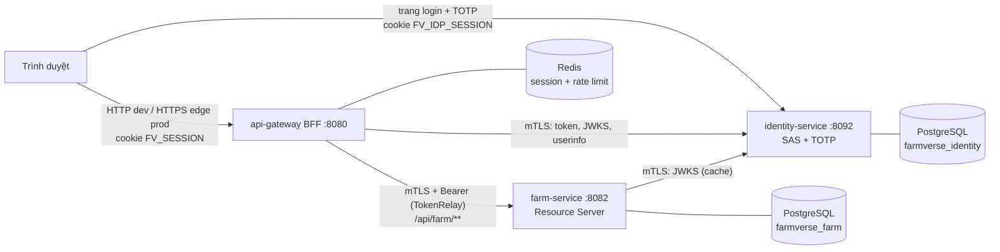

# Kiến trúc FarmVerse

Bộ tài liệu này mô tả kiến trúc **thực tế trong code** và kiến trúc **mục tiêu production**, cùng chênh lệch giữa hai bên.
Quy tắc: không ghi một tính năng là "đã có" nếu chưa tìm thấy nó trong code hoặc test. Mỗi khẳng định có link tới file.

Rà lần cuối: 2026-11-04, trên `main` (commit `b7dae53`) cộng thay đổi chưa commit trong working tree.

## Đọc theo thứ tự

| # | Tài liệu | Trả lời câu hỏi |
|---|---|---|
| 1 | [current-architecture.md](current-architecture.md) | Hệ thống hiện chạy thế nào? Bằng chứng ở đâu? |
| 2 | [target-architecture.md](target-architecture.md) | Production cần trông thế nào? Vì sao? Lệch ở đâu? |
| 3 | [security-threat-model.md](security-threat-model.md) | Ranh giới tin cậy, tài sản, mối đe dọa, biện pháp, rủi ro P0-P3 |
| 4 | [authentication-flow.md](authentication-flow.md) | Login, TOTP, session, logout, vòng đời token, BFF gọi Farm |
| 5 | [deployment.md](deployment.md) | Redis, PostgreSQL, mTLS, chứng chỉ/secret, observability |
| 6 | [migration-roadmap.md](migration-roadmap.md) | Milestone, ưu tiên, phụ thuộc, test, rollback |
| 7 | [adr/](adr/) | Quyết định kiến trúc đã chốt hoặc đang đề xuất |

## Sơ đồ tổng quan (hiện tại)

mTLS chỉ bật với profile `mtls` (prod luôn bật). Xem [current-architecture.md](current-architecture.md).

## Tài liệu liên quan

- Thiết kế, tiêu chí 10/10 và kế hoạch gRPC: [`content/thiet-ke-farmverse.md`](../../content/thiet-ke-farmverse.md).
- Pattern chi tiết: [`docs/patterns/`](../patterns/) (BFF, OIDC/SAS, hexagonal + multi-tenant, mTLS).
- Vận hành: [`docs/operations/`](../operations/).

## Chú giải

| Ký hiệu | Nghĩa |
|---|---|
| ✅ | Có trong code và có test chứng minh |
| 🟡 | Có một phần, hoặc có code nhưng chưa có test |
| ⬜ | Chưa có |
| ❓ | Chưa kiểm được trong môi trường hiện tại |
