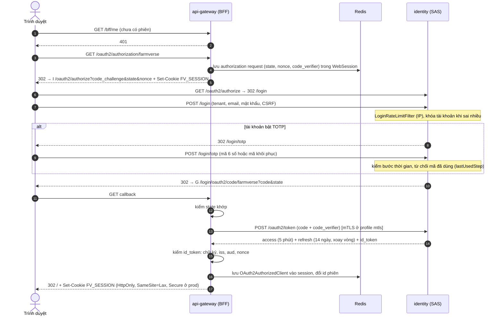
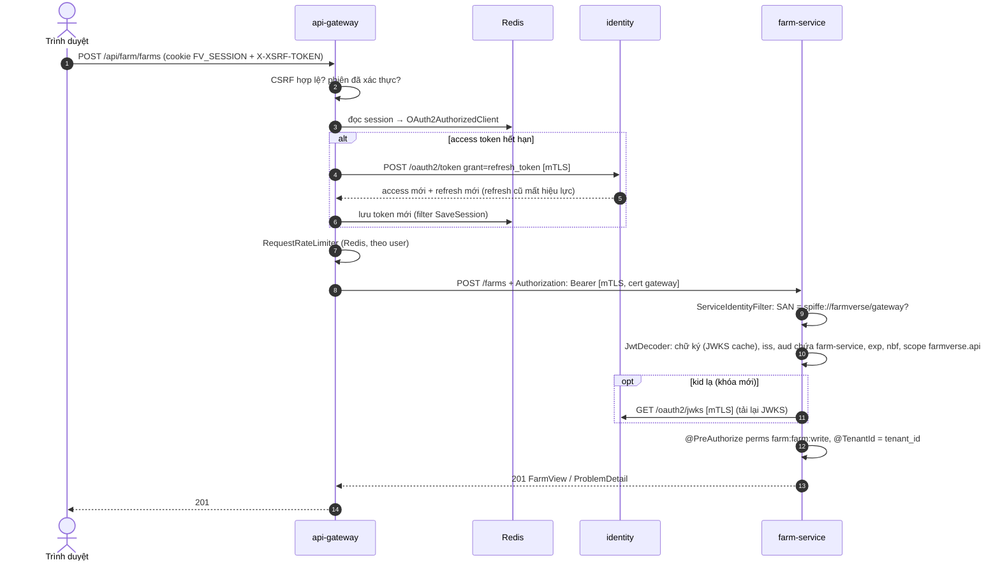
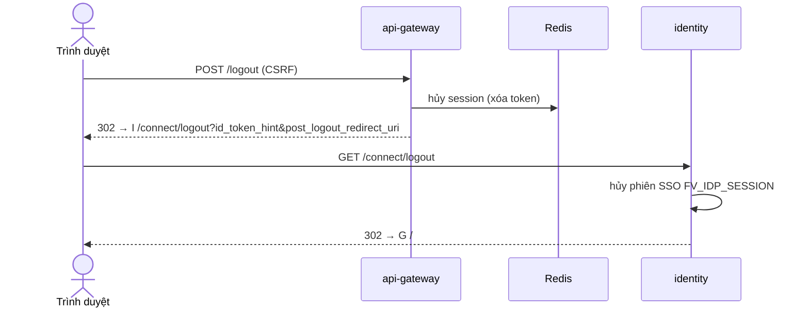

# Luồng xác thực

Mọi bước dưới đây có trong code trừ khi ghi **[chưa có]**.

## 1. Đăng nhập (Authorization Code + PKCE + TOTP)

Bằng chứng: [`SecurityConfiguration` gateway](../../platform/api-gateway/src/main/java/com/htv/farmverse/gateway/config/SecurityConfiguration.java), [`OidcClientConfiguration`](../../platform/api-gateway/src/main/java/com/htv/farmverse/gateway/config/OidcClientConfiguration.java), [`SecurityConfiguration` identity](../../services/identity-service/src/main/java/com/htv/farmverse/identity/config/SecurityConfiguration.java), [`TotpEnforcementFilter`](../../services/identity-service/src/main/java/com/htv/farmverse/identity/login/TotpEnforcementFilter.java), [`TotpService`](../../services/identity-service/src/main/java/com/htv/farmverse/identity/mfa/TotpService.java). Test: `AuthorizationCodeFlowTest`, `TotpLoginFlowTest`, `LoginRateLimitFilterTest`.

Có test (M5) bằng luồng HTTP thật với identity giả ([`FakeIdentityServer`](../../platform/api-gateway/src/test/java/com/htv/farmverse/gateway/FakeIdentityServer.java)): bước 5 có `state`, `nonce`, `code_challenge_method=S256`, mới cho mỗi lần; bước 13 gửi `code_verifier`; bước 15 id_token mang đúng `nonce`; bước 16 id phiên đổi, id cũ trả 401; `state` giả thì không đăng nhập. Xem [`LoginSessionSecurityTest`](../../platform/api-gateway/src/test/java/com/htv/farmverse/gateway/LoginSessionSecurityTest.java).

## 2. BFF gọi Farm

Ba lớp kiểm khác nhau, mỗi lớp trả lời một câu hỏi:

| Lớp | Cơ chế | Câu hỏi | Lỗi khi sai |
|---|---|---|---|
| mTLS | TLS hai chiều + `ServiceIdentityFilter` | Máy nào đang gọi? | đứt bắt tay hoặc 403 |
| JWT/JWKS | `JwtDecoder` + validator | Token có thật, còn hạn, đúng người nhận không? Người dùng là ai, tenant nào? | 401 `SF-AUTH-001` |
| Authorization | `@PreAuthorize` + `@TenantId` | Người đó được làm gì, trên dữ liệu nào? | 403 `SF-AUTH-002` / không thấy dữ liệu |

`aud=farm-service` và kiểm `scope` đã có (M6, ADR-0006 bước 1). **[chưa có]** ownership (R11).

## 3. Phiên (session)

| Thuộc tính | Hiện trạng |
|---|---|
| Nơi lưu | Spring Session Redis, qua `WebSession` |
| Nội dung | Security context (`OidcUser`), `OAuth2AuthorizedClient` (access + refresh token), CSRF không ở đây (ở cookie) |
| Thời hạn | `${GATEWAY_SESSION_TIMEOUT:30m}` không hoạt động; key `farmverse:gateway:session:*` |
| Khi Redis lỗi | Request có cookie phiên → 503 `SF-GATEWAY-503`, `Retry-After: 5`, không chuyển xuống service. Request không có cookie → 401 như thường (không cần đọc Redis) |

## 4. Đăng xuất

Test: `GatewaySecurityTest#logoutRedirectsTheBrowserToIdentityEndSession` (cần Redis đang chạy, xem P2-6).
Giới hạn: refresh token trong `oauth2_authorization` của identity không bị thu hồi chủ động lúc logout; access token đã cấp vẫn hợp lệ tới khi hết hạn (tối đa 5 phút). **[chưa có]** thu hồi refresh token khi logout: cần kiểm hành vi của SAS khi end session trước khi khẳng định.

## 5. Vòng đời token

| Token | Hạn | Nơi giữ | Xoay vòng | Thu hồi |
|---|---|---|---|---|
| Access (JWT) | 5 phút | Redis (session gateway) | Refresh khi hết hạn | Không tức thì; khóa membership chặn cấp mới (`FarmVerseTokenCustomizer#grantFor`) |
| Refresh (opaque) | 14 ngày | Redis + `oauth2_authorization` | Mỗi lần dùng (`reuseRefreshTokens(false)`) | Khi membership bị khóa: refresh bị từ chối |
| ID token | theo SAS | Redis (trong `OidcUser`) | — | Dùng làm `id_token_hint` khi logout |
| Phiên SSO identity | phiên servlet | cookie `FV_IDP_SESSION` | — | `/connect/logout` |
