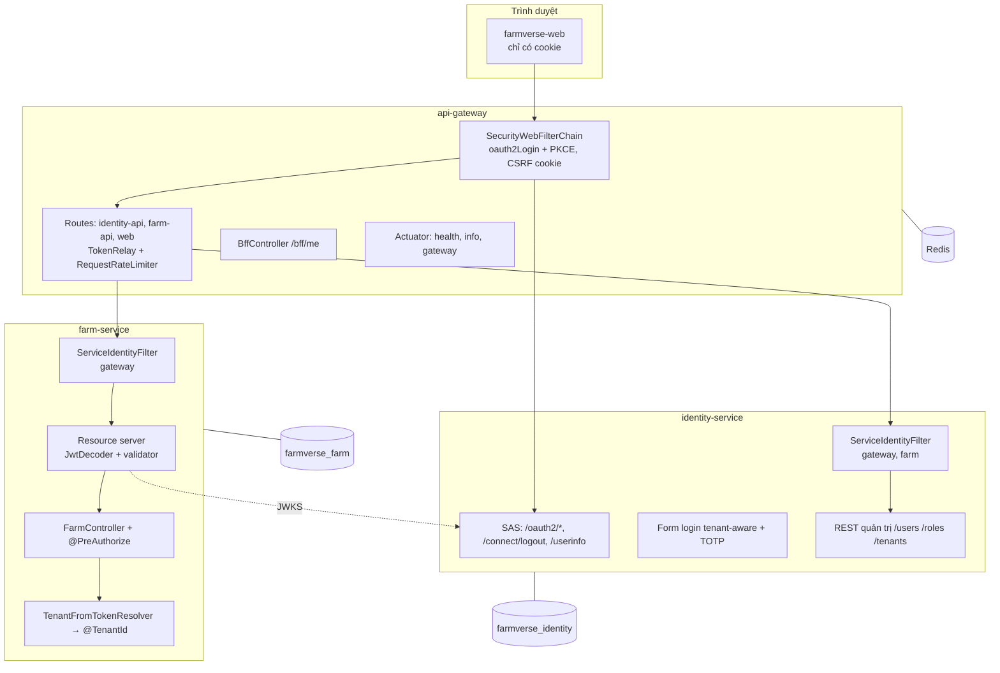

# Kiến trúc hiện tại

Mô tả đúng những gì có trong code ngày 2026-11-04. Mỗi dòng có bằng chứng.

## 1. Module

Khai trong [`pom.xml`](../../pom.xml): Spring Boot 4.1.2 (parent), Spring Cloud 2025.1.4 (BOM), Java 17.

| Module | Cổng | Công nghệ chính | Bằng chứng |
|---|---|---|---|
| `platform/api-gateway` | 8080 | Spring Cloud Gateway (WebFlux), OAuth2 Client, Spring Session Redis | [`pom.xml`](../../platform/api-gateway/pom.xml), [`SecurityConfiguration`](../../platform/api-gateway/src/main/java/com/htv/farmverse/gateway/config/SecurityConfiguration.java) |
| `services/identity-service` | 8092, quản trị 9092 (profile `mtls`) | Spring Authorization Server, JPA, Flyway, TOTP | [`SecurityConfiguration`](../../services/identity-service/src/main/java/com/htv/farmverse/identity/config/SecurityConfiguration.java) |
| `services/farm-service` | 8082, quản trị 9082 (profile `mtls`) | OAuth2 Resource Server, JPA, Hibernate `@TenantId` | [`SecurityConfiguration`](../../services/farm-service/src/main/java/com/htv/farmverse/farm/config/SecurityConfiguration.java) |
| `libs/farmverse-starter-service` | — | Converter JWT, validator, `ApiProblem`, mTLS client | [`FarmVerseJwtValidators`](../../libs/farmverse-starter-service/src/main/java/com/htv/farmverse/service/security/FarmVerseJwtValidators.java), [`MtlsClients`](../../libs/farmverse-starter-service/src/main/java/com/htv/farmverse/service/mtls/MtlsClients.java) |
| `apps/farmverse-web` | 5173 (dev) | React + Vite, chỉ dùng cookie | [`package.json`](../../apps/farmverse-web/package.json) |

Hạ tầng dev: [`compose.yaml`](../../compose.yaml) có PostgreSQL 17 và Redis 8 (mật khẩu `REDIS_PASSWORD`, mặc định `farmverse-dev`), cả hai chỉ mở ở `127.0.0.1`. Service chạy ngoài compose.

## 2. Sơ đồ thành phần



## 3. Gateway (BFF)

| Việc | Hiện trạng | Bằng chứng |
|---|---|---|
| Đăng nhập | `oauth2Login` + PKCE `S256`; `state`, `nonce` mới cho mỗi lần; đổi code gửi `code_verifier`; `state` sai thì không đăng nhập | `SecurityConfiguration#security`, [`LoginSessionSecurityTest`](../../platform/api-gateway/src/test/java/com/htv/farmverse/gateway/LoginSessionSecurityTest.java) |
| Client OIDC | Khai tĩnh, không discovery, để gateway khởi động khi identity chưa chạy | [`OidcClientConfiguration`](../../platform/api-gateway/src/main/java/com/htv/farmverse/gateway/config/OidcClientConfiguration.java) |
| Lưu token | `WebSessionServerOAuth2AuthorizedClientRepository` → WebSession → Spring Session Redis | `SecurityConfiguration#authorizedClientRepository` |
| Cookie phiên | `FV_SESSION` opaque, `HttpOnly`, `SameSite=Lax`, `Path=/`, không `Domain`; `Secure` khi `farmverse.gateway.secure-cookie=true` (bật ở [`application-prod.yml`](../../platform/api-gateway/src/main/resources/application-prod.yml), có test khóa) | `SecurityConfiguration#webSessionIdResolver`, [`SessionCookieAttributesTest`](../../platform/api-gateway/src/test/java/com/htv/farmverse/gateway/config/SessionCookieAttributesTest.java), [`LoginSessionSecurityTest`](../../platform/api-gateway/src/test/java/com/htv/farmverse/gateway/LoginSessionSecurityTest.java) |
| Chống session fixation | Mặc định Spring Security WebFlux đổi id phiên khi đăng nhập; id cũ trả 401. Có test, và đã đối chứng: tắt đổi id thì test đỏ | [`LoginSessionSecurityTest`](../../platform/api-gateway/src/test/java/com/htv/farmverse/gateway/LoginSessionSecurityTest.java) |
| CSRF | `CookieServerCsrfTokenRepository.withHttpOnlyFalse()` (cookie `XSRF-TOKEN` + header/field) | `SecurityConfiguration#security`, test `logoutFormWithCsrfFieldIsAccepted_andWithoutItIsRejected` |
| Gọi xuống service | `TokenRelay` (tự refresh), `StripPrefix=2` | [`application.yml`](../../platform/api-gateway/src/main/resources/application.yml) |
| Giới hạn đăng nhập theo IP | `/oauth2/authorization/**`, `/login/oauth2/code/**`: 20 lần/phút/IP (`farmverse.gateway.login-rate-limit.*`), bộ đếm Redis (script INCR + PEXPIRE nguyên tử), chạy trước Spring Security nên bị chặn thì không tạo phiên; 429 `SF-GATEWAY-429` (G5) | [`LoginRateLimitFilter`](../../platform/api-gateway/src/main/java/com/htv/farmverse/gateway/config/LoginRateLimitFilter.java), [`RedisLoginAttemptCounter`](../../platform/api-gateway/src/main/java/com/htv/farmverse/gateway/config/RedisLoginAttemptCounter.java), `LoginRateLimitFilterTest`, `GatewayRedisIT` |
| Rate limit | `RequestRateLimiter` Redis, key = tên principal, 20/s, burst 40. Redis lỗi thì bộ giới hạn **cho qua** (hành vi của Spring Cloud Gateway), nhưng phiên đã bị chặn trước đó | `application.yml`, `SecurityConfiguration#principalKeyResolver` |
| Redis | Mật khẩu bắt buộc, timeout lệnh `${REDIS_TIMEOUT:2s}`, kết nối `${REDIS_CONNECT_TIMEOUT:1s}`; phiên `${GATEWAY_SESSION_TIMEOUT:30m}`, namespace `farmverse:gateway:session`; Redis lỗi → 503 `SF-GATEWAY-503` (M3) | `application.yml`, [`RedisUnavailableHandler`](../../platform/api-gateway/src/main/java/com/htv/farmverse/gateway/config/RedisUnavailableHandler.java), [`RedisSessionHardeningTest`](../../platform/api-gateway/src/test/java/com/htv/farmverse/gateway/RedisSessionHardeningTest.java) |
| Timeout xuống service | Mọi profile: connect `${GATEWAY_CONNECT_TIMEOUT:3000}` ms, response `${GATEWAY_RESPONSE_TIMEOUT:10s}` | [`application.yml`](../../platform/api-gateway/src/main/resources/application.yml) |
| Lỗi của gateway | Một dạng `application/problem+json` có `code`: 401 `SF-AUTH-001`, 403 `SF-AUTH-002` (cả thiếu CSRF), 429 `SF-GATEWAY-429`, 502 `SF-GATEWAY-502`, 503 `SF-GATEWAY-503`, 504 `SF-GATEWAY-504`. Không lộ địa chỉ nội bộ hay tên exception | [`GatewayProblems`](../../platform/api-gateway/src/main/java/com/htv/farmverse/gateway/config/GatewayProblems.java), [`DownstreamErrorHandler`](../../platform/api-gateway/src/main/java/com/htv/farmverse/gateway/config/DownstreamErrorHandler.java), [`RateLimitProblemFilter`](../../platform/api-gateway/src/main/java/com/htv/farmverse/gateway/config/RateLimitProblemFilter.java), [`GatewayErrorProblemsTest`](../../platform/api-gateway/src/test/java/com/htv/farmverse/gateway/GatewayErrorProblemsTest.java) |
| Đăng xuất | RP-initiated logout: chuyển trình duyệt tới `/connect/logout` của identity | `OidcClientInitiatedServerLogoutSuccessHandler`, test `logoutRedirectsTheBrowserToIdentityEndSession` |
| `/bff/me` | Đọc claim từ access token để hiển thị, không trả token | [`BffController`](../../platform/api-gateway/src/main/java/com/htv/farmverse/gateway/bff/BffController.java) |
| Actuator | Cổng quản trị riêng `${GATEWAY_MANAGEMENT_PORT:9080}`, bind `127.0.0.1`, chỉ `health,info` (M2, 2026-11-04). Cổng 8080 không còn `/actuator/**`. Endpoint `gateway` không bật | `application.yml` khối `management`, [`GatewayActuatorExposureTest`](../../platform/api-gateway/src/test/java/com/htv/farmverse/gateway/GatewayActuatorExposureTest.java), [ADR-0008](adr/0008-gateway-management-port.md) |
| Sau edge TLS | Chỉ đọc `Forwarded`/`X-Forwarded-*` khi kết nối TCP đến từ `farmverse.gateway.trusted-proxies` (`GATEWAY_TRUSTED_PROXIES`); nguồn khác bị xóa header. `server.forward-headers-strategy: none` để Netty không tự tin mọi nguồn. Prod thiếu danh sách thì không khởi động. `X-Forwarded-Prefix` bị bỏ qua (M5c) | [`TrustedProxyForwardedHeaderTransformer`](../../platform/api-gateway/src/main/java/com/htv/farmverse/gateway/config/TrustedProxyForwardedHeaderTransformer.java), [`ForwardedHeadersTest`](../../platform/api-gateway/src/test/java/com/htv/farmverse/gateway/ForwardedHeadersTest.java) |
| Header bảo mật | CSP theo profile (prod chỉ `'self'`, dev nới cho Vite), HSTS 1 năm khi `farmverse.gateway.headers.hsts=true` (prod), `Referrer-Policy: strict-origin-when-cross-origin`, `Permissions-Policy`, cộng mặc định Spring (nosniff, `X-Frame-Options: DENY`). Áp cho cả trang SPA đi qua route `web` (M5b) | `SecurityConfiguration#securityHeaders`, [`SecurityHeadersTest`](../../platform/api-gateway/src/test/java/com/htv/farmverse/gateway/SecurityHeadersTest.java) |

## 4. Identity

| Việc | Hiện trạng | Bằng chứng |
|---|---|---|
| OIDC provider | SAS; client đăng ký từ cấu hình, PKCE bắt buộc, refresh token xoay vòng (`reuseRefreshTokens(false)`), access token 5 phút, refresh 14 ngày | [`OAuthClientProvisioner`](../../services/identity-service/src/main/java/com/htv/farmverse/identity/oauth2/OAuthClientProvisioner.java), [`IdentityProperties`](../../services/identity-service/src/main/java/com/htv/farmverse/identity/config/IdentityProperties.java) |
| Claim token | `aud` = `farmverse.identity.token-audiences` (mặc định `farm-service`, `identity-service`; M6), `scope`, `tenant_id`, `membership_id`, `roles`, `perms`, `token_type`. REST quản trị của identity chỉ nhận `identity-service` | [`FarmVerseTokenCustomizer`](../../services/identity-service/src/main/java/com/htv/farmverse/identity/oauth2/FarmVerseTokenCustomizer.java), [`AudienceTest`](../../services/identity-service/src/test/java/com/htv/farmverse/identity/AudienceTest.java) |
| Khóa ký | JWKS nhiều khóa, khóa nghỉ vẫn công bố | [`SigningKeyConfiguration`](../../services/identity-service/src/main/java/com/htv/farmverse/identity/oauth2/SigningKeyConfiguration.java), `SigningKeyRotationTest`, [`key-rotation.md`](../operations/key-rotation.md) |
| TOTP | Secret mã hóa `Encryptors.delux` (AES-GCM); chống replay bằng `lastUsedStep`; sai mã tính vào khóa tạm tài khoản; mã khôi phục dùng một lần | [`TotpService`](../../services/identity-service/src/main/java/com/htv/farmverse/identity/mfa/TotpService.java), [`UserTotp`](../../services/identity-service/src/main/java/com/htv/farmverse/identity/mfa/UserTotp.java), `TotpLoginFlowTest`, `RecoveryCodeServiceTest` |
| Chống dò | Khóa tài khoản theo số lần sai; giới hạn theo IP cho `POST /login` và `POST /login/totp` (10/phút, **trong bộ nhớ một instance**) | [`LoginRateLimitFilter`](../../services/identity-service/src/main/java/com/htv/farmverse/identity/login/LoginRateLimitFilter.java), `LoginRateLimitFilterTest` |
| Audit | Logger `SECURITY_AUDIT`, làm sạch giá trị, cấm ghi mật khẩu/mã/token | [`SecurityAudit`](../../services/identity-service/src/main/java/com/htv/farmverse/identity/audit/SecurityAudit.java), `SecurityAuditTest`, `AdminAuditTest` |
| Log có cấu trúc | ECS JSON ở `application-prod.yml` của cả ba service, mỗi dòng có `traceId`/`spanId` (M7). Logger in bí mật ở DEBUG bị ghim INFO | `application-prod.yml`, [`IdentityObservabilityTest`](../../services/identity-service/src/test/java/com/htv/farmverse/identity/IdentityObservabilityTest.java) |

## 5. Farm

| Việc | Hiện trạng | Bằng chứng |
|---|---|---|
| Kiểm JWT | Chữ ký + `exp`/`nbf` + `iss` + `aud` chứa một giá trị trong `${FARM_ACCEPTED_AUDIENCES:farm-service}` (M6) | `FarmVerseJwtValidators`, [`MtlsConfiguration`](../../services/farm-service/src/main/java/com/htv/farmverse/farm/config/MtlsConfiguration.java), `application.yml`; [`TokenValidationTest`](../../services/farm-service/src/test/java/com/htv/farmverse/farm/TokenValidationTest.java) (token ký thật) |
| JWKS | Tải từ identity, cache của `NimbusJwtDecoder`; chỉ tải lại khi gặp `kid` mới. Không gọi identity mỗi request | `MtlsClients#jwtDecoder`, [`TokenValidationTest`](../../services/farm-service/src/test/java/com/htv/farmverse/farm/TokenValidationTest.java) |
| Phân quyền | Mọi request cần `SCOPE_farmverse.api` (M6), rồi `@PreAuthorize` theo `perms` (`farm:farm:read/write`) hoặc role `SUPER_ADMIN` | [`SecurityConfiguration`](../../services/farm-service/src/main/java/com/htv/farmverse/farm/config/SecurityConfiguration.java), [`FarmController`](../../services/farm-service/src/main/java/com/htv/farmverse/farm/adapter/in/rest/FarmController.java) |
| Tenant | Hibernate `@TenantId`, tenant lấy từ claim `tenant_id`; không có token → tenant giả `__none__` | [`TenantFromTokenResolver`](../../services/farm-service/src/main/java/com/htv/farmverse/farm/adapter/out/jpa/TenantFromTokenResolver.java), `TenantIsolationTest` |
| Ownership trong tenant | **Chưa có** (farm không có chủ sở hữu; mọi người cùng tenant có quyền như nhau theo `perms`) | — |
| Đồng thời | `@Version`; 409 `SF-FARM-010` / `SF-FARM-011` | [`FarmExceptionHandler`](../../services/farm-service/src/main/java/com/htv/farmverse/farm/adapter/in/rest/FarmExceptionHandler.java), `FarmControllerTest` |

## 6. mTLS

Profile `mtls`; `prod` kéo theo `mtls` (`spring.profiles.group.prod: [mtls]` trong mỗi `application.yml`).

| Chặng | Hiện trạng | Bằng chứng |
|---|---|---|
| gateway → farm | `client-auth: need`; chỉ SAN `spiffe://farmverse/gateway` | [`application-mtls.yml` farm](../../services/farm-service/src/main/resources/application-mtls.yml), [`ServiceIdentityFilter`](../../libs/farmverse-starter-service/src/main/java/com/htv/farmverse/service/mtls/ServiceIdentityFilter.java), farm `MtlsIntegrationTest` |
| gateway/farm → identity | `client-auth: want`; đường máy-gọi-máy đòi SAN `gateway` hoặc `farm` | [`application-mtls.yml` identity](../../services/identity-service/src/main/resources/application-mtls.yml), identity `MtlsIntegrationTest` |
| Gateway trình cert | Route dùng SSL bundle; WebClient riêng cho token/JWKS | gateway `application-mtls.yml`, `MtlsClientTest` |
| Cert dev | 1 CA + 1 cert mỗi service | [`scripts/generate-dev-mtls.sh`](../../scripts/generate-dev-mtls.sh) |

## 7. Dữ liệu

| Việc | Hiện trạng | Bằng chứng |
|---|---|---|
| Database | Hai database riêng `farmverse_identity`, `farmverse_farm` trên một PostgreSQL | [`infra/postgres-init.sh`](../../infra/postgres-init.sh) |
| User DB | Mỗi service hai vai trò: `<svc>_owner` (sở hữu DB + schema, Flyway dùng qua `spring.flyway.user`) và `<svc>_app` (ứng dụng, chỉ DML). `PUBLIC` bị thu hồi `CONNECT`: vai trò service này không vào được DB service kia. Không vai trò nào là superuser (M4) | [`infra/postgres-init.sh`](../../infra/postgres-init.sh), `application-dev.yml` / `application-prod.yml`, [`DatabaseRolesIT`](../../services/farm-service/src/test/java/com/htv/farmverse/farm/DatabaseRolesIT.java), `PostgresFlowsIT`, `FarmPostgresIT` |
| Migration | Flyway, `ddl-auto: validate` | `services/*/src/main/resources/db/migration/` |

## 8. Build, test, đóng gói

| Việc | Hiện trạng |
|---|---|
| Build | Maven, chưa có wrapper (`mvnw`). Lệnh baseline: `mvn -o -B test` |
| Test | `mvn test`: test nhanh, H2 + kho bộ nhớ, không cần Docker. `mvn verify`: thêm `*IT` (failsafe ở pom gốc) trên PostgreSQL 17 và Redis 8 thật qua Testcontainers: `PostgresFlowsIT` (identity: Flyway, SAS JDBC, luồng OIDC/token/TOTP), `FarmPostgresIT` (tenant, khóa lạc quan, trùng mã đồng thời), `GatewayRedisIT` (ACL user, TTL, đổi id phiên, Redis treo, giới hạn IP). Ngày 2026-11-04: 110 unit + 19 IT xanh |
| Test phụ thuộc môi trường | Test nhanh không cần Redis/Docker (M2a). `*IT` cần Docker; chạy local với Colima: xem [`local-development.md`](../operations/local-development.md) |
| Docker | [`Dockerfile`](../../Dockerfile) chung, user không root. Trong container mọi service dùng `SERVER_PORT=8080` và `MANAGEMENT_SERVER_PORT=9090` (loopback); healthcheck gọi `http://127.0.0.1:9090/actuator/health/readiness`; chỉ `EXPOSE 8080` (M2) |
| CI | [`.github/workflows/ci.yml`](../../.github/workflows/ci.yml): `mvn -B verify` rồi `docker build` cho 3 service (không push), chạy trên mọi nhánh. Lần chạy đầu (2026-11-04, run 41835098123, commit `cc44c18`): **cả 4 job xanh** |
| CD | Không có |
| Observability | Micrometer Tracing + OpenTelemetry (W3C `traceparent`, OTLP khi có endpoint), Prometheus ở cổng quản trị, ECS JSON ở prod ([ADR-0012](adr/0012-observability.md)) |

## 9. Kết quả baseline (2026-11-04)

```
/Users/jaxmac/sdk/apache-maven-3.9.16/bin/mvn -o -B test
farmverse-starter-service  SUCCESS
identity-service           SUCCESS
farm-service               SUCCESS (13 test)
api-gateway                FAILURE: 2/5 test, Redis không chạy trên máy
```

Lần chạy trước trong cùng ngày (khi Redis còn chạy) toàn bộ xanh. Đây là bằng chứng test gateway không độc lập môi trường (P2-6).

Sau M2a:

```
REDIS_PORT=1 mvn -o -B test        # Redis trỏ cổng chết
service-support 4 · identity 39 · farm 13 · gateway 6   BUILD SUCCESS
```

Đối chứng: bỏ `@Import(InMemorySessionTestConfiguration.class)` thì 2 test logout đỏ lại.
