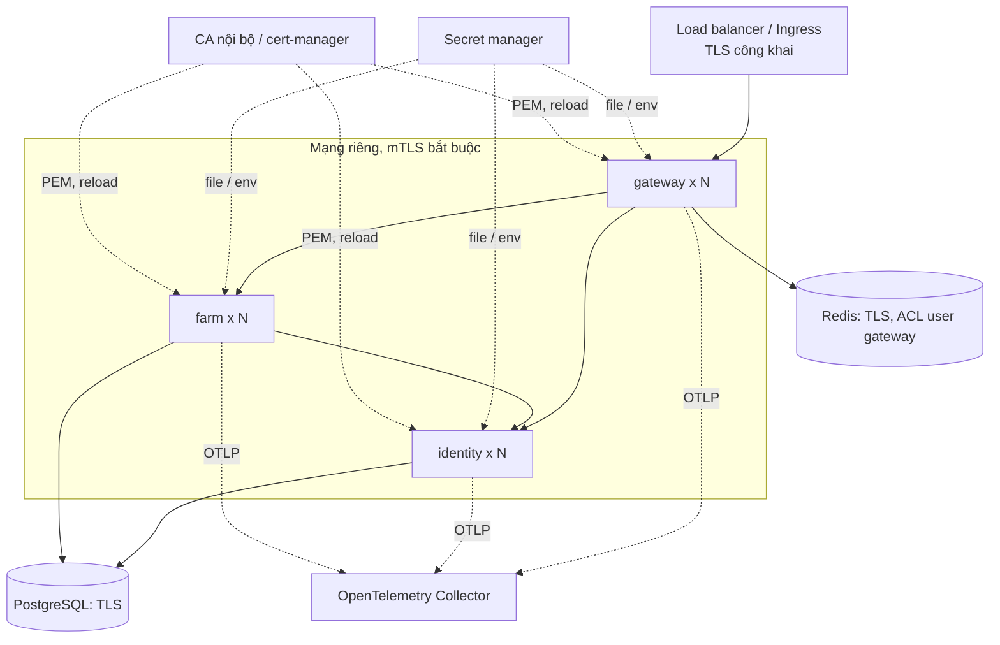

# Triển khai

Phần **Hiện trạng** là thứ có trong repo. Phần **Mục tiêu** là hướng cho production, chưa làm.

## 1. Sơ đồ triển khai mục tiêu

## 2. Redis

| Mục | Hiện trạng | Mục tiêu |
|---|---|---|
| Xác thực | Mật khẩu bắt buộc: gateway `REDIS_PASSWORD`, `compose.yaml` `--requirepass ${REDIS_PASSWORD:-farmverse-dev}` | ACL user riêng, đặt `SPRING_DATA_REDIS_USERNAME`. **Đã kiểm trên Redis 8 thật** (`GatewayRedisIT`): `ACL SETUSER gateway on >… ~farmverse:gateway:* ~request_rate_limiter.* +@read +@write +@keyspace +@scripting +@connection +time -@dangerous` (`farmverse:gateway:*` gồm phiên và bộ đếm đăng nhập theo IP). Cần `+time` vì script Lua của bộ giới hạn gọi `TIME`; thiếu nó, bộ giới hạn **âm thầm cho qua** mọi request (chỉ có log `Error calling rate limiter lua`) |
| TLS | Prod `spring.data.redis.ssl.enabled: ${REDIS_SSL:true}` | Giữ; thêm CA tin cậy qua SSL bundle |
| Timeout | Lệnh `${REDIS_TIMEOUT:2s}`, kết nối `${REDIS_CONNECT_TIMEOUT:1s}` (M3) | Giữ; chỉnh theo độ trễ thật |
| TTL phiên | `${GATEWAY_SESSION_TIMEOUT:30m}`, namespace `farmverse:gateway:session` (M3) | Giữ |
| Fail-closed | Redis lỗi hoặc treo → 503 ProblemDetail `SF-GATEWAY-503` (M3). Treo thật (`docker pause`) trả 503 trong khoảng timeout lệnh (`GatewayRedisIT`). Rate limiter của SCG tự fail-open, nhưng phiên đã bị chặn trước | Giữ |
| Log | Không log nội dung session | Giữ; cấm log mức DEBUG của Lettuce/Session ở prod |
| Mạng | Dev: `127.0.0.1:6379` (M3) | Prod không public |

## 3. PostgreSQL

| Mục | Hiện trạng | Mục tiêu |
|---|---|---|
| Database | `farmverse_identity`, `farmverse_farm` ([`infra/postgres-init.sh`](../../infra/postgres-init.sh)) | Giữ |
| User | Đã có (M4): `<svc>_owner` sở hữu DB + schema; `<svc>_app` chỉ `SELECT/INSERT/UPDATE/DELETE` + dùng sequence (default privileges cho bảng Flyway tạo sau); `PUBLIC` mất `CONNECT`. Biến: `<SVC>_DB_USER`/`_PASSWORD` (app), `<SVC>_DB_MIGRATION_USER`/`_PASSWORD` (owner) | Prod: tạo vai trò bằng cùng script (hoặc tương đương ở DB managed) |
| Migration | Flyway khi khởi động, chạy bằng `<svc>_owner` (`spring.flyway.user`); ứng dụng chạy bằng `<svc>_app`; `ddl-auto: validate` | Có thể tách Flyway thành job riêng để ứng dụng không cần mật khẩu owner |
| TLS | Không cấu hình | `sslmode=verify-full` ở prod |

## 4. mTLS và chứng chỉ

| Mục | Hiện trạng |
|---|---|
| Bundle | `spring.ssl.bundle.pem.farmverse`, `reload-on-update: true` ở cả ba service |
| Danh tính | SAN `spiffe://farmverse/<service>`; allowlist ở `farmverse.mtls.allowed-callers` |
| Cert dev | [`scripts/generate-dev-mtls.sh`](../../scripts/generate-dev-mtls.sh), hạn 30 ngày |
| Prod | CA thật hoặc cert-manager ghi file PEM vào `FARMVERSE_MTLS_DIR`; service tự nạp lại khi file đổi |
| Actuator | Cổng quản trị loopback, HTTP: trên máy gateway `9080`, farm `9082`, identity `9092`; trong container cả ba `9090` |

## 5. Audience của token (M6)

| Biến | Service | Mặc định | Ghi chú |
|---|---|---|---|
| `farmverse.identity.token-audiences` | identity | `farm-service,identity-service` | Danh sách `aud` cấp vào access token |
| `farmverse.identity.accepted-audiences` | identity | `identity-service` | Audience REST quản trị của identity nhận |
| `FARM_ACCEPTED_AUDIENCES` | farm | `farm-service` | Audience farm nhận |

Đổi audience theo đúng thứ tự trong [ADR-0006](adr/0006-per-service-audience.md): mở rộng phía nhận trước, đổi phía cấp sau, đợi hết hạn token (5 phút) rồi thu hẹp.

## 6. Secret

| Secret | Biến | Ghi chú |
|---|---|---|
| Client secret gateway | `GATEWAY_CLIENT_SECRET` | Cùng giá trị ở identity và gateway |
| Khóa ký JWT | `IDENTITY_PRIVATE_KEY_PATH`, `IDENTITY_PUBLIC_KEY_PATH`, `IDENTITY_KEY_ID` | Xoay theo [`key-rotation.md`](../operations/key-rotation.md) |
| Khóa mã hóa TOTP | `IDENTITY_MFA_ENCRYPTION_PASSWORD`, `IDENTITY_MFA_ENCRYPTION_SALT` | Đổi khóa này làm mọi secret TOTP cũ không giải mã được: chưa có quy trình xoay |
| DB | `IDENTITY_DB_*`, `FARM_DB_*` | |
| Redis | `REDIS_PASSWORD` | |
| Key mTLS | file trong `FARMVERSE_MTLS_DIR` | `.gitignore` chặn `*.key`, `*.pem`, `.local` |

Giá trị dev nằm trong `application-dev.yml` và chỉ dùng cho máy dev. `scripts/generate-secret.sh` sinh giá trị ngẫu nhiên.

## 7. Observability

| Mục | Hiện trạng | Mục tiêu |
|---|---|---|
| Health | Actuator `health` + probes trên cổng quản trị loopback ở cả ba (M2) | Kubernetes: probe cần gọi được cổng quản trị. Vì bind loopback, dùng probe kiểu `exec` (`curl` trong container) hoặc đổi `management.server.address` sang IP pod |
| Log JSON | identity prod (ECS) | Cả ba service ở prod |
| Audit | `SECURITY_AUDIT` ở identity | Thêm sự kiện ở gateway (login thành công/thất bại, logout) |
| Trace | Micrometer Tracing + OpenTelemetry, W3C `traceparent` qua gateway (M7). Lấy mẫu `TRACING_SAMPLING_PROBABILITY` (mặc định 0.1, dev 1.0). Xuất khi đặt `MANAGEMENT_OPENTELEMETRY_TRACING_EXPORT_OTLP_ENDPOINT` (vd `http://otel-collector:4318/v1/traces`) | Collector thật (OpenTelemetry Collector → Tempo/Jaeger) |
| Metric | `/actuator/prometheus` trên cổng quản trị (gateway luôn có; farm/identity ở profile `mtls`), thẻ `application` (M7) | Cổng quản trị bind loopback: Prometheus ngoài pod không gọi được. Dùng sidecar/agent trong pod, hoặc đổi `management.server.address` sang IP pod có NetworkPolicy |
| Lọc dữ liệu nhạy cảm | `SecurityAudit`; logger in bí mật ở DEBUG bị ghim INFO; gateway bỏ `Cookie` trước khi chuyển xuống; test ở DEBUG cho cả ba service (ADR-0012) | — |

## 8. Edge TLS và header forwarded

| Mục | Giá trị |
|---|---|
| `GATEWAY_TRUSTED_PROXIES` | IP/CIDR của edge (bắt buộc ở prod; thiếu thì gateway dừng khi khởi động) |
| Edge phải gửi | `X-Forwarded-Proto: https`, `X-Forwarded-Host: <host công khai>`, `X-Forwarded-Port` (hoặc `Forwarded`). **Ghi đè** giá trị trình duyệt gửi, không nối thêm |
| Không dùng | `X-Forwarded-Prefix` (gateway luôn ở `/`) |
| Kiểm sau khi triển khai | Mở `/oauth2/authorization/farmverse`: `redirect_uri` trong `Location` phải là `https://<host công khai>/login/oauth2/code/farmverse`, khớp `GATEWAY_PUBLIC_URL` của identity |
| Kubernetes | Boot tự bật `native` khi thấy Kubernetes; cấu hình đã đặt `server.forward-headers-strategy: none` để chặn việc đó |

## 9. Header bảo mật

| Header | dev | prod |
|---|---|---|
| `Content-Security-Policy` | nới: `'unsafe-inline'` cho script/style, `ws://127.0.0.1:8080` (Vite HMR) | chỉ `'self'`; `form-action 'self' <origin identity>`; `frame-ancestors 'none'` |
| `Strict-Transport-Security` | không | `max-age=31536000` (gateway tự ghi vì thấy HTTP sau edge; không `includeSubDomains`) |
| `Referrer-Policy`, `Permissions-Policy`, `X-Frame-Options`, `X-Content-Type-Options` | có | có |

Đổi CSP: sửa `farmverse.gateway.headers.content-security-policy`. Thêm thư viện tải từ CDN hoặc dùng `eval` sẽ bị chặn ở prod; chạy thử bản build (`npm run build`) qua gateway trước khi phát hành.

## 10. Container

[`Dockerfile`](../../Dockerfile) dùng chung, build theo `SERVICE_PATH` (`platform/api-gateway`, `services/identity-service`, `services/farm-service`), chạy user 1001.

| Mục | Giá trị |
|---|---|
| Cổng ứng dụng | `SERVER_PORT=8080` (TLS ở identity/farm khi `mtls`) — `EXPOSE 8080` |
| Cổng quản trị | `MANAGEMENT_SERVER_PORT=9090`, loopback, không expose. Biến này ghi đè `management.server.port` của từng service |
| Cổng gRPC (identity) | `IDENTITY_GRPC_PORT` (mặc định 9093; **không** dùng 9090, trùng cổng quản trị), `IDENTITY_GRPC_BIND_ADDRESS` (mặc định 127.0.0.1; trong container đặt 0.0.0.0 để farm gọi được). Prod bắt buộc mTLS (ADR-0014) |
| Healthcheck | `curl http://127.0.0.1:9090/actuator/health/readiness` |
| Bắt buộc khi chạy | `*_BIND_ADDRESS=0.0.0.0` (mặc định 127.0.0.1 thì ngoài container không gọi được); các biến trong [`.env.production.example`](../../.env.production.example) |

Đã kiểm (2026-11-04): chạy jar gateway với `SERVER_PORT`/`MANAGEMENT_SERVER_PORT` khác mặc định → readiness 200 trên cổng quản trị, cổng quản trị chỉ ở `127.0.0.1`, cổng công khai không có actuator. Image của 3 service build xanh ở job `image` của CI (run 41835098123). **Chưa** chạy container thật.
