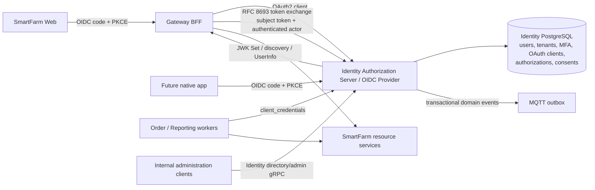

# Identity target: OAuth 2.0 Authorization Server and OpenID Provider

> **Decision status:** Adopted target architecture; implementation has not started.
> **Scope:** Greenfield protocol implementation in the existing Identity bounded context. No legacy auth-endpoint compatibility layer is required. Do not treat this document as evidence that the current service implements OAuth/OIDC.

## Decision

The platform has a browser application, a Gateway, multiple resource servers and machine workers. Its current custom `login`/`refresh` API and JWT signer do not provide interoperable browser authentication, OIDC identity tokens/discovery, or standardized machine grants. Adopt OAuth 2.0 Authorization Server and OpenID Connect Provider capabilities **inside the existing Identity service**, using the Spring Security 7 authorization-server support aligned with the Spring Boot 4.1 / Java 17 baseline.

Do not create a second identity provider service. Account credentials, tenant membership, MFA, authorization policy and OAuth protocol are all part of the same identity/security authority and need one transaction boundary. Keep internal directory, tenant administration and platform authorization RPCs in Identity. Replace custom public token issuance and machine-token transport rather than layering a second token protocol beside them.

OAuth 2.1 is not yet a published RFC; use published OAuth 2.0 Security BCP, OAuth/OIDC specifications and applicable extension RFCs as normative requirements. Treat the OAuth 2.1 draft as direction only.

## Protocol choice by client/use case

| Client/use case | Target flow | Identity/token semantics |
|---|---|---|
| Current SmartFarm browser | OIDC Authorization Code + PKCE (`S256`), preferably through Gateway as a Backend-for-Frontend (BFF) | Browser gets a Secure, HttpOnly, SameSite session cookie; Gateway holds OAuth tokens server-side and calls APIs with audience-restricted access tokens. Do not put refresh tokens in browser storage. |
| Future native mobile client | OIDC Authorization Code + PKCE in the system browser, public client | No embedded user-agent; short-lived access token and rotating or sender-constrained refresh token. |
| Gateway/worker acting as itself | OAuth `client_credentials`; confidential client | Client-only subject, explicitly allowed audience/resource and least-privilege scopes; no user actor claim. Prefer asymmetric client authentication (mTLS or `private_key_jwt`) where operationally supportable. |
| Gateway acting for an authenticated user | OAuth Token Exchange (RFC 8693) | Verify subject token and actor client; delegated output has the user as `sub`, the service actor in `act`, a narrower audience/scope and short expiry. Do not treat a caller-supplied user ID as proof of delegation. |
| Long-running saga/job | Reacquire bounded machine access tokens using the worker client | Never issue bearer access tokens without expiry. Use client credentials at each work boundary or a dedicated job capability with explicit expiry and audience. |

The Gateway is already the public ingress and the web application currently stores refresh tokens in `localStorage`. The target is to change this to a BFF session; if deployment constraints make a BFF impossible, use an OIDC public client with Authorization Code + PKCE, keep access tokens in memory, and never persist refresh tokens in browser-accessible storage.

## Target service boundaries



Identity owns the authorization server protocol and domain policies. Gateway owns browser session/BFF concerns and ingress. Resource services remain OAuth resource servers and validate signature, issuer, expiry and their own audience/scope. The readiness service remains a probe aggregator; it does not own Identity persistence tests or launch/stop services.

## Required protocol behavior

1. **Interactive sign-in:** `/oauth2/authorize` + `/oauth2/token`, authorization code only, state/nonce validation, PKCE `S256`, exact redirect URI allowlists, short-lived one-time codes, and OIDC `openid` scope. Do not enable implicit or resource-owner-password grants.
2. **MFA and tenant selection:** keep existing password, tenant-membership and TOTP policy in Identity. Integrate them as the authorization-server authentication journey: resolve/choose tenant, then complete required MFA/step-up before authorizing the code. Bind challenge state to the authenticated browser session, client, tenant and expiry. Report authentication context with OIDC `auth_time`, `amr`, and `acr` where applicable; the protocol does not itself mandate the platform's MFA policy.
3. **Separate tokens by purpose:** ID token proves authentication to the OIDC client; it is not an API bearer token. Access token is issued for a specific resource/audience and scope. Validate each according to its token type. Expose OIDC discovery, JWKS and UserInfo only after their semantics and claims are implemented and tested.
4. **Machine and delegated access:** OAuth client registration and audience/scope policy replace the custom gRPC `IssueServiceToken` flow. Token Exchange is a separate grant with explicit trusted actor clients, accepted subject-token types, tenant binding and grant policy. Never turn client credentials into a user identity or silently widen user scope.
5. **Refresh, logout and revocation:** persist authorization and refresh-token state in Identity storage; rotate refresh tokens for public clients (or use a proven sender-constrained alternative), detect reuse and revoke the token family. Logout ends the browser session and revokes refresh grants. Stateless access tokens remain valid to `exp` unless a resource-side revocation/version check is deliberately retained; document this limit.
6. **Bounded credentials:** every access token, including tokens used by asynchronous workers, has an explicit short expiry and audience. Resource servers must reject tokens with absent/expired `exp`; remove the `is_async && exp == null` exception.
7. **Key and client security:** persist registered clients and authorization state using versioned schema; keep signing keys outside source/resources, support overlapping `kid` rotation, and use confidential-client authentication for machine callers. Store no client secrets in plaintext. Define access-token and refresh-token persistence/at-rest protection deliberately.
8. **Claims and resource-server contracts:** standard claims first (`iss`, `sub`, `aud`, `iat`, `exp`, `scope`, `client_id`, OIDC claims). Keep SmartFarm extensions minimal and namespaced/documented (`tenant_id`, authorization version, token type if genuinely needed). Tenant is not a mandatory claim for every OAuth token: machine-only tokens may have no tenant unless the grant is explicitly tenant-bound. The current global validator's mandatory tenant and `identity_claims_version` assumptions must become grant/resource-profile-aware.

## Clean implementation structure

Keep the existing service and domain data. Replace only the custom authentication/token surface:

```text
identity/
  protocol/
    authorizationserver/  # Spring Security 7 protocol configuration and converters/providers
    oidc/                 # OIDC claims, UserInfo, discovery/logout policy
    tokenexchange/        # RFC 8693 request validation and delegation policy
  authentication/
    credentials/          # account password validation and login lockout
    tenant/               # tenant selection and membership binding
    mfa/                  # challenge-bound TOTP/recovery and step-up
  authorization/
    clients/              # registered OAuth client and audience/scope policy
    grants/               # code, client_credentials and exchange grant policy
    persistence/          # authorization, consent and refresh token records
  administration/         # existing internal gRPC directory/admin policy
  messaging/              # existing transactional domain events/outbox
```

The Identity service now uses Spring Security 7 authorization-server support (resolved as `spring-security-oauth2-authorization-server:7.1.1` under the Spring Boot 4.1.1 baseline). Registered-client/authorization/consent persistence and migration V4 are in Identity. Keep this protocol state here; do not duplicate accounts or move it into Gateway. PostgreSQL migration behavior and end-to-end interoperability remain release gates.

## Current implementation replacement map

| Current surface | Target replacement | Work required |
|---|---|---|
| `AuthController.login`, `AuthService.login` | Authorization endpoint + an Identity user-authentication provider/journey | Remove custom token-returning login; retain credential, tenant and lockout policy behind the provider. |
| `AuthController.verifyMfa`, MFA enrollment HTTP handlers | Session/challenge-bound MFA in authorization flow; internal credential administration as appropriate | Preserve TOTP security; return authorization code only after policy succeeds. Add step-up context claims. |
| `AuthController.refresh/logout`, `JpaRefreshSessionAdapter` | OAuth authorization/refresh grant persistence and OIDC logout/session policy | Reuse the security invariants (hashed refresh secret, family rotation/replay revocation) via a Spring Security 7 persistence integration; delete legacy route/schema after callers move. |
| `TokenService`, `NimbusUserTokenSigner`, `TokenGrantFacade` | Authorization-server token generation, JWK source and token customizer | Keep RS256 only if operationally desired; add multi-key rotation; separate ID/access tokens; delete duplicate signer path. |
| `ServiceTokenService.issue`, `IdentityTokenService.IssueServiceToken` | `/oauth2/token` with `client_credentials` | Register gateway/order/reporting as confidential clients, use allowlisted audience/scope and standard client authentication. |
| `ServiceTokenService.issue(... actorId ...)`, `ExchangeDelegatedToken` gRPC | RFC 8693 token-exchange grant | Require verified `subject_token` and authenticated actor; correct semantics to `sub=user`, `act.sub=service`; update every resource-service claim consumer. |
| `is_async`, exp-less async JWT, `SmartFarmJwtValidator` exception | Bounded machine tokens and profile-aware resource-server validation | Remove exp-less token issuance and validation exception; workers reacquire credentials. |
| `/.well-known/jwks.json` hand-built endpoint | Spring Authorization Server JWK Set and OIDC discovery | Remove duplicate/non-standard endpoint wiring once standard endpoint is active; publish stable issuer metadata. |
| `AuthProxyController`, browser token storage (`apps/smartfarm-web/src/lib/api.ts`, `auth.tsx`) | Gateway OAuth2 client/BFF callback and server-side token/session handling | Replace password JSON proxy, localStorage refresh token and client-managed refresh with browser redirect + secure session cookie. |
| `identity.proto` `IdentityTokenService` | OAuth token endpoint for grants; keep directory/admin gRPC | Update Gateway/Order/Reporting clients together; no compatibility shim is required for this in-development platform. Preserve directory/admin gRPC unless separately versioned. |

## Rollout and clean-start policy

This is a new, coordinated protocol implementation, not an incremental dual-stack deployment. Do not add compatibility endpoints or preserve custom token formats solely for old in-development clients. Update Gateway, Web, Identity, all resource-server claim validation, workers, docs and contract tests in one change sequence. Once implementation is ready, start with an empty development Identity database and apply the new Flyway baseline; there is no data-backup or old-token migration requirement. Never run schema deletion against a shared or production database as part of ordinary build/test commands.

Implementation order:

1. Lock protocol/client inventory and audience/scope matrix; add/verify Boot 4.1 + Security 7 authorization-server dependencies.
2. Implement registered-client, authorization/consent persistence and OIDC Authorization Code + PKCE with tenant/MFA journey; validate discovery and OIDC conformance.
3. Convert Gateway to BFF and Web to redirect/session behavior; remove refresh tokens from browser storage.
4. Migrate client credentials and RFC 8693 exchange; update all resource servers for standard claims and short-lived exp-bearing tokens; remove exp-less async tokens.
5. Remove custom auth/token endpoints, duplicate signer and legacy refresh/session storage; retain account/MFA/RBAC/admin/outbox domain features.
6. Run unit and PostgreSQL integration suites, protocol interoperability tests, negative security tests, and a real Termux runtime smoke check owned by platform operations.

## Standards and framework references

- [RFC 9700 — Best Current Practice for OAuth 2.0 Security](https://www.rfc-editor.org/rfc/rfc9700.html)
- [RFC 7636 — Proof Key for Code Exchange (PKCE)](https://www.rfc-editor.org/rfc/rfc7636.html)
- [RFC 6749 — OAuth 2.0 Authorization Framework](https://www.rfc-editor.org/rfc/rfc6749.html)
- [RFC 8252 — OAuth 2.0 for Native Apps](https://www.rfc-editor.org/rfc/rfc8252.html)
- [RFC 8693 — OAuth 2.0 Token Exchange](https://www.rfc-editor.org/rfc/rfc8693.html)
- [RFC 8176 — Authentication Method Reference Values](https://www.rfc-editor.org/rfc/rfc8176.html)
- [RFC 9470 — Step-Up Authentication Challenge Protocol](https://www.rfc-editor.org/rfc/rfc9470.html)
- [OpenID Connect Core 1.0](https://openid.net/specs/openid-connect-core-1_0.html)
- [OAuth 2.1 Internet-Draft status](https://datatracker.ietf.org/doc/draft-ietf-oauth-v2-1/)
- [Spring Authorization Server migration to Spring Security 7](https://spring.io/blog/2025/09/11/spring-authorization-server-moving-to-spring-security-7-0/)
- [Spring Security 7 Authorization Server reference](https://docs.spring.io/spring-security/reference/servlet/oauth2/authorization-server/index.html)
