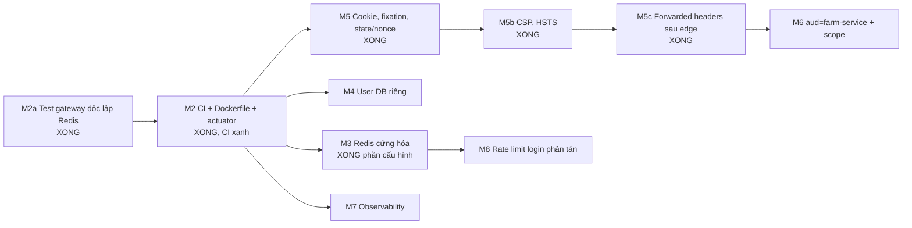

# Roadmap chuyển đổi

Mỗi milestone nhỏ, độc lập, có test và rollback. Không làm hai milestone trong một lần.

| M | Ưu tiên | Việc | Phụ thuộc | Test chứng minh | Rollback | Xong khi |
|---|---|---|---|---|---|---|
| **M2a** ✅ | P2 | Test gateway dùng kho session trong bộ nhớ, không cần Redis ([ADR-0007](adr/0007-hermetic-gateway-tests.md)) | — | `REDIS_PORT=1 mvn test` xanh; bỏ cấu hình test thì 2 test đỏ (đối chứng); `sessionStoreInTestsIsInMemory` | Xóa `InMemorySessionTestConfiguration` + `@Import` | Xong 2026-11-04 |
| **M2** ✅ | P1 | GitHub Actions `mvn -B verify` + `docker build` 3 service; gateway actuator sang cổng quản trị loopback ([ADR-0008](adr/0008-gateway-management-port.md)); healthcheck/`EXPOSE` của `Dockerfile`; dọn `.env.production.example` | M2a | `GatewayActuatorExposureTest` (đỏ trước khi sửa, xanh sau); `mvn verify` xanh; chạy jar với biến container | Revert `ci.yml`, `Dockerfile`, khối `management`, `.env.production.example` | Xong 2026-11-04; CI lần đầu xanh (run 41835098123) |
| **M3** ✅ | P1 | Redis (`*IT` Testcontainers: `GatewayRedisIT`, xong 2026-11-04): bật lại mật khẩu dev, bind `127.0.0.1`; khai `spring.data.redis.timeout`, `spring.session.timeout`, namespace; 503 ProblemDetail khi Redis lỗi; tài liệu ACL prod | M2 (cần bạn chốt D8) | Test: Redis lỗi → 503, không cho qua; test cấu hình timeout | Revert cấu hình | Fail-closed có test |
| **M4** ✅ | P1 | Script tạo `<svc>_owner`/`<svc>_app`, `REVOKE` chéo; dev dùng user riêng | M2 | `*IT` Testcontainers: farm user không connect được DB identity | Revert script; dev quay lại `postgres` | IT xanh ở CI |
| **M5** ✅ | P2 | Test session fixation, thuộc tính cookie, `state`/`nonce`/PKCE bằng luồng đăng nhập thật với identity giả | M2 | `LoginSessionSecurityTest` (5), `SessionCookieAttributesTest` (3); đối chứng: tắt đổi id phiên → 2 test đỏ | Xóa test (chỉ thêm test, không đổi code chính) | R2, R3, R5 ✅ — xong 2026-11-04 |
| **M5b** ✅ | P2 | Header CSP (theo profile), HSTS (prod), Referrer/Permissions-Policy ([ADR-0010](adr/0010-security-headers.md)) | M5 | `SecurityHeadersTest` (5; đỏ trước khi sửa); Chrome headless: SPA bản build qua gateway 0 lỗi CSP, đối chứng dương tính bắt được script nhúng; Vite dev qua gateway 0 lỗi | Revert khối `headers` trong `SecurityConfiguration` + yml | Xong 2026-11-04 |
| **M5c** ✅ | P1 | Gateway chỉ tin `X-Forwarded-*` từ edge đã khai, để `redirect_uri` đúng `https://` (P1-5, [ADR-0011](adr/0011-trusted-proxy-forwarded-headers.md)) | M5b | `ForwardedHeadersTest` (4; 3 đỏ trước khi sửa): `redirect_uri` công khai, đăng nhập trọn vẹn qua edge, header giả bị bỏ, `native` tắt; `TrustedProxyForwardedHeaderTransformerTest` (6): CIDR v4/v6, xóa header, prod thiếu cấu hình thì dừng | Xóa bean `forwardedHeaderTransformer` + 2 thuộc tính | Xong 2026-11-04; còn thử với load balancer thật |
| **M6** ✅ (bước 1) | P1 | Audience riêng `farm-service` ([ADR-0006](adr/0006-per-service-audience.md)), giai đoạn chuyển tiếp chấp nhận cả hai; farm kiểm `scope`; test JWKS đổi khóa ở farm | M5 | Token `aud` khác → 401; thiếu scope → 403; khóa mới → vẫn 200 | Farm chấp nhận lại `farmverse-api` (cờ cấu hình) | Không còn token chung |
| **M7** ✅ | P2 | Micrometer Tracing + OTLP, log JSON cả ba service, test log không chứa token/cookie ([ADR-0012](adr/0012-observability.md)) | M2 | `GatewayObservabilityTest` (4), `FarmObservabilityTest` (2), `IdentityObservabilityTest` (2): trace id lan qua gateway, có trong log; ở DEBUG không có cookie/token/mã/mật khẩu trong log (bắt được 3 logger in bí mật và cookie bị chuyển xuống service, đã sửa); jar thật gửi span tới collector OTLP giả | Xóa dependency + khối `management.tracing` | Xong 2026-11-04; còn collector/Prometheus thật |
| **M8** ✅ | P2 | Rate limit login ở identity dùng bộ đếm chung: chọn PostgreSQL (identity đã có, không thêm Redis); không đẩy lên gateway vì form login gửi thẳng tới identity | M3 | `LoginRateLimitPostgresIT` (6, PostgreSQL thật): hai instance chung một giới hạn, lần 4 bị chặn ở instance khác, 40 request đồng thời không mất lần nào, cửa sổ hết hạn, dọn dòng cũ; `LoginRateLimitFilterTest`: bộ đếm lỗi → 503 | `farmverse.identity.rate-limit.store=memory` | Xong 2026-11-04 |

## Tiêu chí chung cho mỗi milestone

1. `mvn -B test` xanh trước và sau.
2. Không đổi public API REST, không đổi schema trừ khi milestone ghi rõ và đã duyệt.
3. Tài liệu trong `docs/architecture/` cập nhật cùng thay đổi (trạng thái ✅/🟡/⬜).
4. Rollback bằng `git revert` một commit.

## Nhật ký

| Ngày | Milestone | Kết quả |
|---|---|---|
| 2026-11-04 | — | Nghi vấn P0 actuator `gateway` bị loại bằng request thật; hạ thành P3-4 |
| 2026-11-04 | M2a | Xong. 62 test xanh với Redis trỏ cổng chết |
| 2026-11-04 | M2 | Xong local. 66 test xanh (`mvn verify`). CI và image chưa chạy vì chưa push |
| 2026-11-04 | M3 | Cấu hình + 503 fail-closed xong, 72 test xanh. Còn `*IT` với Redis thật và ACL thật |
| 2026-11-04 | M5 | Xong, chỉ thêm test. 80 test xanh. Không tìm thấy lỗi: Spring đã đổi id phiên mặc định |
| 2026-11-04 | M5b | Xong. 85 test xanh. Phát hiện P1-5 (forwarded headers) |
| 2026-11-04 | M5c | Xong. 95 test xanh |
| 2026-11-04 | M2 | CI lần đầu trên GitHub: `mvn verify` + 3 `docker build` xanh |
| 2026-11-04 | IT Docker | Failsafe ở pom gốc; IT PostgreSQL (identity, farm) và Redis (gateway). IT bắt được 2 lỗi thật: Redis treo trả 500 (Lettuce reactive ném lỗi gốc), ACL thiếu `+time` làm bộ giới hạn âm thầm tắt |
| 2026-11-04 | G5 | Giới hạn đăng nhập theo IP. 110 unit + 19 IT xanh |
| 2026-11-04 | M4 | Vai trò owner/app cho từng service, IT Postgres chạy bằng vai trò app. Đối chứng: bỏ REVOKE thì `DatabaseRolesIT` đỏ |
| 2026-11-04 | M6 | `aud` theo service, farm đòi scope, test token ký thật + JWKS cache/xoay khóa. 122 unit + 19 IT xanh |
| 2026-11-04 | G2 + G3 (timeout) | Lỗi gateway thành ProblemDetail, timeout mọi profile. 105 test xanh. Circuit breaker làm sau (xong cùng ngày, `CircuitBreakerTest`) |
