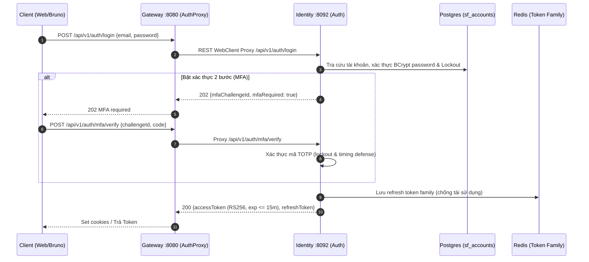
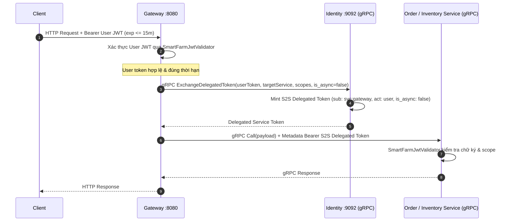
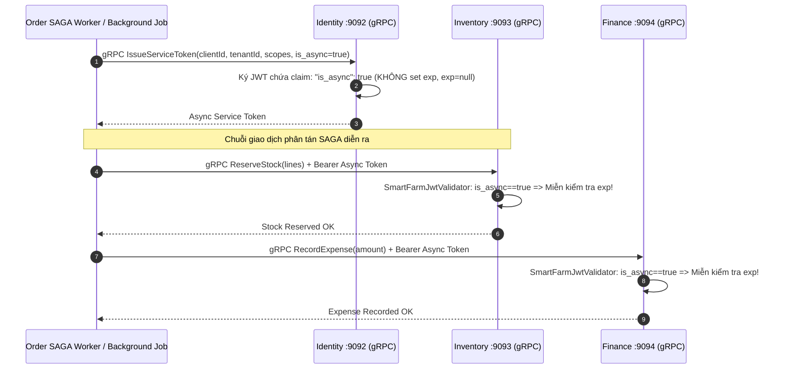
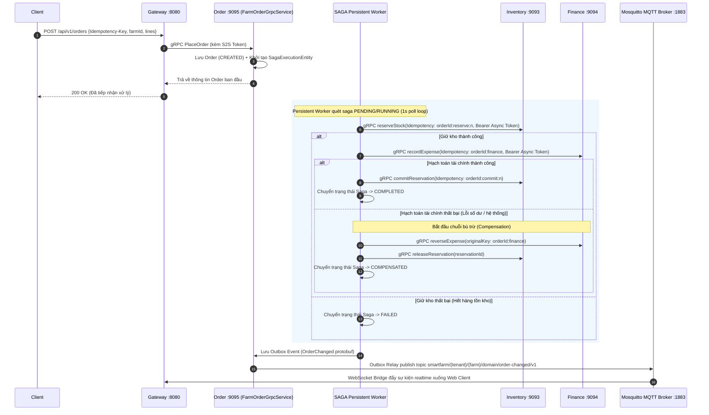
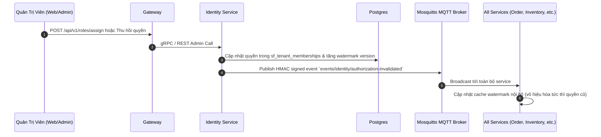

# Request Flows — SmartFarm Platform

> **Chuẩn hóa:** 2026-10-16  
> **Nguyên tắc:** Dùng sequence diagram trực quan, tinh giản giải thích; thể hiện chuẩn mô hình Hai Tầng Xác Thực (Two-Tier Auth) và Token Bất Đồng Bộ (Async Token) phục vụ SAGA/MQTT.

---

## 1. Xác Thực Đăng Nhập & Cấp Phát User Token (Client → Gateway → Identity)

- **Đặc tính Token Tầng 1 (User Token):** RS256, thời hạn ngắn ($\le 15$ phút), mang định danh người dùng (`sub`), vai trò (`roles`), quyền hạn (`scopes`) và tenant (`tenant_id`).

---

## 2. Mô Hình Xác Thực 2 Tầng (Two-Tier Auth) & Trao Đổi Service Token (S2S)

Để bảo vệ các microservice nghiệp vụ nội bộ khỏi nguy cơ lạm dụng token người dùng và tránh phụ thuộc vào thời hạn ngắn của User Token khi xử lý sâu trong chuỗi dịch vụ:

- **Tầng Ngoài (Client → Gateway):** Kiểm tra nghiêm ngặt `exp`, chữ ký và tenant scope.
- **Tầng Trong (Gateway → Services):** Sử dụng Delegated Token hoặc Machine Token được cấp từ Identity để bảo đảm cô lập danh tính hạ tầng.

---

## 3. Cấp Phát & Sử Dụng Token Bất Đồng Bộ (Async Token cho SAGA & Worker)

Các luồng xử lý nền (SAGA retry, Batch job, MQTT subscriber) có thể kéo dài qua nhiều giờ mà không có tương tác trực tiếp của người dùng. Để không bị đứt gãy luồng do token hết hạn (`TokenExpiredException`), Identity cấp phát Async Token riêng:

- **Đặc tính Token Bất Đồng Bộ:**
  - Claim `is_async: true`.
  - Claim `exp`: không tồn tại (`null`).
  - `SmartFarmJwtValidator` trong `libs/smartfarm-security` tự động bỏ qua kiểm tra `missing_expiry` khi phát hiện `is_async=true`.

---

## 4. Chuỗi Giao Dịch Phân Tán (SAGA PlaceOrder: Forward & Compensation)

---

## 5. Luồng Cập Nhật & Thu Hồi Quyền Tức Thời (Realtime Watermark Invalidation)

---

← [System Overview](./system-overview.md) · [Service Communications](./service-communications.md) · [Documentation Index](../index.md)
