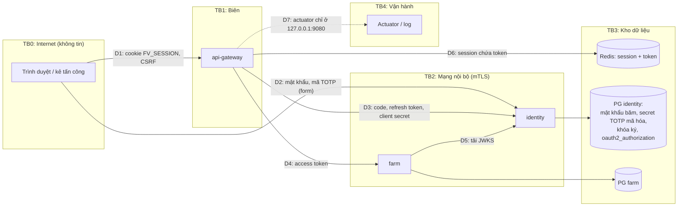

# Mô hình đe dọa

Phương pháp: STRIDE theo từng ranh giới tin cậy. Trạng thái biện pháp dựa trên code ngày 2026-11-04.

## 1. Ranh giới tin cậy và luồng dữ liệu

## 2. Tài sản

| Tài sản | Nơi ở | Hậu quả nếu lộ |
|---|---|---|
| Access/refresh token | Redis (session), `oauth2_authorization` ở identity | Mạo danh người dùng tới hết hạn refresh (14 ngày) |
| Cookie `FV_SESSION` | Trình duyệt | Chiếm phiên |
| Khóa ký JWT | File PEM do `IDENTITY_PRIVATE_KEY_PATH` trỏ tới | Tự cấp token bất kỳ |
| Secret TOTP | `user_totp` (mã hóa) + khóa `IDENTITY_MFA_ENCRYPTION_*` | Vượt 2FA |
| Mật khẩu | băm trong `user_account` | Dò offline |
| Client secret gateway | biến `GATEWAY_CLIENT_SECRET` | Đổi code/refresh thay gateway (vẫn cần code/refresh) |
| Key mTLS | `FARMVERSE_MTLS_DIR` | Giả làm service nội bộ |
| Dữ liệu farm theo tenant | PG farm | Lộ dữ liệu khách hàng |
| Cấu hình route gateway | bộ nhớ gateway | Chuyển hướng lưu lượng, SSRF |

## 3. Mối đe dọa và biện pháp

| # | Ranh giới | STRIDE | Mối đe dọa | Biện pháp hiện có | Còn thiếu |
|---|---|---|---|---|---|
| T1 | TB0→TB1 | S | Đánh cắp token qua XSS | Token không ở trình duyệt; cookie `HttpOnly` | CSP (M5) |
| T2 | TB0→TB1 | T | CSRF lên `/api/**`, `/logout` | CSRF cookie + header/field | — |
| T3 | TB0→TB1 | S | Session fixation | Đổi id phiên khi đăng nhập, id cũ vô dụng (`LoginSessionSecurityTest`) | — |
| T4 | TB0→TB1 | I | Cookie đi qua HTTP | `Secure` ở prod, có test khóa cấu hình | HSTS (M5b) |
| T5 | TB0→TB1 | I | Dò thông tin vận hành qua `/actuator/**` ẩn danh | Cổng quản trị loopback (M2); endpoint `gateway` không bật; `GatewayActuatorExposureTest` | — |
| T6 | TB0→ID | S | Dò mật khẩu / mã TOTP | Khóa tài khoản, giới hạn IP, chống replay TOTP | Giới hạn IP phân tán (M8) |
| T7 | TB0→ID | S | Giả mạo redirect, đánh cắp code | redirect URI chính xác, PKCE bắt buộc, `state` | — |
| T8 | TB1→TB2 | S | Máy lạ gọi farm/identity | mTLS + allowlist SAN | — |
| T9 | TB2 | E | Token cấp cho API này dùng ở API khác | `aud=farmverse-api` | Audience riêng (M6) |
| T10 | TB2 | S | Token giả | Kiểm chữ ký bằng JWKS, `iss`, `exp`, `nbf`, `aud` | — |
| T11 | TB2 | E | Người tenant A đọc dữ liệu tenant B | `@TenantId` từ claim, `TenantIsolationTest` | — |
| T12 | TB2 | E | Người cùng tenant đọc farm của người khác | Chỉ `perms` | Ownership (chưa có yêu cầu) |
| T13 | TB1→TB3 | I | Đọc session (token) trong Redis | Mật khẩu bắt buộc (dev + prod), cổng dev chỉ `127.0.0.1`, TLS prod, namespace riêng | ACL user riêng (hướng dẫn ở [deployment.md](deployment.md)) |
| T14 | TB1→TB3 | D | Redis treo làm gateway treo | Timeout lệnh 2s, kết nối 1s; lỗi → 503 nhanh (`RedisSessionHardeningTest`) | Test Redis treo thật (không chỉ từ chối kết nối) cần Testcontainers |
| T15 | TB2→TB3 | E | Farm bị chiếm đọc DB identity | DB riêng | User riêng, không superuser (M4) |
| T16 | TB4 | I | Token, mã, cookie lọt vào log | `SecurityAudit` làm sạch; quy tắc cấm | Test lọc log cho gateway/farm (M7) |
| T17 | TB2 | R | Không truy được ai làm gì | Audit ở identity | Trace id xuyên service (M7) |
| T18 | TB2 | D | Identity sập | Farm vẫn kiểm JWT bằng JWKS cache | — |

## 4. Rủi ro P0-P3

| Mức | # | Vấn đề | Bằng chứng | Milestone |
|---|---|---|---|---|
| P0 | — | **Không tìm thấy P0.** Nghi vấn ban đầu "actuator `gateway` lộ ra ngoài" đã bị loại bằng request thật: endpoint không bật | — | — |
| P1 | P1-1 | ~~Redis dev không mật khẩu~~ **Đã sửa (M3)**: `compose.yaml` dùng `REDIS_PASSWORD`, cổng chỉ `127.0.0.1` | [`compose.yaml`](../../compose.yaml) | M3 ✅ |
| P1 | P1-2 | Một audience chung `farmverse-api` cho mọi resource server | `FarmVerseTokenCustomizer`, `FarmVerseClaims.API_AUDIENCE` | M6 |
| P1 | P1-3 | Dev dùng superuser `postgres` cho cả hai service; chưa có script user riêng | `application-dev.yml` hai service, `infra/postgres-init.sql` | M4 |
| P1 | P1-4 | ~~Không có CI~~ **Đã có workflow (M2)**; còn chờ lần chạy đầu trên GitHub | [`ci.yml`](../../.github/workflows/ci.yml) | M2 ✅ (chờ xác nhận) |
| P2 | P2-1 | Farm không kiểm `scope` | `FarmController` | M6 |
| P2 | P2-2 | ~~Chưa có test session fixation, cookie, `state`/`nonce`~~ **Đã có (M5)** | `LoginSessionSecurityTest`, `SessionCookieAttributesTest` | M5 ✅ |
| P2 | P2-3 | Không có CSP/HSTS tùy chỉnh ở gateway | `SecurityConfiguration` | M5b |
| P3 | P3-5 | Cookie `XSRF-TOKEN` không đặt `SameSite` riêng (mặc định trình duyệt: Lax). Cố ý không `HttpOnly` để SPA đọc | `SecurityConfiguration#security` | M5b |
| P2 | P2-4 | ~~Redis chưa khai TTL, timeout~~ **Đã sửa (M3)** | gateway `application.yml`, `RedisSessionHardeningTest` | M3 ✅ |
| P2 | P2-5 | Không tracing/metric; log JSON chỉ ở identity prod | các `pom.xml`, `application-prod.yml` | M7 |
| P2 | P2-6 | ~~2 test gateway cần Redis thật~~ **Đã sửa (M2a, 2026-11-04)** | [`InMemorySessionTestConfiguration`](../../platform/api-gateway/src/test/java/com/htv/farmverse/gateway/InMemorySessionTestConfiguration.java) | M2a ✅ |
| P2 | P2-7 | ~~Healthcheck `Dockerfile` sai cổng~~ **Đã sửa (M2)**: dùng `MANAGEMENT_SERVER_PORT=9090`. Đã kiểm bằng chạy jar với biến của container; chưa build image thật (máy không có Docker) | [`Dockerfile`](../../Dockerfile) | M2 ✅ |
| P2 | P2-8 | Giới hạn IP login chỉ đúng với một instance | `LoginRateLimitFilter` | M8 |
| P3 | P3-1 | ~~`.env.production.example`, `EXPOSE` lỗi thời~~ **Đã sửa (M2)** | [`.env.production.example`](../../.env.production.example), `Dockerfile` | M2 ✅ |
| P3 | P3-2 | README identity là bản cũ | [`services/identity-service/README.md`](../../services/identity-service/README.md) | M2 |
| P3 | P3-3 | Cảnh báo `@Valid` trên List khi gateway khởi động | log test gateway | — |
| P3 | P3-4 | ~~Actuator mở trên cổng công khai 8080~~ **Đã sửa (M2)** | [`application.yml`](../../platform/api-gateway/src/main/resources/application.yml), `GatewayActuatorExposureTest` | M2 ✅ |
