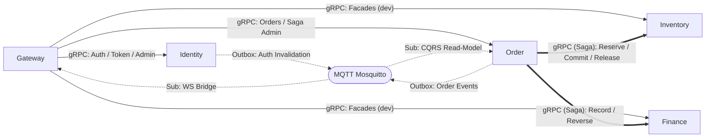

# Ma Trận Giao Tiếp Dịch Vụ — SmartFarm Platform

> **Chuẩn hóa:** 2026-10-16  
> **Nguyên tắc:** Dùng bảng thống kê và biểu đồ luồng; loại bỏ text dư thừa; phân định rành mạch giữa giao tiếp đồng bộ (Sync - gRPC/REST) và bất đồng bộ (Async - MQTT/SAGA).

---

## 1. Sơ Đồ Ma Trận Giao Tiếp Tổng Thể

---

## 2. Bảng Ma Trận Giao Tiếp Giữa Các Dịch Vụ (Service-to-Service Matrix)

| Nguồn (From) | Đích (To) | Giao Thức | Endpoint / Action | Cơ Chế Bảo Mật & Xác Thực | Mục Đích Nghiệp Vụ |
|---|---|:---:|---|---|---|
| **Client** | **Gateway** | HTTP / WS | `/api/v1/*`, `/graphql`, `/ws` | Public hoặc Bearer User JWT (`exp <= 15m`) | Ingress cho Web App và Mobile/CLI |
| **Gateway** | **Identity** | REST (HTTP) | `/api/v1/auth/*` | Public / Basic Proxy qua WebClient | Đăng ký, Đăng nhập, MFA Verify, Refresh |
| **Gateway** | **Identity** | gRPC | `IdentityTokenService`, `IdentityAdmin*` | S2S Machine Token (`client_id=gateway`) | Đổi Delegated Token, Quản trị Roles & Users |
| **Gateway** | **Order** | gRPC | `FarmOrderService`, `OrderSagaAdmin*` | Delegated Service Token (`sub=svc:gateway`) | Tạo draft, Submit đơn, Quản trị SAGA |
| **Gateway** | **Inventory** | gRPC | `InventoryService` | Delegated Service Token | Tra cứu tồn kho, Quản lý kho hàng |
| **Gateway** | **Finance** | gRPC | `FarmFinanceService` | Delegated Service Token | Tra cứu thu chi, Báo cáo dòng tiền |
| **Gateway** | **Livestock** | gRPC | `LivestockRegistryService`, `TaskService` | Delegated Service Token | Đăng ký vật nuôi, Giao nhiệm vụ chăm sóc |
| **Gateway** | **Health** | gRPC | `AnimalHealthService` | Delegated Service Token | Hồ sơ bệnh án, Khám chữa, Tiêm phòng |
| **Gateway** | **Reporting** | gRPC | `ReportingService` | Delegated Service Token | Yêu cầu kết xuất báo cáo dữ liệu |
| **Order (Saga)** | **Inventory** | gRPC | `ReserveStock`, `CommitReservation`, `ReleaseReservation` | Async Service Token (`is_async=true`) | Giữ chỗ kho, Xác nhận xuất kho, Hoàn kho khi hủy |
| **Order (Saga)** | **Finance** | gRPC | `RecordExpense`, `ReverseExpense` | Async Service Token (`is_async=true`) | Hạch toán chi phí đơn, Hoàn tiền khi hủy |
| **Identity** | **MQTT Broker** | MQTT | `events/identity/authorization-invalidated` | Message HMAC Envelope (ký ứng dụng) | Phát tán sự kiện thu hồi token/phiên tức thời |
| **Order** | **MQTT Broker** | MQTT | `smartfarm/{tenant}/{farm}/domain/order/v1` | Protobuf `DomainEvent` | Thông báo đơn hàng tạo/thay đổi trạng thái |
| **MQTT Broker** | **Gateway** | MQTT | `smartfarm/+/+/domain/#` | MQTT Subscription | Đẩy sự kiện realtime tới Web qua WebSocket bridge |
| **MQTT Broker** | **Order** | MQTT | `smartfarm/{tenant}/{farm}/domain/order/v1` | MQTT Subscription (CQRS Consumer) | Cập nhật Read-Model Projection của đơn hàng |

---

## 3. Quy Tắc Giao Tiếp An Toàn (Security & Idempotency Rules)

1. **Ủy Quyền Service-to-Service (S2S Delegation):**
   - Không chuyển tiếp raw User Token vào mạng nội bộ.
   - Gateway luôn gắn token do Identity cấp phát, mang `client_id=gateway` và người dùng thực hiện qua claim `act` (`act.sub = user_id`).
2. **Khóa Chống Trùng Lặp (Idempotency Key):**
   - Mọi thao tác ghi (POST/PUT/Saga step) qua gRPC đều bắt buộc mang `idempotency_key` trong `RequestContext`.
   - Cấu trúc key trong Saga: `orderId + ":" + stepKey` (Ví dụ: `ORD-123:reserve:1`, `ORD-123:finance`).
3. **Phân Biệt Rõ Luồng Đồng Bộ & Bất Đồng Bộ:**
   - **Đồng bộ (REST / gRPC User-facing):** Bắt buộc có thời hạn ngắn $\le 15$ phút, timeout gRPC mặc định 5s.
   - **Bất đồng bộ (Saga / MQTT Workers):** Sử dụng Async Token (`is_async=true`), không ràng buộc thời hạn hết hạn ngắn để đảm bảo worker retry và hàng đợi không bị gãy giữa chừng.
