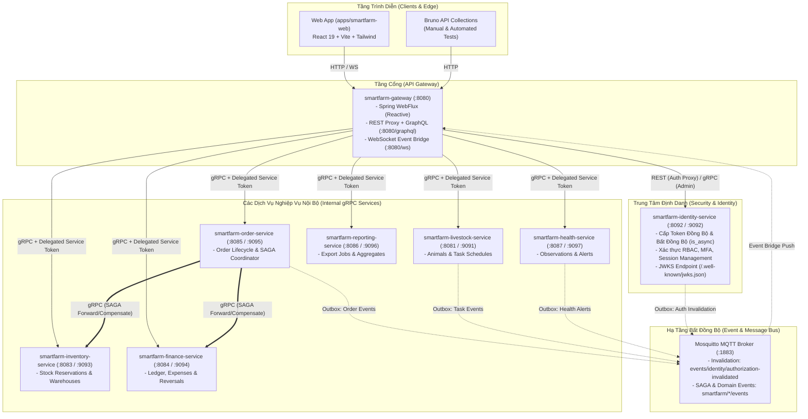
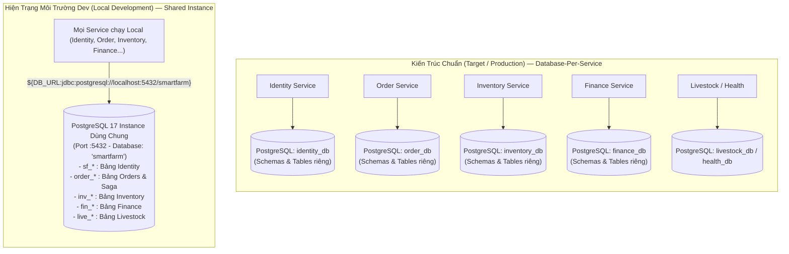

# Tổng Quan Kiến Trúc Hệ Thống — SmartFarm Platform

> **Chuẩn hóa:** 2026-10-16  
> **Nguyên tắc:** Sử dụng biểu đồ trực quan (Mermaid) và bảng thống kê; thông tin cô đọng, dễ tích hợp và mở rộng; nguồn mã nguồn làm chuẩn duy nhất.

---

## 1. Cấu Trúc Liên Kết Tinh Giản Của Hệ Thống (Service Interconnection)

---

## 2. Bảng Ma Trận Công Nghệ (Tech Stack Matrix)

Bảng phân bổ công nghệ cốt lõi trên từng service và thư viện trong toàn bộ dự án:

| Module / Service | Spring Boot 4 | Spring gRPC | Spring WebFlux | Spring Data JPA | PostgreSQL (Shared Dev / Dedicated Prod) | Flyway Migration | Mosquitto MQTT | React 19 / Vite | Protobuf v3 | Spring Security / JWT |
|---|:---:|:---:|:---:|:---:|:---:|:---:|:---:|:---:|:---:|:---:|
| `smartfarm-web` | — | — | — | — | — | — | — | ✅ | — | ✅ (Token Client) |
| `smartfarm-gateway` | ✅ | ✅ (Client) | ✅ | — | — | — | ✅ (Sub/WS) | — | ✅ | ✅ (Resource Server) |
| `smartfarm-identity-service` | ✅ | ✅ (Server) | — | ✅ | ✅ | ✅ | ✅ (Outbox/Inbox)| — | ✅ | ✅ (Issuer/JWKS) |
| `smartfarm-order-service` | ✅ | ✅ (Server/Client) | — | ✅ | ✅ | ✅ | ✅ (Outbox/CQRS) | — | ✅ | ✅ (Resource Server) |
| `smartfarm-inventory-service` | ✅ | ✅ (Server) | — | ✅ | ✅ | ✅ | ✅ (Sub) | — | ✅ | ✅ (Resource Server) |
| `smartfarm-finance-service` | ✅ | ✅ (Server) | — | ✅ | ✅ | ✅ | — | — | ✅ | ✅ (Resource Server) |
| `smartfarm-livestock-service` | ✅ | ✅ (Server) | — | ✅ | ✅ | ✅ | ✅ (Outbox) | — | ✅ | ✅ (Resource Server) |
| `smartfarm-health-service` | ✅ | ✅ (Server) | — | ✅ | ✅ | ✅ | ✅ (Outbox) | — | ✅ | ✅ (Resource Server) |
| `smartfarm-reporting-service` | ✅ | ✅ (Server) | — | ✅ | ✅ | ✅ | — | — | ✅ | ✅ (Resource Server) |
| `libs/smartfarm-security` | — | ✅ (Interceptors) | ✅ (WebFlux Guard) | — | — | — | ✅ (Envelope Verifier) | — | — | ✅ (Common Core) |
| `libs/smartfarm-proto` | — | ✅ (Contracts) | — | — | — | — | — | — | ✅ | — |
| `libs/smartfarm-common-kernel` | — | — | — | — | — | — | — | — | — | ✅ (Contract Claims) |

---

## 3. Kiến Trúc Cơ Sở Dữ Liệu: Tách Biệt Nghiệp Vụ vs Dev Dùng Chung

### So Sánh Cơ Chế Lưu Trữ

| Thuộc Tính | Môi Trường Phát Triển (Dev) | Mục Tiêu Triển Khai (Production / Target) |
|---|---|---|
| **Mô hình kết nối** | Dùng chung 1 PostgreSQL database instance (`smartfarm:5432`) | Database-per-service (Mỗi service sở hữu kết nối và DB riêng biệt) |
| **Phân vùng dữ liệu** | Phân tách theo tiền tố bảng (`sf_*`, `order_*`, `inv_*`, `fin_*`...) | Tách biệt hoàn toàn ở cấp Database/Schema vật lý |
| **Ràng buộc khóa ngoại (FK)** | Tuyệt đối **không tạo FK liên service** (giữ ranh giới microservice) | Hoàn toàn cô lập; không phụ thuộc lẫn nhau |
| **Khởi tạo Schema** | Hibernate `ddl-auto: update` (Dev) hoặc H2 in-memory (Test) | Flyway Migration bắt buộc (`ddl-auto: validate`) |
| **Lợi ích vận hành** | Nhẹ tài nguyên máy phát triển, khởi động nhanh qua 1 lệnh Docker | Tối đa hóa khả năng mở rộng, cô lập sự cố, bảo mật dữ liệu độc lập |

---

## 4. Bảng Danh Mục Service, Cổng Mạng & Giao Thức (Ports & Network)

| Tên Dịch Vụ | Module Thư Mục | HTTP Port | gRPC Port | Giao Thức & Vai Trò Chính |
|---|---|:---:|:---:|---|
| **Gateway** | `apps/smartfarm-gateway` | `8080` | — | Ingress duy nhất: REST Proxy, GraphQL (`/graphql`), WebSocket Bridge (`/ws`) |
| **Web Frontend** | `apps/smartfarm-web` | `5173` | — | Giao diện người dùng SPA (Vite Dev Server / Nginx build) |
| **Identity Service** | `services/smartfarm-identity-service` | `8092` | `9092` | Cấp phát Token (Sync/Async), Quản trị RBAC, Session gRPC, Auth HTTP |
| **Order Service** | `services/smartfarm-order-service` | `8085` | `9095` | Quản lý Đơn hàng, Điều phối SAGA Transaction qua gRPC & Outbox Relay |
| **Inventory Service** | `services/smartfarm-inventory-service` | `8083` | `9093` | Quản lý Kho, Giữ tồn kho (`reserveStock`), Xuất kho (`commitReservation`) |
| **Finance Service** | `services/smartfarm-finance-service` | `8084` | `9094` | Ghi nhận chi phí (`recordExpense`), Hoàn tác chi phí (`reverseExpense`) |
| **Livestock Service** | `services/smartfarm-livestock-service` | `8081` | `9091` | Quản lý Đàn vật nuôi, Lịch tiêm, Nhiệm vụ chăm sóc |
| **Health Service** | `services/smartfarm-health-service` | `8087` | `9097` | Hồ sơ sức khỏe, Theo dõi triệu chứng, Cảnh báo dịch bệnh |
| **Reporting Service** | `services/smartfarm-reporting-service` | `8086` | `9096` | Tổng hợp báo cáo, Xử lý export file bất đồng bộ |
| **MQTT Broker** | Hạ tầng (`compose.yaml`) | — | `1883` | Trao đổi sự kiện domain bất đồng bộ & Watermark Invalidation |

---

## 5. Quy Chuẩn Tích Hợp & Mở Rộng Tính Năng

1. **Thêm API Mới:**
   - Định nghĩa hợp đồng tại `libs/smartfarm-proto` (`.proto`).
   - Biên dịch sinh mã: `mvn compile -pl libs/smartfarm-proto`.
   - Cài đặt Server Impl trong Service nghiệp vụ; Gateway chỉ định tuyến qua gRPC stub tương ứng.
2. **Bảo Mật API & Service Token:**
   - Mọi Service nghiệp vụ phải include `libs/smartfarm-security`.
   - Cuộc gọi gRPC từ Gateway hoặc Service-to-Service bắt buộc gắn `BearerCallCredentials` chứa Service Token được cấp từ Identity.
   - Luồng bất đồng bộ (Background job, SAGA) dùng token với `is_async = true`.
3. **Mở Rộng Sự Kiện (Events):**
   - Sự kiện xuất bản dưới dạng Protobuf `DomainEvent`.
   - Sử dụng Transactional Outbox Pattern để cam kết dữ liệu DB và xuất bản MQTT đồng nhất.
