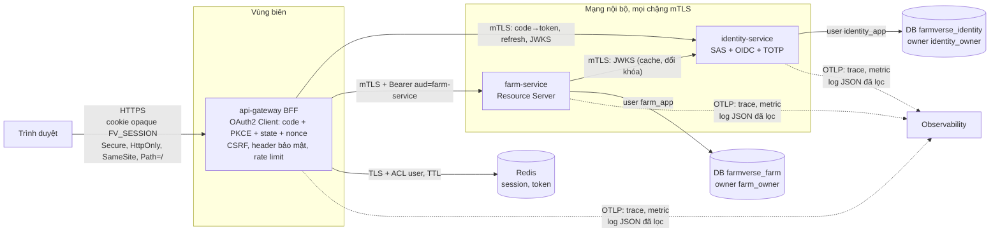

# Kiến trúc mục tiêu (production)

## 1. Sơ đồ

## 2. Yêu cầu và trạng thái

| # | Yêu cầu | Hiện trạng | Chênh lệch | Milestone |
|---|---|:-:|---|---|
| R1 | Trình duyệt chỉ giữ cookie phiên opaque; token chỉ ở server | ✅ | — (`/bff/me` không trả token) | — |
| R2 | Cookie `Secure`, `HttpOnly`, `SameSite`, `Path=/` | ✅ | — (M5; `Secure` theo profile prod, có test khóa) | — |
| R3 | Chống session fixation | ✅ | — (M5, có đối chứng) | — |
| R4 | CSRF | ✅ | — | — |
| R5 | Authorization Code + PKCE, `state`, `nonce` | ✅ | — (M5) | — |
| R6 | BFF gọi Farm bằng mTLS | ✅ (profile `mtls`) | — | — |
| R7 | Access token gửi Farm có `aud=farm-service` | ✅ | Bước 1 của ADR-0006: token mang `[farm-service, identity-service]`; token riêng từng route là bước 2 | — |
| R8 | Farm kiểm chữ ký, `iss`, `aud`, `exp`, `nbf` | ✅ | — | — |
| R9 | Farm kiểm `scope` | ✅ | — (`SCOPE_farmverse.api`) | — |
| R10 | Farm kiểm tenant | ✅ | — | — |
| R11 | Farm kiểm ownership | ⬜ | Chưa có khái niệm chủ sở hữu; cần thiết kế nghiệp vụ trước | ngoài roadmap ngắn |
| R12 | Phân biệt mTLS (máy nào), JWT/JWKS (ai, token thật không), authorization (được làm gì) | ✅ trong code, 🟡 tài liệu | Ghi rõ ở [ADR-0003](adr/0003-mtls-ssl-bundles-spiffe.md), [ADR-0004](adr/0004-local-jwt-validation-cached-jwks.md) | — |
| R13 | Farm không gọi Identity mỗi request; JWKS cache và chịu đổi khóa | ✅ | — (`TokenValidationTest`: 5 request không gọi JWKS; `kid` mới thì tải lại) | — |
| R14 | Redis có TTL, timeout, access control, fail-closed, không log token | ✅ | — (M3 + `GatewayRedisIT` trên Redis 8 thật: ACL user, TTL, treo → 503). TLS chỉ cấu hình ở prod | — |
| R15 | Identity và Farm không dùng chung bảng/credential | 🟡 | DB riêng; dev dùng chung user `postgres`; chưa có script tạo user riêng | M4 |
| R16 | TOTP: rate limit, chống brute force, chống replay, mã hóa secret | ✅ | Giới hạn IP trong bộ nhớ, sai khi nhiều instance | M8 |
| R17 | Structured logging, tracing, metrics, audit, không log dữ liệu nhạy cảm | 🟡 | Audit có; JSON chỉ ở identity prod; không tracing/metric export | M7 |
| R18 | Actuator không lộ ra cổng công khai | ✅ | — (M2: cổng quản trị loopback ở cả ba service) | — |
| R19 | Build và test lặp lại được, có CI | ✅ | — (CI xanh lần đầu 2026-11-04). CD chưa có, ngoài phạm vi | — |

## 3. Quyết định thiết kế

| Quyết định | Lý do | ADR |
|---|---|---|
| BFF giữ token, trình duyệt chỉ có cookie | XSS không lấy được token; refresh token không rời server | [0001](adr/0001-bff-server-side-tokens.md) |
| Spring Authorization Server, không Keycloak | Mục tiêu học OAuth2/OIDC; cùng hệ sinh thái Spring | [0002](adr/0002-spring-authorization-server.md) |
| mTLS bằng Spring Boot SSL bundles + SAN SPIFFE | Không thêm service mesh; xoay cert bằng `reload-on-update` | [0003](adr/0003-mtls-ssl-bundles-spiffe.md) |
| Resource server tự kiểm JWT bằng JWKS cache | Không phụ thuộc identity mỗi request | [0004](adr/0004-local-jwt-validation-cached-jwks.md) |
| Database per service | Tách sở hữu dữ liệu; đổi schema không ảnh hưởng service khác | [0005](adr/0005-database-per-service.md) |
| Audience riêng cho từng resource server (bước 1 đã làm) | Token cho farm không dùng được ở service khác | [0006](adr/0006-per-service-audience.md) |
| Test gateway dùng kho session trong bộ nhớ | Build lặp lại được trên mọi máy; Redis thật để cho test tích hợp | [0007](adr/0007-hermetic-gateway-tests.md) |
| Chỉ tin header forwarded từ edge đã khai | `redirect_uri` đúng `https://` sau edge; người gọi thẳng không giả được host | [0011](adr/0011-trusted-proxy-forwarded-headers.md) |
| Redis lỗi thì 503, fail-closed | Không cho request không có token đi tiếp; SPA phân biệt lỗi tạm với chưa đăng nhập | [0009](adr/0009-redis-fail-closed.md) |
| Actuator gateway trên cổng quản trị loopback | Endpoint vận hành không bao giờ ở cổng công khai | [0008](adr/0008-gateway-management-port.md) |

## 4. Giả định

1. TLS từ trình duyệt kết thúc ở edge (load balancer/ingress) phía trước gateway. Gateway không tự cấp cert công khai. Gateway lấy URL công khai từ `X-Forwarded-*` của edge, và chỉ tin edge có IP nằm trong `GATEWAY_TRUSTED_PROXIES` (M5c, [ADR-0011](adr/0011-trusted-proxy-forwarded-headers.md)). Giả định thêm: edge **ghi đè** chứ không nối thêm `X-Forwarded-Host`/`-Proto` mà trình duyệt gửi.
2. Mạng nội bộ không tin cậy hoàn toàn: đó là lý do dùng mTLS chứ không chỉ dựa vào firewall.
3. Một tenant là ranh giới cô lập dữ liệu chính. Ownership trong tenant là yêu cầu nghiệp vụ chưa định nghĩa.
4. Redis và PostgreSQL production do hạ tầng quản lý (managed hoặc cluster riêng), có TLS.
5. Secret production được tiêm qua biến môi trường hoặc file mount từ secret manager; repo chỉ có giá trị dev.

## 5. Trade-off

| Lựa chọn | Được | Mất |
|---|---|---|
| Kiểm JWT cục bộ (không introspection) | Nhanh, identity sập vẫn phục vụ được | Thu hồi quyền không tức thì: token sống tới khi hết hạn (5 phút) |
| Một token mang danh sách audience (hiện tại, ADR-0006 bước 1) | Gateway giữ một token; service ngoài danh sách không nhận | Token vẫn dùng chéo được giữa farm và identity |
| Token riêng từng route (bước 2) | Giới hạn thiệt hại tối đa | Gateway cần token exchange hoặc resource indicator |
| Redis fail-closed | Không bao giờ cho qua khi mất phiên | Redis sập = mọi người dùng nhận 503 tới khi Redis về |
| Rate limit fail-open (mặc định SCG) | Redis chập chờn không chặn người đã có phiên hợp lệ | Lúc Redis lỗi, không còn giới hạn tốc độ; chỉ chấp nhận được vì phiên được nạp trước và cũng cần Redis |
| Rate limit trong bộ nhớ (identity) | Không cần Redis cho identity | Sai khi chạy nhiều instance |

## 6. Chưa triển khai (không được coi là đã có)

- Ownership trong tenant. Token riêng cho từng route (ADR-0006 bước 2).
- Redis ACL user (mới có hướng dẫn), TLS ở dev, test với Redis thật.
- User PostgreSQL riêng cho từng service và phân quyền owner/app.
- Tracing, metric export, log JSON ở gateway và farm.
- Rate limit phân tán cho login.
- CD (deploy).
- Circuit breaker ở gateway.
- gRPC (đang chờ duyệt trong [`content/thiet-ke-farmverse.md`](../../content/thiet-ke-farmverse.md) mục 6).
