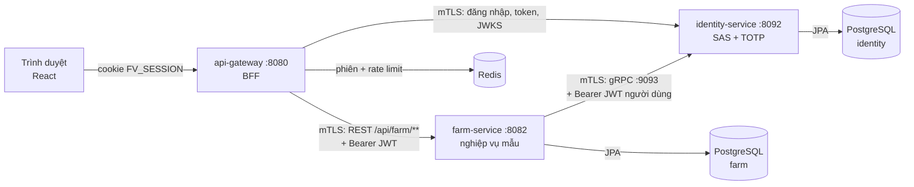
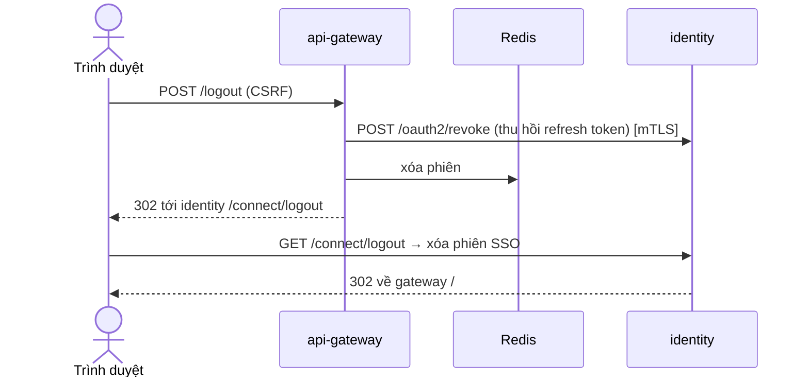
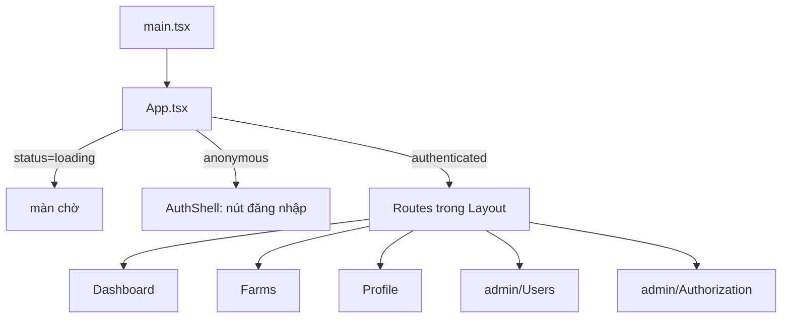

# Đọc hiểu mã FarmVerse theo luồng

Tài liệu cho người mới đọc mã: đi từ bức tranh lớn, tới cách các phần nối nhau, rồi từng luồng chi tiết kèm class và hàm, cuối cùng là bảng tra cứu class và cây thư mục. Không có phần tiến độ hay kế hoạch; những nội dung đó đã bỏ.

Thuật ngữ: **BFF** = backend cho giao diện (gateway giữ token thay trình duyệt). **SAS** = Spring Authorization Server (máy cấp token). **mTLS** = TLS hai chiều (hai bên đều có chứng chỉ). **JWT** = token có chữ ký. **tenant** = tổ chức.

## 1. Bức tranh lớn

Bốn phần chạy riêng. Trình duyệt chỉ nói chuyện với gateway. Gateway nói chuyện với hai service bằng mTLS.



| Phần | Thư mục | Việc chính |
|---|---|---|
| Gateway (BFF) | `platform/api-gateway` | Đăng nhập OIDC thay trình duyệt, giữ token trong phiên, chuyển REST xuống service |
| Identity | `services/identity-service` | Cấp token (SAS), quản người dùng, tổ chức, vai trò, quyền, TOTP |
| Farm | `services/farm-service` | Service nghiệp vụ mẫu: trang trại và chuồng, tách theo tổ chức |
| Web | `apps/farmverse-web` | Giao diện React, chỉ dùng cookie |
| Thư viện chung | `libs/farmverse-starter-service` | Đọc JWT thành quyền, kiểm audience, dạng lỗi chung, mTLS client |
| Hợp đồng gRPC | `libs/farmverse-contracts` | File `.proto`, sinh mã lúc build |

Điểm vào mỗi service là lớp `*Application`: `GatewayApplication`, `IdentityApplication`, `FarmApplication`.

## 2. Các phần nối nhau thế nào

| Đường | Giao thức | Ai gọi ai | Mang theo gì |
|---|---|---|---|
| Trình duyệt → gateway | HTTPS | Web → BFF | Cookie `FV_SESSION`, header `X-XSRF-TOKEN` |
| Gateway → identity | HTTP/mTLS | Đổi code, refresh token, tải khóa (JWKS) | Chứng chỉ gateway |
| Gateway → farm | HTTP/mTLS | Chuyển REST `/api/farm/**` | Chứng chỉ gateway + `Bearer` access token |
| Farm → identity | gRPC/mTLS | Hỏi thành viên tổ chức | Chứng chỉ farm + `Bearer` token người dùng |
| Gateway → Redis | — | Lưu phiên, đếm rate limit | — |

Ba lớp kiểm khi một service nhận lời gọi, mỗi lớp trả một câu:

| Lớp | Trả lời câu hỏi | Lớp xử lý |
|---|---|---|
| mTLS | Máy nào đang gọi? | `ServiceIdentityFilter` (REST), `ServiceIdentityInterceptor` (gRPC) |
| JWT | Token thật không, ai, tổ chức nào? | `JwtDecoder` + `FarmVerseJwtValidators` |
| Quyền | Được làm gì? | `@PreAuthorize` + `@TenantId` |

Token mang sẵn mọi thứ để quyết định (ai, tổ chức, vai trò, quyền), nên farm **không** gọi lại identity mỗi request. Khóa công khai (JWKS) được nhớ đệm; gặp khóa lạ mới tải lại.

## 3. Luồng chi tiết từng tính năng

### 3.1 Đăng nhập (Authorization Code + PKCE + TOTP)

Trình duyệt chưa có phiên thì gateway đẩy sang trang đăng nhập của identity. Đăng nhập xong, token nằm ở gateway, trình duyệt chỉ nhận cookie.

```mermaid
sequenceDiagram
    autonumber
    actor U as Trình duyệt
    participant G as api-gateway
    participant R as Redis
    participant I as identity
    U->>G: GET /oauth2/authorization/farmverse
    G->>R: lưu state, nonce, code_verifier vào phiên
    G-->>U: 302 tới identity /oauth2/authorize + cookie FV_SESSION
    U->>I: GET /oauth2/authorize → 302 /login
    U->>I: POST /login (tổ chức, email, mật khẩu, CSRF)
    Note over I: LoginRateLimitFilter đếm theo IP; sai nhiều thì khóa tài khoản
    alt tài khoản bật TOTP
        I-->>U: 302 /login/totp
        U->>I: POST /login/totp (mã 6 số hoặc mã khôi phục)
    end
    I-->>U: 302 tới gateway /login/oauth2/code/farmverse?code&state
    U->>G: GET callback
    G->>I: POST /oauth2/token (code + code_verifier) [mTLS]
    I->>I: FarmVerseTokenCustomizer thêm claim (tổ chức, vai trò, quyền)
    I-->>G: access (5 phút) + refresh (14 ngày) + id_token
    G->>R: lưu token vào phiên, đổi id phiên
    G-->>U: 302 / + cookie FV_SESSION mới
```

Class và hàm tham gia:

| Bên | Class | Hàm / việc |
|---|---|---|
| Gateway | `SecurityConfiguration` | `oauth2Login`, PKCE, `RevokeTokensOnLogoutHandler` cho logout |
| Gateway | `OidcClientConfiguration` | Dựng client OIDC, `WebClient` mTLS, kiểm `id_token` |
| Identity | `SecurityConfiguration` | Ba chuỗi filter: authorization server, API, trang login |
| Identity | `LoginController`, `TenantAuthenticationProvider` | Form login có chọn tổ chức |
| Identity | `LoginRateLimitFilter` + `JdbcLoginAttemptCounter` | Giới hạn theo IP, đếm chung ở PostgreSQL |
| Identity | `AccountService`, `UserAccount` | Đếm lần sai, khóa tài khoản |
| Identity | `TotpEnforcementFilter`, `TotpService`, `TotpCodes` | Bắt buộc và kiểm mã TOTP |
| Identity | `FarmVerseTokenCustomizer` ← `AccessService` | Nhúng tổ chức, vai trò, quyền vào token |

### 3.2 Gọi farm qua gateway

SPA gọi `/api/farm/**`. Gateway kiểm phiên và CSRF, refresh token nếu hết hạn, rồi chuyển xuống farm kèm access token.

```mermaid
sequenceDiagram
    autonumber
    actor U as Trình duyệt
    participant G as api-gateway
    participant R as Redis
    participant I as identity
    participant F as farm-service
    U->>G: POST /api/farm/farms (cookie + X-XSRF-TOKEN)
    G->>G: kiểm CSRF và phiên
    G->>R: đọc token trong phiên
    alt access token hết hạn
        G->>I: POST /oauth2/token refresh_token [mTLS]
        I-->>G: token mới (refresh cũ hết hiệu lực)
        G->>R: lưu token mới (SaveSession)
    end
    G->>G: RequestRateLimiter (Redis, theo người dùng)
    G->>F: POST /farms + Bearer [mTLS, cert gateway]
    F->>F: ServiceIdentityFilter: cert là gateway?
    F->>F: JwtDecoder: chữ ký, iss, aud, hạn, scope
    F->>F: @PreAuthorize quyền; @TenantId lọc theo tổ chức
    F-->>G: 201 FarmView hoặc ProblemDetail
    G-->>U: 201
```

Class và hàm tham gia:

| Bên | Class | Hàm / việc |
|---|---|---|
| Gateway | route trong `application.yml` | `TokenRelay`, `RequestRateLimiter`, `CircuitBreaker`, `RemoveRequestHeader=Cookie` |
| Gateway | `CircuitBreakerConfiguration` | Service sập kéo dài thì trả 503 ngay |
| Gateway | `DownstreamErrorHandler`, `GatewayProblems` | Lỗi service thành ProblemDetail (502/503/504) |
| Farm | `ServiceIdentityFilter` (thư viện chung) | Kiểm SAN `spiffe://farmverse/gateway` |
| Farm | `SecurityConfiguration`, `FarmVerseJwtAuthenticationConverter` | JWT thành quyền, đòi scope `farmverse.api` |
| Farm | `TenantFromTokenResolver` | Lấy tổ chức từ claim `tenant_id` cho `@TenantId` |
| Farm | `FarmController` → `FarmService` → `Farm` | REST, use case, luật nghiệp vụ |
| Farm | `JpaFarmRepository`, `FarmEntity`, `BarnEmbeddable` | Lưu xuống PostgreSQL |
| Farm | `FarmExceptionHandler` | 400, 409 (khóa lạc quan, trùng mã) thành ProblemDetail |

Phân lớp của farm (hexagonal): `domain` (luật) ← `application` (use case + port) ← `adapter/in/rest` và `adapter/out/jpa`, `adapter/out/grpc`. Domain không biết Spring hay JPA.

### 3.3 Gán người phụ trách (farm hỏi identity bằng gRPC)

Ca dùng cho thấy một service gọi service khác. Farm hỏi identity "người này có phải thành viên đang hoạt động cùng tổ chức" trước khi ghi.

```mermaid
sequenceDiagram
    autonumber
    actor U as Trình duyệt
    participant G as api-gateway
    participant F as farm-service
    participant I as identity (gRPC :9093)
    U->>G: PUT /api/farm/farms/{id}/manager {userId}
    G->>F: PUT /farms/{id}/manager + Bearer JWT [mTLS]
    F->>F: FarmService.assignManager: hỏi identity TRƯỚC khi mở transaction
    F->>I: gRPC GetMember(userId) [mTLS + chuyển tiếp token người dùng]
    I->>I: ServiceIdentityInterceptor: cert là farm?
    I->>I: kiểm token (aud identity-service, scope); tenant lấy từ token
    alt thành viên đang hoạt động
        I-->>F: Member{status=ACTIVE}
        F->>F: Farm.assignManager, mở transaction lưu
        F-->>U: 200
    else không có / không hoạt động
        I-->>F: NOT_FOUND
        F-->>U: 422 SF-FARM-012
    else identity lỗi
        I--xF: UNAVAILABLE / quá hạn
        F-->>U: 503 SF-FARM-503 (không ghi)
    end
```

Class và hàm tham gia:

| Bên | Class | Hàm / việc |
|---|---|---|
| Hợp đồng | `identity_directory.proto` | `IdentityDirectory`: `GetMember`, `BatchGetMembers` |
| Farm | `FarmService.assignManager` | Hỏi `MemberDirectory` rồi mới lưu (ngoài transaction) |
| Farm | `MemberDirectory` (port) ← `GrpcMemberDirectory` | Gọi gRPC, chuyển tiếp token, deadline 2s |
| Farm | `MemberMapper` | Đổi proto thành record của farm |
| Identity | `ServiceIdentityInterceptor`, `GrpcSecurityConfiguration` | mTLS + SAN + kiểm token |
| Identity | `IdentityDirectoryGrpcService` → `MemberDirectoryService` | Trả thành viên của đúng tổ chức |
| Identity | `GrpcProductionGuard` | Prod không cho chạy gRPC không mã hóa |

### 3.4 Đăng xuất



Class: `RevokeTokensOnLogoutHandler` (thu hồi), `SecurityConfiguration` của gateway (chuỗi logout), `RefreshTokenReuseDetection` ở identity (dùng lại refresh token cũ thì thu hồi cả nhóm).

### 3.5 Web tải và hiển thị



`AuthProvider` (`lib/auth.tsx`) gọi `GET /bff/me` khi mở trang. Có phiên thì hiện trang; 401 thì chuyển sang đăng nhập. `RequirePermission` ẩn trang khi thiếu quyền. `lib/api.ts` là client gọi gateway (gắn CSRF, bắt lỗi). `lib/errors.ts` đổi ProblemDetail thành câu tiếng Việt. Mọi chữ hiển thị nằm ở `i18n/vi.ts`.

## 4. Bảng class và vai trò

### Gateway — `platform/api-gateway`

| Class | Vai trò |
|---|---|
| `GatewayApplication` | Điểm vào |
| `bff/BffController` | `GET /bff/me`: trả thông tin người dùng từ token, không trả token |
| `config/SecurityConfiguration` | Chuỗi filter WebFlux: đăng nhập OIDC, CSRF, header bảo mật, logout |
| `config/OidcClientConfiguration` | Client OIDC, `WebClient` mTLS, kiểm `id_token` |
| `config/GatewayOidcProperties` | Thuộc tính OIDC (issuer, client, secret) |
| `config/TrustedProxyForwardedHeaderTransformer` | Chỉ tin header `X-Forwarded-*` từ edge đã khai |
| `config/LoginRateLimitFilter` + `RedisLoginAttemptCounter` + `LoginAttemptCounter` | Giới hạn đăng nhập theo IP ở cổng vào |
| `config/RequestRateLimiter` (cấu hình) | Giới hạn theo người dùng cho `/api/**` |
| `config/CircuitBreakerConfiguration` | Circuit breaker mỗi route |
| `config/DownstreamErrorHandler`, `GatewayProblems` | Lỗi service thành ProblemDetail |
| `config/RedisUnavailableHandler` | Redis lỗi thì 503, không cho qua |
| `config/RateLimitProblemFilter` | 429 thành ProblemDetail |
| `config/RevokeTokensOnLogoutHandler` | Thu hồi refresh token khi logout |

### Identity — `services/identity-service`

| Package | Class chính | Vai trò |
|---|---|---|
| (gốc) | `IdentityApplication` | Điểm vào |
| `config` | `SecurityConfiguration` | Ba chuỗi filter: SAS, API quản trị, trang login |
| `config` | `IdentityProperties` | Thuộc tính `farmverse.identity.*` |
| `config` | `MtlsConfiguration`, `OpenApiConfiguration` | mTLS cho đường máy-gọi-máy; Swagger ở dev |
| `oauth2` | `FarmVerseTokenCustomizer` | Nhúng claim vào token |
| `oauth2` | `OAuthClientProvisioner` | Nạp client OAuth lúc khởi động |
| `oauth2` | `SigningKeyConfiguration` | Khóa ký, `JwtDecoder`, `JwtEncoder`, JWKS |
| `oauth2` | `RefreshTokenReuseDetection` | Phát hiện dùng lại refresh token đã xoay |
| `login` | `LoginController`, `TenantAuthenticationProvider`, `TenantLoginDetails` | Form login có tổ chức |
| `login` | `AccountUserDetailsService` | Nạp tài khoản theo email |
| `login` | `TotpEnforcementFilter`, `TotpLogin` | Bắt bước TOTP trước khi cấp code |
| `login` | `LoginRateLimitFilter` + `Jdbc`/`InMemoryLoginAttemptCounter` | Giới hạn đăng nhập theo IP |
| `mfa` | `TotpService`, `TotpCodes`, `UserTotp` | TOTP: tạo, xác nhận, chống dùng lại |
| `mfa` | `RecoveryCodeService`, `RecoveryCode` | Mã khôi phục dùng một lần |
| `account` | `AccountService`, `UserAccount` | Tài khoản, mật khẩu, khóa tài khoản |
| `tenant` | `Tenant`, `Membership`, `MembershipStatus` | Tổ chức và tư cách thành viên |
| `tenant` | `TenantAdministrationService`, `UserAdministrationService`, `UserView` | Quản trị tổ chức và người dùng |
| `authorization` | `Role`, `Permission`, `AccessService` | Vai trò, quyền, tính quyền hiệu lực |
| `authorization` | `RoleAdministrationService` | Quản trị vai trò |
| `directory` | `MemberDirectoryService` | Danh bạ thành viên chỉ-đọc (cho gRPC) |
| `grpc` | `IdentityDirectoryGrpcService`, `MemberMapper` | Server gRPC và mapper |
| `grpc` | `ServiceIdentityInterceptor`, `GrpcSecurityConfiguration`, `GrpcProductionGuard` | Bảo mật gRPC |
| `web` | `MeController`, `UserController`, `RoleController`, `TenantController` | REST quản trị |
| `web` | `Can`, `IdentityExceptionHandler` | Luật quyền; lỗi thành ProblemDetail |
| `audit` | `SecurityAudit`, `SecurityAuditListener` | Nhật ký bảo mật |
| `bootstrap` | `PlatformSeeder` | Seed quyền và super admin đầu tiên |
| `shared` | `BaseEntity`, `IdentityErrors` | Khóa UUID, mã lỗi `SF-IDENTITY-*` |

### Farm — `services/farm-service`

| Package | Class | Vai trò |
|---|---|---|
| (gốc) | `FarmApplication` | Điểm vào |
| `domain` | `Farm` | Aggregate: luật về chuồng, người phụ trách, sức chứa |
| `domain` | `Barn`, `FarmStatus`, `FarmRuleViolation` | Chuồng, trạng thái, lỗi nghiệp vụ |
| `application` | `FarmService` | Use case, mỗi method một transaction |
| `application` | `FarmRepository`, `MemberDirectory` | Port ra ngoài (JPA, gRPC) |
| `adapter/in/rest` | `FarmController`, `FarmExceptionHandler` | REST, ánh xạ lỗi |
| `adapter/out/jpa` | `JpaFarmRepository`, `FarmEntity`, `BarnEmbeddable`, `FarmJpaRepository` | Lưu PostgreSQL |
| `adapter/out/jpa` | `TenantFromTokenResolver`, `JpaConfiguration` | Lấy tổ chức từ token cho `@TenantId` |
| `adapter/out/grpc` | `GrpcMemberDirectory`, `MemberMapper` | Client gRPC tới identity |
| `config` | `SecurityConfiguration`, `MtlsConfiguration` | Resource server; mTLS |

### Thư viện chung — `libs/farmverse-starter-service`

| Class | Vai trò |
|---|---|
| `security/FarmVerseClaims` | Tên claim dùng chung (`tenant_id`, `perms`, `roles`...) |
| `security/FarmVerseJwtAuthenticationConverter` | Claim thành authority cho `@PreAuthorize` |
| `security/FarmVerseJwtValidators` | Kiểm issuer và audience |
| `mtls/ServiceIdentityFilter` | Kiểm SAN `spiffe://farmverse/<service>` (REST) |
| `mtls/MtlsClients` | `RestTemplate` / `JwtDecoder` gắn chứng chỉ service |
| `web/ApiProblem`, `ProblemExceptionHandler`, `ProblemResponses` | Dạng lỗi RFC 9457 chung cho mọi service |

### Web — `apps/farmverse-web/src`

| File | Vai trò |
|---|---|
| `main.tsx`, `app.tsx` | Điểm vào; định tuyến theo trạng thái đăng nhập |
| `lib/auth.tsx` | `AuthProvider`, `useAuth`, `hasPermission` |
| `lib/api.ts` | Client gọi gateway (CSRF, Idempotency-Key, bắt lỗi) |
| `lib/errors.ts` | ProblemDetail thành câu tiếng Việt |
| `lib/farm.tsx`, `lib/recent.ts` | Chọn trang trại; lịch sử gần đây |
| `components/Layout`, `RequirePermission` | Khung trang; ẩn trang theo quyền |
| `components/ui`, `dialog`, `notifications` | Thành phần dùng chung, hộp xác nhận, thông báo |
| `components/TotpSettings`, `AppErrorBoundary` | Cài TOTP; bắt lỗi toàn trang |
| `pages/*` | Dashboard, Farms, Profile, admin/Users, admin/Authorization |
| `i18n/vi.ts` | Mọi chữ hiển thị |

## 5. Cây thư mục và vai trò

```text
smartfarm-platform-maven-starter/
├── platform/api-gateway/          BFF: đăng nhập OIDC, giữ token, chuyển REST
├── services/
│   ├── identity-service/          OIDC provider (SAS), người dùng, tổ chức, quyền, TOTP
│   └── farm-service/              Nghiệp vụ mẫu: trang trại, chuồng (hexagonal + tenant)
├── libs/
│   ├── farmverse-starter-service/ Dùng chung: JWT→quyền, mTLS client, dạng lỗi
│   └── farmverse-contracts/       Hợp đồng gRPC (.proto), sinh mã lúc build
├── apps/farmverse-web/            Giao diện React (chỉ dùng cookie)
├── infra/                         postgres-init.sh (database + vai trò theo service)
├── scripts/                       Sinh khóa, cert mTLS, bí mật
├── docs/                          Tài liệu (kiến trúc, pattern, vận hành)
└── content/thiet-ke-farmverse.md  Tài liệu thiết kế
```

Mỗi service theo khung Maven: `src/main/java` (mã), `src/main/resources` (`application*.yml`, `db/migration`), `src/test/java` (test). Farm còn thêm `src/main/java/.../domain|application|adapter` theo hexagonal.

## Đọc tiếp

- Luồng xác thực chi tiết: [authentication-flow.md](architecture/authentication-flow.md)
- Pattern: [BFF](patterns/bff.md), [OIDC với SAS](patterns/oidc-sas.md), [hexagonal + tenant](patterns/hexagonal-multitenant.md), [mTLS](patterns/mtls.md), [gRPC](patterns/grpc.md)
- Chạy trên máy: [local-development.md](operations/local-development.md)
