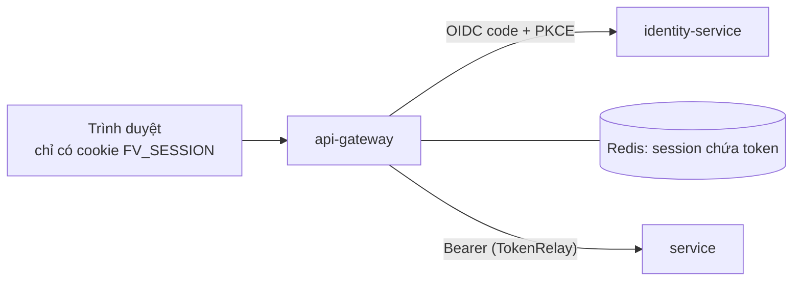

# Pattern: Backend for Frontend (BFF) + Token Relay

**Nhà:** `platform/api-gateway`

## Vấn đề

SPA giữ access/refresh token trong trình duyệt (`localStorage`) thì một lỗi XSS là mất token.
Mỗi service cũng phải tự lo CORS và cách nhận token.

## Cách làm ở FarmVerse

| Việc | Thành phần Spring |
|---|---|
| Đăng nhập thay trình duyệt | `oauth2Login()` + `OAuth2AuthorizationRequestCustomizers.withPkce()` |
| Giữ token phía server | `WebSessionServerOAuth2AuthorizedClientRepository` + Spring Session Redis |
| Gắn token xuống service, tự refresh | filter `TokenRelay=` + `ReactiveOAuth2AuthorizedClientManager` (authorizationCode + refreshToken) |
| Chống CSRF cho cookie | `CookieServerCsrfTokenRepository.withHttpOnlyFalse()`; SPA gửi `X-XSRF-TOKEN` |
| Đăng xuất cả IdP | `OidcClientInitiatedServerLogoutSuccessHandler` |
| Giới hạn tốc độ | `RequestRateLimiter` + Redis, khóa theo người dùng |

## Thử

1. `docker compose up -d postgres redis`, chạy identity rồi gateway, `npm run dev` trong `apps/farmverse-web`.
2. Mở `http://127.0.0.1:8080` → "Đăng nhập" → trang login của identity → quay về.
3. DevTools: chỉ thấy cookie `FV_SESSION` (HttpOnly) và `XSRF-TOKEN`; không có token nào trong JS.

## Bằng chứng

`platform/api-gateway/src/test/.../GatewaySecurityTest`: chưa đăng nhập thì `/api/**`, `/bff/me` trả 401; route khai đúng.

## Đánh đổi

- Gateway có trạng thái (session) → cần Redis dùng chung khi chạy nhiều instance.
- Gateway phải khởi động sau identity (discovery `issuer-uri`).
