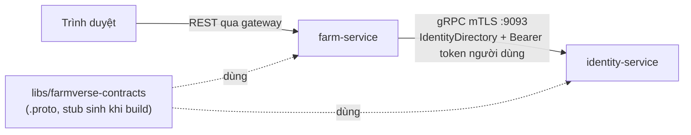

# Pattern: gRPC giữa service, hợp đồng ở module riêng, bảo mật ba lớp

**Nhà:** `libs/farmverse-contracts` (chỉ `.proto`), server ở `services/identity-service` (package `grpc`, `directory`), client ở `services/farm-service` (`adapter/out/grpc`). Quyết định: [ADR-0014](../architecture/adr/0014-grpc-service-calls.md). Ca dùng đầu tiên: farm gán người phụ trách (P3).

gRPC chỉ cho **service gọi service**. Trình duyệt đi REST qua gateway; gateway không proxy gRPC ra ngoài.



## Hợp đồng ở module riêng

`libs/farmverse-contracts` chỉ chứa `.proto` dưới `src/main/proto/farmverse/<miền>/v<N>/`. Code Java **sinh lúc build** bằng `io.github.ascopes:protobuf-maven-plugin` (version 5.1.11, cấu hình `protoc` + `protoc-gen-grpc-java` đều do `spring-boot-starter-parent` quản), **không commit**. Module con chỉ khai plugin, không ghi version.

Quy tắc tương thích, khóa bằng `ContractCompatibilityTest` (so với bản chuẩn đã commit `src/test/resources/contracts/<miền>-v<N>.txt`):

1. Thư mục theo phiên bản (`.../v1/`). Thay đổi phá vỡ thì tạo `v2`, chạy song song.
2. Không đổi, không dùng lại số field. Field bỏ thì khai `reserved`.
3. Enum luôn có `..._UNSPECIFIED = 0`. Bên nhận chịu được giá trị lạ (mapper của client đổ về "không ACTIVE").
4. Không trả email, hash, secret. Lô (batch) tối đa 100 → quá thì `INVALID_ARGUMENT`.
5. Chỉ **thêm** field/rpc. Thêm xong, chạy test: `baselineCoversTheWholeCurrentContract` đỏ và in các dòng mới để chép vào bản chuẩn.

Chỉ **adapter (mapper)** của mỗi service được `import` lớp sinh ra. Domain không biết gRPC: farm khai port `MemberDirectory` trả record của chính mình.

## Bảo mật ba lớp (giống REST)

| Lớp | Cơ chế | Trả lời |
|---|---|---|
| 1. Đường truyền | mTLS. Server `spring.grpc.server.ssl.{bundle,client-auth=REQUIRE}`; client `spring.grpc.client.channel.<tên>.ssl.{enabled,bundle}`. **Dùng chung CA và cert với REST** | Có phải máy FarmVerse? |
| 2. Service nào | `ServiceIdentityInterceptor` đọc SAN `spiffe://farmverse/<service>` (dùng chung `ServiceIdentityFilter.spiffeId` với REST), chỉ cho `farmverse.grpc.allowed-callers` (mặc định `farm`) | Service nào gọi hàm nào? |
| 3. Người/tenant | **D3-B**: farm chuyển tiếp access token của người dùng trong metadata `authorization`. Identity kiểm bằng cùng `JwtDecoder` với REST (aud `identity-service`), đòi scope `farmverse.api` và `token_type=user`, lấy tenant từ claim `tenant_id` | Gọi thay cho tenant nào? |

Cấu hình `GrpcSecurity` (bean **không** được tên `grpcSecurity` — trùng bean auto-config):

```java
grpc.oauth2ResourceServer(r -> r.jwt(j -> j.decoder(jwtDecoder).jwtAuthenticationConverter(converter)))
    .authorizeRequests(rpc -> rpc
        .methods("farmverse.identity.v1.IdentityDirectory/*").hasAuthority("SCOPE_farmverse.api")
        .methods("grpc.health.v1.Health/*").permitAll()
        .allRequests().denyAll())
    .build();   // trả AuthenticationProcessInterceptor, gắn @GlobalServerInterceptor
```

Thêm:
- **Cổng 9093** (`IDENTITY_GRPC_PORT`), bind loopback. **Không** dùng 9090 — trùng cổng quản trị trong container.
- **Reflection** chỉ bật ở dev (cho `grpcurl`); prod tắt.
- `GrpcProductionGuard` dừng service ở prod nếu thiếu mTLS, thiếu `REQUIRE`, hoặc reflection đang bật.
- **Không log** id hay tên người dùng.

## Phía client (farm)

- `GrpcMemberDirectory` cài port `MemberDirectory`. Mỗi lời gọi: mở channel qua `GrpcChannelFactory`, gắn `CallCredentials` mang access token của người dùng hiện tại (từ `SecurityContextHolder`), rồi đóng channel.
- **Deadline** 2s cho mọi lời gọi (`spring.grpc.client.channel.identity.default.deadline`).
- **Gọi gRPC ngoài transaction DB**: use case hỏi identity trước, rồi mới mở `@Transactional` để lưu. Không giữ kết nối DB trong lúc chờ mạng.
- Ánh xạ lỗi gRPC → nghiệp vụ:

| gRPC status | Khi gán (ghi) | `code` |
|---|---|---|
| `NOT_FOUND` / status khác ACTIVE | 422, không ghi | `SF-FARM-012` |
| `UNAVAILABLE` / `DEADLINE_EXCEEDED` | 503, không ghi (ghi phải đúng, không đoán) | `SF-FARM-503` |

Khi **đọc** (hiện tên người phụ trách trên danh sách), identity lỗi thì giảm cấp: vẫn trả danh sách, tên rỗng. `MemberDirectory.findAll` đã có và có test; việc nối vào đường đọc của `FarmController` chưa làm (xem "Chưa làm").

## Kiểm thử

| Test | Ở đâu | Chứng minh |
|---|---|---|
| Hợp đồng | `ContractCompatibilityTest` (contracts) | Số field/kiểu/rpc không đổi |
| Server logic + token | `IdentityDirectoryGrpcTest` | ACTIVE/SUSPENDED, khác tenant → NOT_FOUND, token sai/thiếu/máy → từ chối, batch giới hạn |
| Server mTLS | `IdentityGrpcMtlsTest` | Cert farm + token → OK; cert khác → PERMISSION_DENIED; không cert → UNAVAILABLE |
| Guard prod | `GrpcConfigurationTest` | Prod không cho plaintext / thiếu client-auth / reflection |
| Use case gán | `FarmServiceAssignManagerTest` | Hỏi identity rồi mới ghi; không ACTIVE → 422; lỗi → 503; archived → rule |
| Client gRPC | `GrpcMemberDirectoryTest` | Chuyển tiếp token; NOT_FOUND → rỗng; UNAVAILABLE → DirectoryUnavailable; enum lạ an toàn |
| REST | `FarmControllerTest` | `PUT /farms/{id}/manager` cần quyền ghi; 503 khi danh bạ lỗi |

## Chạy ở dev

Bật mTLS cho cả ba service (`SPRING_PROFILES_ACTIVE=dev,mtls` + `scripts/generate-dev-mtls.sh`), hoặc để mặc định (plaintext, gRPC `127.0.0.1:9093`). Thử nhanh server bằng `grpcurl` (reflection bật ở dev):

```bash
grpcurl -plaintext 127.0.0.1:9093 list
```

## Chưa làm

- Nối `managerName` (giảm cấp qua `BatchGetMembers`) vào đường đọc của `FarmController`.
- Farm gọi identity thật trong container giữa hai pod.
- Khi làm [ADR-0006](../architecture/adr/0006-per-service-audience.md) bước 2 (token riêng từng service), token farm nhận sẽ không còn `aud=identity-service`; lúc đó cần token exchange (RFC 8693).
