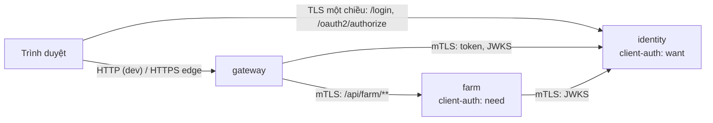

# Pattern: mTLS giữa service bằng Spring Boot SSL bundles

**Nhà:** `libs/farmverse-starter-service` (`ServiceIdentityFilter`, `MtlsClients`) + profile `mtls` của từng service.

Hai lớp kiểm:

1. **TLS** (Tomcat / Reactor Netty): cert phải do CA của FarmVerse ký. farm `need` → không cert là đứt bắt tay.
2. **Danh tính** (`ServiceIdentityFilter`): SAN `spiffe://farmverse/<service>` phải nằm trong danh sách cho phép.
   identity chỉ áp dụng cho đường máy-gọi-máy, nên trình duyệt vẫn vào trang login.

JWT vẫn quyết định *người dùng* được làm gì; mTLS quyết định *service nào* được nói chuyện.

| Việc | Cấu hình |
|---|---|
| Khai cert | `spring.ssl.bundle.pem.farmverse.{keystore,truststore}`, `reload-on-update: true` |
| Server | `server.ssl.bundle`, `server.ssl.client-auth` |
| Gateway → service | `spring.cloud.gateway.server.webflux.httpclient.ssl.ssl-bundle` |
| Gateway → identity | `WebClient` gắn `SslContext` từ bundle (đổi code, refresh, JWKS) |
| Service → identity | `MtlsClients.jwtDecoder(...)` |
| Cert dev | `scripts/generate-dev-mtls.sh` |

Bằng chứng: `services/farm-service/.../MtlsIntegrationTest` (không cert → đứt; cert identity → 403; cert gateway → tới JWT, 401),
`services/identity-service/.../MtlsIntegrationTest` (trình duyệt vào `/login`; `/oauth2/jwks` đòi cert gateway/farm),
`platform/api-gateway/.../MtlsClientTest` (WebClient trình cert gateway). Cả ba dùng cert do chính script tạo.
