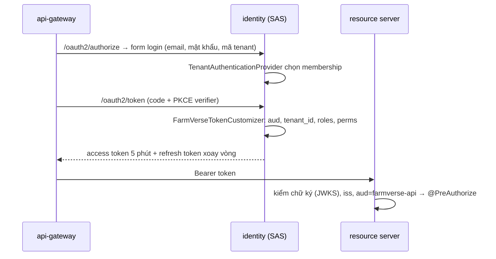

# Pattern: OIDC Provider tự dựng bằng Spring Authorization Server, quyền nằm trong JWT

**Nhà:** `services/identity-service`; phía nhận: mọi resource server (mẫu: `services/livestock-service`).

## Vấn đề

Nhiều service cần biết "ai, ở tổ chức nào, được làm gì" mà không gọi lại identity mỗi request.

## Cách làm

| Việc | Thành phần |
|---|---|
| Endpoint OAuth2/OIDC chuẩn | `OAuth2AuthorizationServerConfigurer` + `oidc()` |
| Lưu client, authorization, consent | `JdbcRegisteredClientRepository`, `JdbcOAuth2AuthorizationService` (bảng ở `V2__oauth2_authorization_server.sql`) |
| Đăng nhập có chọn tenant | `DaoAuthenticationProvider` mở rộng, principal = membership id |
| Claim tùy biến | `OAuth2TokenCustomizer<JwtEncodingContext>` |
| Phía nhận | `spring.security.oauth2.resourceserver.jwt.{issuer-uri,jwk-set-uri,audiences}` + `FarmVerseJwtAuthenticationConverter` |

## Bằng chứng

- `AuthorizationCodeFlowTest`: login → code → token có `aud`, `roles`, `tenant_id`; dùng token gọi `/me`, `/users`.
- `AnimalControllerTest`: không token → 401; thiếu `livestock:animal:read` → 403; đúng quyền → 200.

## Đánh đổi

- Quyền đổi có hiệu lực sau tối đa 5 phút (TTL access token). Membership bị khóa thì lần refresh kế tiếp bị từ chối.
- Redirect URI không được dùng host `localhost` (RFC 8252) → gateway chạy ở `127.0.0.1`.
- MFA tạm dừng: Spring Security 7.1.2 chưa có factor TOTP.
