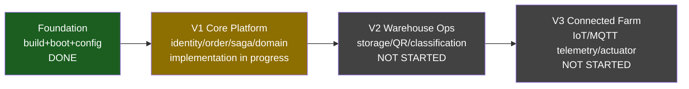

# Roadmap — SmartFarm Platform

> Reconciled 2026-10-15 against the current source tree and runtime profiles. Versioning follows the existing backlog: V1 Core Platform / V2 Warehouse / V3 Connected Farm. Do not treat old dated validation notes as current test results.

## Milestone map

**Hiện tại: V1 in progress; no percent-complete claim.** The source has gateway/service APIs, order saga integrations, identity token/session code, and MQTT event infrastructure. Production readiness is not established by code presence. Remaining work includes choosing and hardening a single identity token-issuance boundary with TLS/mTLS, adding database/server-level concurrency and authorization tests, broker ACL/TLS, and completing missing RPCs and production paths.

## V0 — Foundation (✅ DONE)
- **Mục tiêu**: build → boot → config nhất quán.
- [x] 14 module reactor declared in root `pom.xml` (declaration only; validate builds with `./scripts/build-all.sh`)
- [x] Profile mặc định `dev` + env override (verified in current configuration)
- [x] Security key nested fix (ISSUE-01, CFG-01 resolved)
- **Điều kiện chuyển V1**: service boot được ở dev. ✅

## V1 — Core Platform (`~` IN PROGRESS)
- **Mục tiêu**: identity + order saga + domain services chạy end-to-end qua gateway, có event-bus an toàn.
- [x] Identity auth/MFA/RBAC + gRPC (verified source)
- [x] Order persistent saga + outbox + CQRS (verified)
- [x] inventory/finance saga integration (5 cross-service RPC)
- [x] gateway REST+GraphQL edge
- [x] MQTT source implementation: identity emits protobuf `DomainEvent` on the normalized topic; live broker/WS delivery is not asserted here.
- [x] HMAC `SFM1` implementation and dev profile configuration exist; production defaults are off. Broker authentication/TLS/ACL are not enabled.
- [x] Health has a development gateway facade and publisher/configuration source; six of ten declared health RPCs have no handlers.
- [x] identity `command.result`: reclassified by-design, command-ack qua WS (ISSUE-06)
- [~] finance/reporting: expose prod còn thiếu (GW-02)
- [x] Inventory `AdjustStock` and `TraceLot` have server handlers; caller, security, and test coverage still need to be verified per method.
- [ ] broker hardening: allow_anonymous=false + ACL + TLS bật thật
- [ ] gRPC TLS prod
- [ ] Build/test results must be recorded from the current checkout; this documentation update does not claim a successful full reactor run.
- **Rủi ro còn lại**: token issuance transport/TLS hardening, bootstrap concurrency, incomplete RPCs (FarmDirectory and health), profile-limited REST facades, and production transport hardening.
- **Điều kiện hoàn thành V1**: define and verify release gates from current source and tests; no V1 gate document is present in this checkout.

## V2 — Warehouse Operations (NOT STARTED)
- **Phạm vi dự kiến**: storage location, QR, inventory classification, warehouse workflow. A V2 backlog is not present in this checkout.
- Dependency: verify inventory handlers' callers, authorization, and tests; `AdjustStock` and `TraceLot` have implementations.
- [ ] toàn bộ. A V2 release gate is not present in this checkout.

## V3 — Connected Farm (NOT STARTED)
- **Phạm vi dự kiến**: device registry, MQTT telemetry, environment rules, actuator control, sensor simulator, safety/observability, E2E. A V3 backlog is not present in this checkout.
- Dependency: `farm.proto` + `telemetry.proto` (hiện chưa impl), MQTT security (ISSUE-02).
- [ ] toàn bộ.

## TODO checklist còn hiệu lực (cross-version)
- [x] EVT-01/02: source builds identity protobuf DomainEvent and normalized topic
- [x] GW-01: route gateway cho health (dev REST facade)
- [x] EVT-03: health publisher/source configuration exists; production delivery and signing depend on deployment config
- [x] ISSUE-02: HMAC implementation exists; broker hardening remains open (ISSUE-15/16)
- [x] ISSUE-06: command.result reclassified by-design (command-ack WS)
- [x] DOC-01: sửa README broken link
- [ ] GW-02: finance prod path (REST/GraphQL prod)
- [x] inventory `AdjustStock`/`TraceLot` handlers exist
- [ ] complete caller/security/test coverage for all inventory gRPC operations
- [ ] broker allow_anonymous=false + ACL + mTLS bật thật
- [ ] gRPC TLS prod, observability/SLO alerting cluster-wide, K8s cho 5 service

← [Documentation Index](index.md) · [Identity implementation backlog](../IDENTITY_BACKLOG_UPDATED.md)
