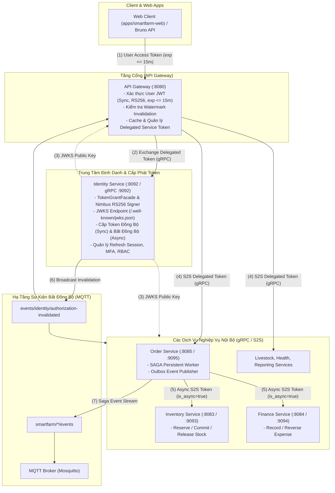
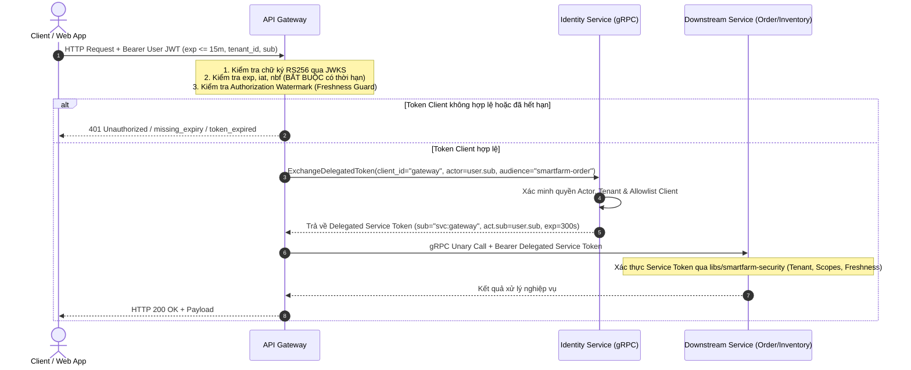
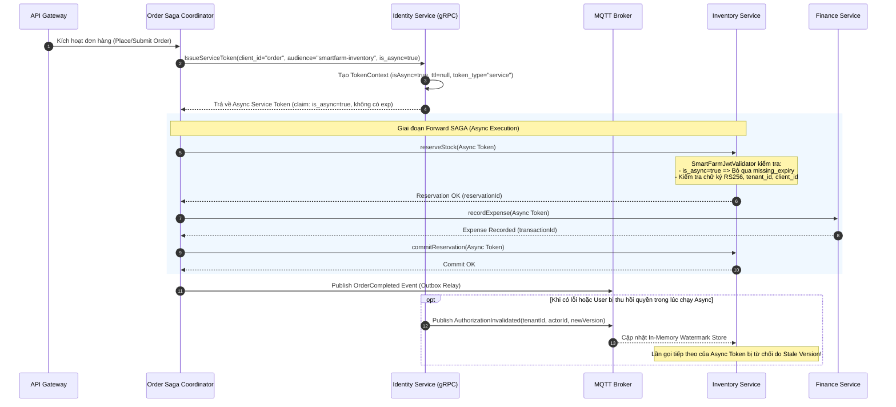

# Kiến Trúc Bảo Mật & Quản Lý Token — SmartFarm Platform

> **Phiên bản:** Cập nhật 2026-10-16  
> **Cơ chế:** Quản lý và cấp phát Token tập trung qua Identity Service & thư viện dùng chung `libs/smartfarm-security` (Security Common).  
> **Phân loại quản lý tiến độ:** Chuẩn **DONE / DOING / TODO**.

---

## 1. Cấu Trúc Tổng Thể & Ranh Giới Bảo Mật (System Architecture)

---

## 2. Luồng Xác Thực Token Đồng Bộ (Sync: Client $\to$ Gateway $\to$ Service)

Request từ Client đi qua Gateway được kiểm tra thời gian hết hạn (`exp`) và tính hợp lệ. Khi đi vào mạng nội bộ (Service-to-Service), Gateway đính kèm **Service Token riêng** (được cấp phát và định danh từ Identity) thay vì dùng lại raw User Token, ngăn chặn việc lạm dụng hoặc phụ thuộc thời hạn token client.

---

## 3. Luồng Cấp Phát Token Bất Đồng Bộ & Điều Phối SAGA (Async Flow qua MQTT)

Trong luồng xử lý bất đồng bộ (Background Workers, SAGA Pattern, Event-driven qua MQTT), các bước xử lý hoặc retry có thể kéo dài qua nhiều giờ. Do đó, token cấp cho luồng bất đồng bộ mang thuộc tính `is_async = true` và **không bị ràng buộc thời gian hết hạn (`exp = null`)**, tránh lỗi timeout giữa chừng làm đứt gãy luồng xử lý dữ liệu.

---

## 4. Thống Nhất Cấu Hình Bảo Mật (Unified Security Common)

Toàn bộ logic kiểm soát và xác thực bảo mật được chuẩn hóa tập trung tại:
1. **`libs/smartfarm-common-kernel`:** Định nghĩa `TokenClaimContract` (`identity_claims_version`, `is_async`, `sub`, `tenant_id`, `act`, `token_type`...).
2. **`libs/smartfarm-security` (Security Common):**
   - `SmartFarmJwtValidator`: Xác thực toàn bộ JWT trên toàn hệ thống. Hỗ trợ token sync (bắt buộc `exp`) và token async (bỏ qua `missing_expiry` khi `is_async = true`).
   - `JwtServerInterceptor`: Interceptor gRPC tự động bắt và giải mã token, inject vào `GrpcSecurityContext`.
   - `AuthorizationVersionWatermarkStore`: Cache và kiểm soát việc thu hồi token tức thời (invalidation) qua MQTT mà không cần gọi ngược về DB Identity liên tục.
   - `MqttSecurityVerifier`: Đảm bảo tính toàn vẹn và chữ ký HMAC/token cho tin nhắn trao đổi trên MQTT.
3. **Các Service Nghiệp Vụ (`order`, `inventory`, `finance`, `livestock`, `health`, `reporting`):**
   - Chỉ include `smartfarm-security`.
   - Không tự cấu hình logic xác thực token riêng lẻ.

---

## 5. Master Checklist Dự Án (DONE / DOING / TODO)

### ✅ DONE (Đã hoàn thành và xác nhận trong source code)
- [x] **Cấp phát & Xác thực Token 2 tầng:**
  - Client vào Gateway dùng User JWT ngắn hạn ($\le 15$ phút, RS256, bắt buộc `exp`).
  - Gateway gọi Service nội bộ (S2S) dùng Delegated Service Token cấp phát lại từ Identity qua gRPC `ExchangeDelegatedToken`.
- [x] **Hỗ trợ Token Bất Đồng Bộ (Async Flow Token):**
  - Khai báo claim `is_async` trong `TokenClaimContract`.
  - Nâng cấp `SmartFarmJwtValidator` trong `smartfarm-security`: chấp nhận token async không có `exp` khi `is_async = true`.
  - Bổ sung kiểm thử đơn vị `acceptsAsyncTokenWithoutExpiry` & `rejectsSyncTokenWithoutExpiry` (60/60 tests pass).
  - Cập nhật `TokenContext`, `TokenService`, `ServiceTokenService`, và `IdentityTokenGrpcService` hỗ trợ cấp phát token async qua gRPC.
- [x] **Định danh & Ranh giới Quyền hạn Identity:**
  - Catalog quyền Platform toàn cục (`docs/adr/ADR-001-global-permission-catalog.md`).
  - Thu hồi các endpoint REST quản trị thừa thãi, chuyển toàn bộ quản trị nội bộ sang gRPC.
  - Phân tách thực thể Account, Profile, và Tenant Membership.
- [x] **Refresh Session & MFA:**
  - Refresh session lưu trữ bằng JPA, hỗ trợ xoay vòng và phát hiện replay attack (`REFRESH_TOKEN_REUSE`).
  - Quản lý phiên qua gRPC (`ListSessions`, `RevokeSession`, `RevokeAllSessions`).
  - MFA TOTP enrollment an toàn qua luồng challenge-token riêng biệt; không log bí mật OTP khi bootstrap.
- [x] **Tích hợp Kịch bản Kiểm thử Bruno & Hướng dẫn Test:**
  - Tạo `bruno/04 - order/11 - async-saga-execution-flow.bru`.
  - Tạo tài liệu kịch bản `bruno/ASYNC_TOKEN_AND_SAGA_TEST_SCENARIO.md` cho kiểm thử thủ công và tự động hóa.
- [x] **Xác nhận Build:** Toàn bộ 15 module Maven build thành công (`BUILD SUCCESS`).

---

### 🔄 DOING (Đang triển khai & Tinh giản kiến trúc)
- [-] **SAGA Orchestration qua MQTT:**
  - Hiện tại Order SAGA đang là bản Persistent Worker cục bộ trong `order-service` kết hợp outbox relay.
  - Đang hoàn thiện kịch bản choreography trao đổi sự kiện SAGA qua MQTT Broker.
- [-] **Dynamic Authorization Evaluator & Shadow Observer:**
  - Cơ chế quan sát đánh giá quyền động (Shadow Mode) trên gRPC đã tích hợp trong `smartfarm-security`.
  - Đang thu thập log đánh giá trước khi chuyển sang chế độ cưỡng chế nghiêm ngặt (Enforcing Mode).
- [-] **Đồng bộ Watermark Invalidation qua MQTT:**
  - In-memory watermark store đã hoạt động. Đang chuẩn hóa tenant matching giữa topic MQTT và payload.

---

### 📋 TODO (Phần việc cần làm tiếp theo)
- [ ] **Release Gate trên PostgreSQL thực tế:**
  - Chạy bộ kiểm thử tích hợp Flyway schema validation và concurrent bootstrap row-lock trên database PostgreSQL (thay thế H2 in-memory).
  - Kiểm thử concurrency khi xoay vòng refresh token trên PostgreSQL.
- [ ] **Bảo mật Kênh Truyền Thông gRPC (TLS / mTLS):**
  - Mặc định hiện tại gRPC bind trên loopback (`127.0.0.1`).
  - Cấu hình TLS/mTLS cho các kết nối liên máy chủ (cross-host deployment) giữa Gateway và các Service.
- [ ] **Hardening MQTT Broker:**
  - Bật xác thực broker, cấp chứng chỉ TLS và cấu hình danh sách phân quyền (ACL) theo `docs/security/mqtt-acl-mtls.md`.
- [ ] **Tự động hóa Kiểm thử CI/CD (Auto Test Pipeline):**
  - Tích hợp Bruno CLI (`bru run`) vào pipeline test tự động khi khởi chạy staging docker containers.
  - Viết thêm integration test kịch bản SAGA rollback khi một participant trả về lỗi nghiệp vụ.
