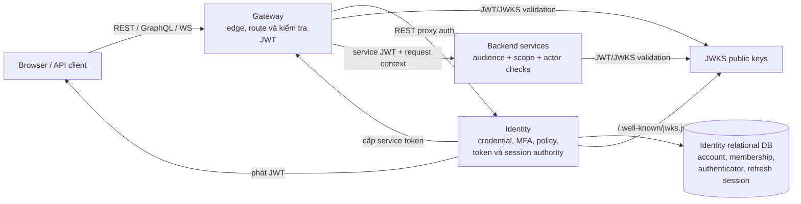
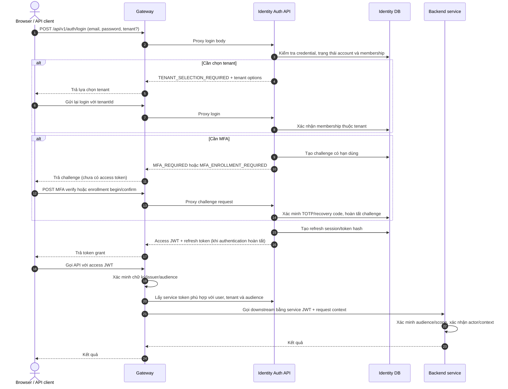
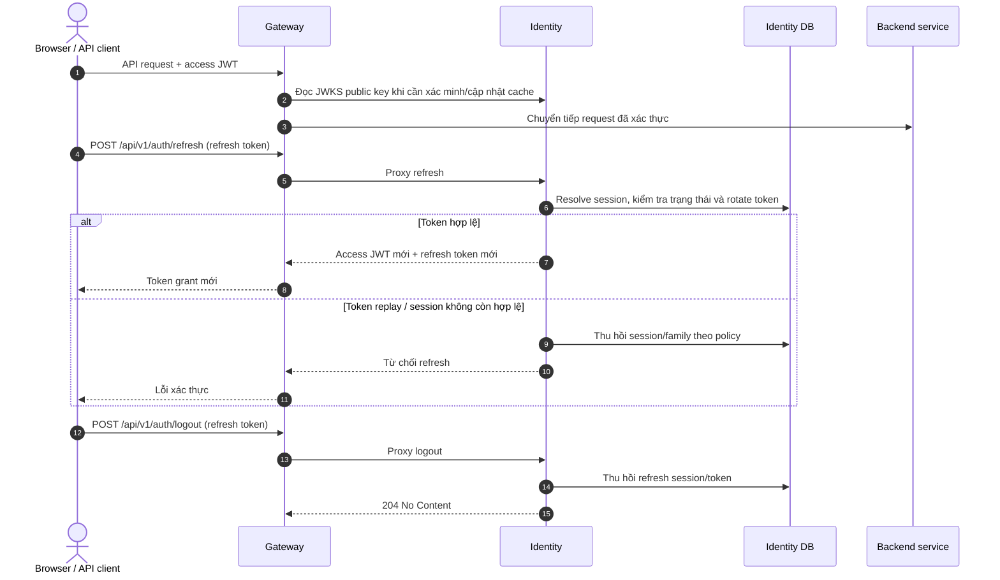
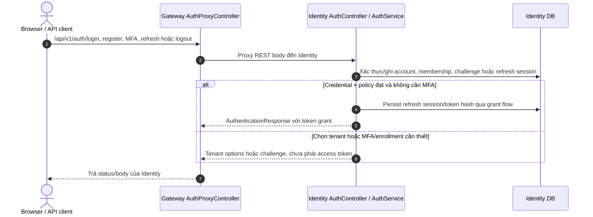
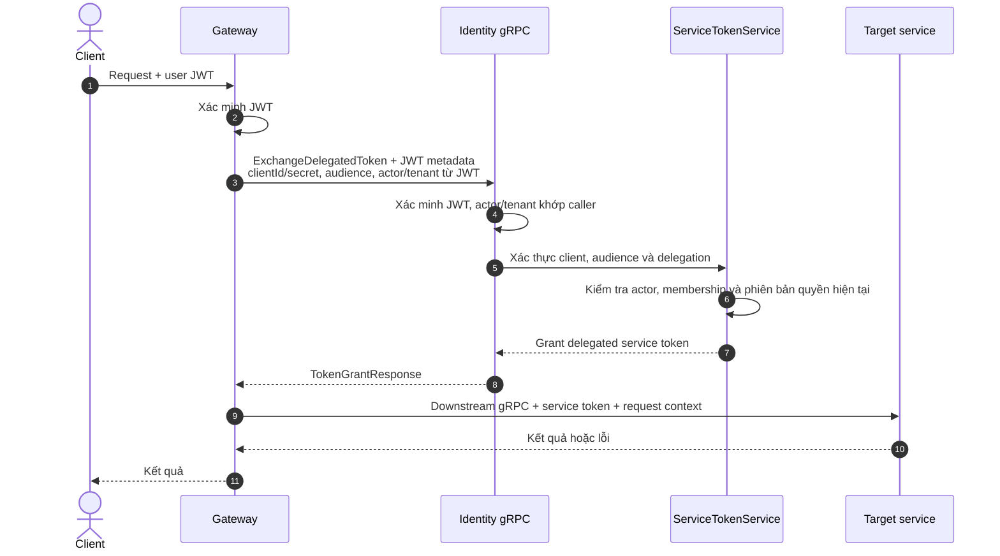

# Identity — Luồng mong muốn và luồng hiện tại

> Sơ đồ mục tiêu là đề xuất kiến trúc, chưa phải trạng thái đã triển khai. Luồng hiện tại được đối chiếu với Gateway/Identity source và kiểm thử local gần nhất ngày 2026-10-15. Màu/nhãn `ĐÃ CÓ`, `CHƯA CÓ`, `CHƯA XÁC MINH` phân biệt source với bằng chứng runtime.

## 1. Ranh giới trách nhiệm



Identity là nguồn quyết định danh tính, membership, quyền và token. Gateway là ingress cho client và là service caller; backend phải xác minh token theo audience/scope của chính nó, không tin các trường actor do client tự gửi. Refresh session/token hash lưu trong relational database của Identity; không phải Redis.

## 2. Luồng người dùng mục tiêu

Thiết kế này giữ public authentication tại Gateway/REST, còn quyết định credential, tenant, MFA và token thuộc Identity.



### Refresh, logout và JWKS



Trong luồng mục tiêu, access token ngắn hạn; logout/revoke tác động vào refresh session. Thu hồi refresh session không đồng nghĩa tự động vô hiệu hoá mọi access JWT đã phát trước đó, trừ khi downstream có cơ chế kiểm tra authorization version/session revocation tương ứng.

## 3. Luồng cấp service token hiện tại

Luồng cấp service token hiện dùng duy nhất gRPC `IdentityTokenService`. Gateway, Order và Reporting không còn gọi endpoint HTTP cấp service token. Machine issue xác thực client bằng credential allowlist; delegated exchange bổ sung user JWT đã xác minh. Listener loopback là ranh giới hiện tại; TLS/mTLS và kiểm thử server thật vẫn là điều kiện trước khi triển khai cross-host/production.

```mermaid
sequenceDiagram
    autonumber
    actor User as Client
    participant GW as Gateway
    participant ID as Identity gRPC
    participant CFG as Allowlist / policy
    participant S as Target service

    User->>GW: Request + user access JWT
    GW->>GW: Xác minh JWT, lấy subject, tenant và authorization versions từ claims
    GW->>ID: ExchangeDelegatedToken + caller JWT metadata (TLS/mTLS khi cross-host)
    Note over GW,ID: Body gồm clientId/secret, audience, context và actor subject,<br/>Gateway chỉ gửi actor/tenant đã xác minh từ JWT
    ID->>ID: Kiểm tra client credential; với delegated exchange xác minh JWT và actor/tenant binding
    ID->>CFG: Xác thực client, allowlist audience/scope, delegation và trạng thái actor/membership
    alt Policy hợp lệ
        ID-->>GW: Service JWT ngắn hạn (client_id + actor claim khi delegated)
        GW->>S: gRPC call + service JWT + context.correlation_id / actor_id
        S->>S: Xác minh issuer, audience, scope, delegated actor và correlation
        S-->>GW: Kết quả
        GW-->>User: Kết quả
    else Không hợp lệ hoặc cấu hình client thiếu
        ID-->>GW: UNAUTHENTICATED / PERMISSION_DENIED
        GW-->>User: Lỗi được chuẩn hoá, không gọi service đích
    end
```

### Mục tiêu bảo mật cần giữ

- Không cấp token nếu Identity chưa nạp được client allowlist; khởi động hoặc cấp token phải fail-closed, không dùng cấu hình rỗng như trạng thái thành công.
- Actor, tenant và authorization version phải lấy từ JWT đã xác minh; client không được tự chọn giá trị tuỳ ý.
- Audience và scope do Identity allowlist quyết định; token có thời hạn ngắn, không chứa secret.
- Gọi machine issue bằng client credential trên listener loopback; delegated exchange phải kèm JWT user hợp lệ.
- Bảo vệ kênh gRPC bằng TLS/mTLS trước khi dùng cross-host; credential và caller JWT không thay thế mã hoá transport.
- Luồng HTTP `/internal/service-token` đã được gỡ; chỉ giữ lại service-token gRPC. Trước production cần bổ sung kiểm thử server runtime và TLS/mTLS nếu triển khai khác host.

## 4. Luồng đang triển khai

### Người dùng: Gateway proxy sang Identity HTTP

Đây là ngoại lệ HTTP có chủ đích cho public authentication REST contract: Gateway giữ ingress và proxy login/MFA/refresh/logout sang Identity. Các luồng cấp service token và API nội bộ không dùng HTTP. POM hiện không có Spring Authorization Server; không có endpoint mặc định `/oauth2/authorize` hoặc `/oauth2/token` cần bọc/chuyển đổi.



`GET /.well-known/jwks.json` được Identity cung cấp; Gateway cấu hình issuer, audience và JWKS URI để xác minh JWT. Bootstrap superadmin là endpoint one-time riêng; bootstrap không còn tạo hoặc ghi log TOTP enrollment URI. MFA enrollment sau đó đi qua challenge endpoints.

### Gateway cấp delegated service token hiện tại: gRPC



Các tiến trình backend không có user JWT (ví dụ Order saga và Reporting worker) dùng `IssueServiceToken` qua gRPC với credential riêng được allowlist; actor audit được truyền trong `RequestContext`, không được coi là delegated identity.

**Trạng thái source và giới hạn:**

| Hạng mục | Trạng thái |
|---|---|
| Gateway delegated token client | Dùng `ExchangeDelegatedToken` gRPC, metadata mang JWT đã xác minh |
| Actor/tenant delegated binding | RPC yêu cầu actor và tenant trùng với verified user caller; có unit regression test |
| Machine token clients | Order và Reporting dùng `IssueServiceToken` gRPC với credential riêng |
| HTTP machine-token endpoint | Đã gỡ khỏi Identity |
| Identity gRPC bind mặc định | Loopback ở base config; phải giữ private |
| TLS/mTLS cross-host | Chưa cấu hình; không mở listener ra mạng trước khi hoàn thiện |
| RPC server registration/live flow | Chưa có bằng chứng gRPC server end-to-end cho Gateway/Order/Reporting |

## 5. Khoảng cách và thứ tự triển khai

1. **P0 — Chứng minh đăng ký/enforcement gRPC runtime.** Test server cho token/session RPC và thử Gateway, Order, Reporting trên server thật.
2. **P0 — Bảo vệ cross-host transport.** Cấu hình TLS/mTLS và kiểm tra danh tính client trước khi listener Identity không còn loopback.
3. **P1 — Hoàn thiện user/session flows.** Kiểm thử PostgreSQL cho bootstrap đồng thời, tenant selection, MFA, refresh rotation/replay, logout/revoke và race conditions.
4. **P1/P2 — Hoàn thiện domain/API gaps.** Permission ownership, authorization-version/outbox atomicity, paging/search và proto gaps theo [Identity backlog](../../IDENTITY_BACKLOG_UPDATED.md).

## Tham chiếu source

- Gateway proxy: `apps/smartfarm-gateway/src/main/java/com/htv/smartfarm/gateway/identity/AuthProxyController.java`
- Gateway service-token client: `apps/smartfarm-gateway/src/main/java/com/htv/smartfarm/gateway/identity/ServiceTokenClient.java`
- Identity auth API/service: `services/smartfarm-identity-service/src/main/java/com/htv/smartfarm/identity/api/AuthController.java`, `oauth2/AuthService.java`
- Gateway, Order, Reporting gRPC token clients: `ServiceTokenClient.java` trong từng module `identity`/`grpc`
- gRPC token adapter/policy: `grpc/IdentityTokenGrpcService.java`, `config/IdentityGrpcSecurityConfiguration.java`
- gRPC contract: `libs/smartfarm-proto/src/main/proto/smartfarm/identity/v1/identity.proto`

[Identity overview](identity.md) · [Identity backlog](../../IDENTITY_BACKLOG_UPDATED.md) · [REST API](../api/rest-api.md) · [gRPC API](../api/grpc-api.md) · [Security architecture](../security/security-architecture.md)
