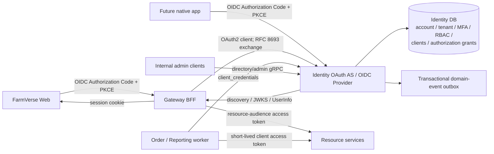

# Identity flows: current custom implementation and OAuth/OIDC target

> OAuth/OIDC protocol support is partially implemented; callers still use custom auth/token routes. PKCE/browser E2E, caller migration, RFC 8693 and PostgreSQL release verification remain open. See [the design decision, standards and class/method migration map](../architecture/identity-oauth2-oidc-target.md).

## 1. Boundaries



Identity remains one service and the authority for credentials, tenant, MFA, authorization and tokens. Gateway owns the public ingress and browser BFF session. Resource services validate issuer, expiry, audience and scopes for their own resources. Each service exposes its own Actuator readiness probe.

## 2. Browser flow target: Authorization Code + PKCE through BFF

Gateway is a confidential OIDC client/BFF. Use Authorization Code, PKCE `S256`, exact redirect URI matching, `state`, `nonce`, one-time short-lived codes and server-side token storage. Tenant selection and required MFA complete at Identity before it issues an authorization code.

```mermaid
sequenceDiagram
    autonumber
    actor User as Browser
    participant GW as Gateway BFF
    participant ID as Identity Authorization Server
    participant DB as Identity PostgreSQL
    participant RS as Resource service

    User->>GW: GET /oauth2/authorize?response_type=code&scope=openid&state=...&nonce=...&code_challenge=...
    GW->>ID: Redirect OIDC request (registered client + PKCE S256)
    ID->>DB: Validate account, tenant membership, MFA policy
    ID-->>User: Identity login / tenant selection / MFA journey
    User->>ID: Complete credentials, selected tenant and required MFA
    ID->>DB: Persist bound authorization and authentication context
    ID-->>GW: Registered callback with one-time authorization code + state
    GW->>ID: /oauth2/token (code + verifier + confidential client authentication)
    ID->>DB: Consume code; persist authorization and refresh grant
    ID-->>GW: ID token + audience-bound access token + refresh grant
    GW-->>User: Secure, HttpOnly, SameSite session cookie
    User->>GW: Same-origin API call + session cookie
    GW->>RS: Call with short-lived access token for target audience
    RS-->>GW: Resource response
    GW-->>User: Resource response
```

Do not expose refresh tokens to browser JavaScript or use an ID token as an API bearer token. If deployment constraints prevent BFF, a native/public client uses Authorization Code + PKCE in the system browser and must never persist a refresh token in browser-accessible storage.

## 3. Machine and delegated flows target

```mermaid
sequenceDiagram
    autonumber
    participant Worker as Order / Reporting worker
    participant GW as Gateway
    participant ID as Identity OAuth AS
    participant RS as Resource service

    Worker->>ID: /oauth2/token grant_type=client_credentials
    ID->>ID: Authenticate confidential client; check audience/resource and allowed scopes
    ID-->>Worker: Short-lived access token (client subject, aud, exp)
    Worker->>RS: Request with audience-restricted access token

    GW->>ID: RFC 8693 token exchange (verified user subject_token)
    ID->>ID: Authenticate Gateway client; validate subject token, tenant and delegation policy
    ID-->>GW: Delegated access token (sub=user, act.sub=service, aud, exp, limited scope)
    GW->>RS: Request with delegated access token
```

Client credentials represent a confidential service acting on its own behalf; they do not represent an end user. For delegation, verify the user subject token and the authenticated service actor separately. The receiving resource validates the audience and scope and uses the subject/actor claims for authorization and audit. Long-running jobs reacquire short-lived machine tokens; Identity must not issue non-expiring async bearer tokens.

## 4. Implementation status and remaining migration

| Area | Current source | Target |
|---|---|---|
| Browser login | OAuth `/oauth2/authorize` and authorization-only login/tenant/MFA journey exist; Gateway `AuthProxyController` still forwards `/api/v1/auth/login`; Web posts email/password | E2E-test redirect/callback with PKCE, then migrate to Gateway BFF |
| Browser token state | `apps/farmverse-web/src/lib/api.ts` stores refresh token in `localStorage`; `auth.tsx` performs refresh | Server-side BFF token storage, Secure/HttpOnly/SameSite cookie |
| User/session | Identity `AuthController` and `AuthService` custom login/MFA/refresh/logout | OIDC code, ID/access token split, OAuth authorization/refresh grant and OIDC logout policy |
| Machine grants | OAuth `client_credentials` is implemented for configured clients; `ServiceTokenService` and `IdentityTokenService` gRPC still serve existing callers | Provision clients securely and migrate each service to the OAuth token endpoint |
| Delegation | Custom delegated gRPC token path | RFC 8693 subject-token exchange, `sub=user`, `act.sub=service` |
| Async access | Unbounded `is_async` token issuance has been removed; custom gRPC service tokens are expiry-bounded | Workers reacquire credentials on retry; migrate to client credentials |
| Discovery | OIDC discovery, `/oauth2/jwks`, and UserInfo are implemented; legacy `/.well-known/jwks.json` remains | Verify interoperability and publish only configured issuer/client metadata |
| Admin and directory | Internal gRPC directory, credential, tenant and platform administration | Retain these domain APIs; token issuance moves to OAuth endpoints |

OIDC endpoints are now present, but interoperability has not been established by the current test coverage. Existing custom endpoints and token formats remain for callers not yet migrated; remove them only after their OAuth replacements and downstream claim contracts are verified. Keep tenant/MFA/RBAC/account/event-outbox behavior unless the linked target design explicitly changes its protocol interface.

## 5. Security and release gates

- No implicit or resource-owner-password grant. Authorization code + PKCE `S256` for interactive clients.
- Public-client refresh tokens must be sender-constrained or rotated; this project target uses rotation and replay-family revocation.
- `client_credentials` is for confidential clients only; configure explicit audience/resource and least-privilege scope.
- RFC 8693 exchange requires a verified subject token and authenticated trusted actor; never trust a caller-supplied actor/user ID alone.
- ID token is for the OIDC client; access token is for a resource server. Every access token has `aud` and finite `exp`.
- Report MFA authentication context where applicable (`auth_time`, `amr`, optionally `acr`); these claims do not replace Identity's MFA enforcement policy.
- Do not expose cross-host gRPC before TLS/mTLS. Keep current loopback boundary during migration.
- Validate discovery, redirect URI/state/nonce/PKCE handling, token claims, client authentication, refresh replay, tenant isolation, MFA step-up and negative authorization with protocol-level tests.

## References

- [RFC 9700 — OAuth 2.0 Security Best Current Practice](https://www.rfc-editor.org/rfc/rfc9700.html)
- [RFC 7636 — PKCE](https://www.rfc-editor.org/rfc/rfc7636.html)
- [RFC 8252 — OAuth 2.0 for Native Apps](https://www.rfc-editor.org/rfc/rfc8252.html)
- [RFC 8693 — OAuth 2.0 Token Exchange](https://www.rfc-editor.org/rfc/rfc8693.html)
- [RFC 8176 — Authentication Method Reference Values](https://www.rfc-editor.org/rfc/rfc8176.html)
- [RFC 9470 — Step-Up Authentication Challenge Protocol](https://www.rfc-editor.org/rfc/rfc9470.html)
- [OpenID Connect Core 1.0](https://openid.net/specs/openid-connect-core-1_0.html)
- [OAuth 2.1 Internet-Draft](https://datatracker.ietf.org/doc/draft-ietf-oauth-v2-1/) (not a published RFC)
- [Spring Security 7 Authorization Server reference](https://docs.spring.io/spring-security/reference/servlet/oauth2/authorization-server/index.html)
