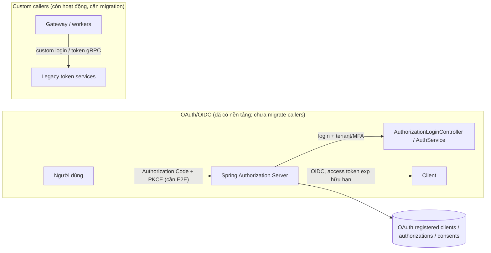

# Identity Service (`services/identity-service`)

> **Cập nhật & Chuẩn hóa:** 2026-10-20
> **Tài liệu tham chiếu:** [`docs/security/security-architecture.md`](../security/security-architecture.md).

---

## 1. Trách Nhiệm & Ranh Giới

Identity Service là trung tâm định danh, quản lý tài khoản, tenant membership, MFA, RBAC và giao thức cấp quyền của nền tảng FarmVerse. **OAuth 2.0 Authorization Server/OIDC Provider đã được triển khai một phần trong service; chưa product-ready vì chưa migrate Gateway/Web/service clients, chưa có PKCE end-to-end và chưa verify PostgreSQL deployment.** Xem [thiết kế OAuth/OIDC mục tiêu và mapping class/method](../architecture/identity-oauth2-oidc-target.md) và checklist triển khai.
- **HTTP Ingress (`:8092`):** Tiếp nhận xác thực công khai (Login, MFA Verify/Enrollment, Refresh, Logout, Bootstrap-superadmin) và cung cấp JWKS công khai (`/.well-known/jwks.json`).
- **gRPC Ingress (`:9092`):** Giao diện nội bộ độc quyền cho quản trị tài khoản, phân quyền, kiểm tra quyền và cấp phát Service Token (Machine Token & Delegated Token).
- **MQTT Event Outbox:** Phát tán các sự kiện định danh (`IdentityLifecycleEvent`) và sự kiện vô hiệu hóa quyền tức thời (`AuthorizationInvalidated`).

### Ranh giới giao thức

- Hiện tại: Identity cung cấp OAuth2 Authorization Server endpoints, OIDC discovery/JWKS/UserInfo, JDBC state, configured client credentials grant và authorization-only browser login/MFA journey. Gateway/Web và machine/delegated callers vẫn dùng custom endpoints/gRPC.
- Mục tiêu: Authorization Code + PKCE qua Gateway BFF; service clients dùng client credentials; delegated access dùng RFC 8693; backend xác minh issuer, expiry, audience và scope.
- Giữ gRPC cho directory, credential và administration nội bộ; không tạo identity provider thứ hai.
- Xóa giao thức auth/token hiện tại khi clients đã được cập nhật đồng bộ; dự án đang phát triển nên không thiết kế legacy compatibility layer.

---

## 2. Các Luồng Cấp Phát Token Cốt Lõi

Các luồng dưới đây mô tả migration đang diễn ra: custom public/gRPC token issuance còn hoạt động cho callers cũ, trong khi OAuth endpoints đã được thêm. `is_async`/exp-less token issuance đã bị loại bỏ.

---

## 3. Quản Lý Phiên Refresh & Chống Tấn Công Replay

- **Lưu trữ JPA:** Bảng `sf_refresh_session` và `sf_refresh_token` lưu trữ hash phiên và token.
- **Xoay vòng Token:** Mỗi lần refresh thành công, token cũ bị thu hồi và một refresh token mới cùng họ được phát hành.
- **Chống Replay (`REFRESH_TOKEN_REUSE`):** Khi phát hiện một refresh token đã từng bị thu hồi được sử dụng lại, toàn bộ họ session sẽ bị thu hồi ngay lập tức trong transaction `REQUIRES_NEW`.
- **Quản trị qua gRPC:** `IdentityTokenService` cung cấp các RPC: `ListSessions`, `RevokeSession`, `RevokeAllSessions`.

---

## 4. Xác Thực Đa Yếu Tố (MFA TOTP)

- **Nguyên tắc bảo mật:** Bootstrap super-admin không tự động sinh hay log TOTP URI/secret ra console.
- **Quy trình Enrollment:** Bắt đầu bằng Challenge Token có thời hạn (`/api/v1/auth/mfa/enrollment/begin`), xác nhận mã OTP (`/api/v1/auth/mfa/enrollment/confirm`).
- **Mã hóa bí mật:** Secret TOTP được mã hóa AES-256 bằng khóa đối xứng an toàn (`MfaEncryptionKeyProvider`).

---

## 5. Trạng Thái Hạng Mục

| Trạng Thái | Hạng Mục Chính |
|:---:|---|
| ✅ **DONE** | Nền tảng Authorization Server/OIDC discovery/JWKS/UserInfo và machine-token protocol tests; custom token/login/MFA/session hiện tại; Catalog quyền Platform toàn cục (ADR-001); 97 unit/component tests pass. |
| 🔄 **DOING** | Tối ưu hóa so khớp tenant trong sự kiện Authorization Invalidation MQTT, Dynamic Authorization Shadow Mode. |
| 📋 **TODO** | E2E Authorization Code + PKCE/login/MFA tests; Gateway BFF + Web cookie migration; client-credentials/RFC 8693 caller migration; PostgreSQL V4 + persistence release gate; gRPC TLS/mTLS nếu cross-host; secret injection/rotation; chốt Shadow → Enforce. Runtime startup smoke check thuộc platform operations (`scripts/health/`), không phải scope Identity hay Readiness Service. |
