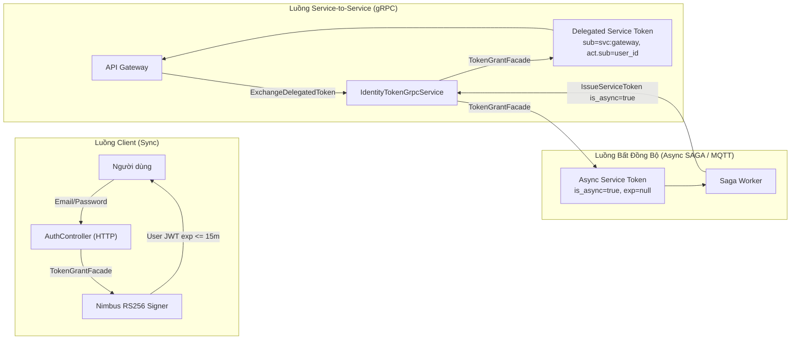

# Identity Service (`services/smartfarm-identity-service`)

> **Cập nhật & Chuẩn hóa:** 2026-10-16  
> **Tài liệu tham chiếu:** [`IDENTITY_BACKLOG_UPDATED.md`](../../IDENTITY_BACKLOG_UPDATED.md) (Master Checklist), [`docs/security/security-architecture.md`](../security/security-architecture.md).

---

## 1. Trách Nhiệm & Ranh Giới

Identity Service là trung tâm định danh, quản lý tài khoản, phân quyền RBAC toàn cục, cấp phát token (Sync & Async), và quản lý phiên người dùng cho toàn bộ nền tảng SmartFarm:
- **HTTP Ingress (`:8092`):** Tiếp nhận xác thực công khai (Login, MFA Verify/Enrollment, Refresh, Logout, Bootstrap-superadmin) và cung cấp JWKS công khai (`/.well-known/jwks.json`).
- **gRPC Ingress (`:9092`):** Giao diện nội bộ độc quyền cho quản trị tài khoản, phân quyền, kiểm tra quyền và cấp phát Service Token (Machine Token & Delegated Token).
- **MQTT Event Outbox:** Phát tán các sự kiện định danh (`IdentityLifecycleEvent`) và sự kiện vô hiệu hóa quyền tức thời (`AuthorizationInvalidated`).

---

## 2. Các Luồng Cấp Phát Token Cốt Lõi

---

## 3. Quản Lý Phiên Refresh & Chống Tấn Công Replay

- **Lưu trữ JPA:** Bảng `sf_refresh_session` và `sf_refresh_token` lưu trữ hash phiên và token.
- **Xoay vòng Token:** Mỗi lần refresh thành công, token cũ bị thu hồi và một refresh token mới cùng họ được phát hành.
- **Chống Replay (`REFRESH_TOKEN_REUSE`):** Khi phát hiện một refresh token đã từng bị thu hồi được sử dụng lại, toàn bộ họ session sẽ bị thu hồi ngay lập tức trong transaction `REQUIRES_NEW`.
- **Quản trị qua gRPC:** `IdentityTokenService` cung cấp các RPC: `ListSessions`, `RevokeSession`, `RevokeAllSessions`.

---

## 4. Xác Thực Đa Yếu Tố (MFA TOTP)

- **Nguyên tắc bảo mật:** Bootstrap super-admin không tự động sinh hay log TOTP URI/secret ra console.
- **Quy trình Enrollment:** Bắt đầu bằng Challenge Token có thời hạn (`/api/v1/auth/mfa/enrollment/begin`), xác nhận mã OTP (`/api/v1/auth/mfa/enrollment/confirm`).
- **Mã hóa bí mật:** Secret TOTP được mã hóa AES-256 bằng khóa đối xứng an toàn (`MfaEncryptionKeyProvider`).

---

## 5. Master Checklist Kế Hoạch Hoàn Thiện

Toàn bộ tiến độ và các hạng mục triển khai của Identity Service được quản lý tập trung tại:
👉 [**Master Checklist Identity Service (TODO / DOING / DONE)**](../../IDENTITY_BACKLOG_UPDATED.md)

| Trạng Thái | Hạng Mục Chính |
|:---:|---|
| ✅ **DONE** | Cấp phát Token đồng bộ & bất đồng bộ (`is_async=true`), Delegated Service Token, Refresh session JPA, Phát hiện Replay Attack, MFA TOTP challenge, Catalog quyền Platform toàn cục (ADR-001), 95/95 test case pass. |
| 🔄 **DOING** | Tối ưu hóa so khớp tenant trong sự kiện Authorization Invalidation MQTT, Dynamic Authorization Shadow Mode. |
| 📋 **TODO** | Release Gate trên PostgreSQL thực tế (Flyway & Concurrency Bootstrap/Refresh), Cấu hình gRPC TLS/mTLS cross-host, Vault/Secret Manager injection. |
