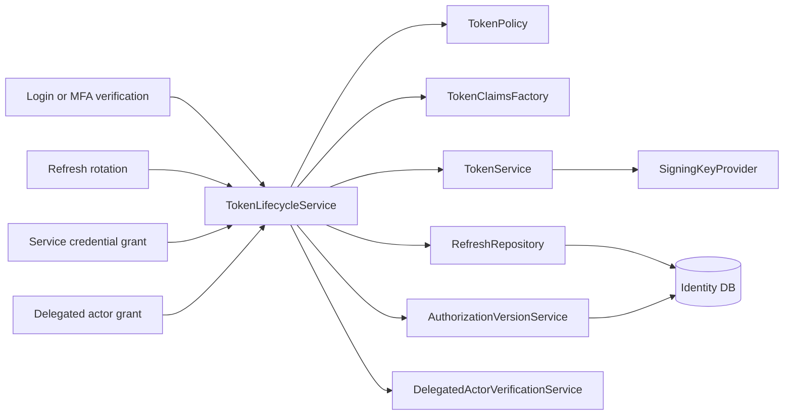
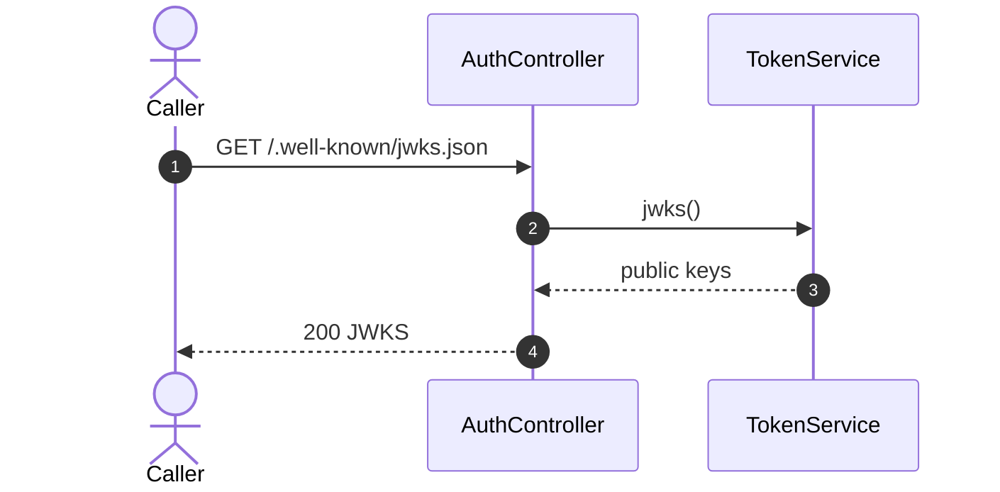
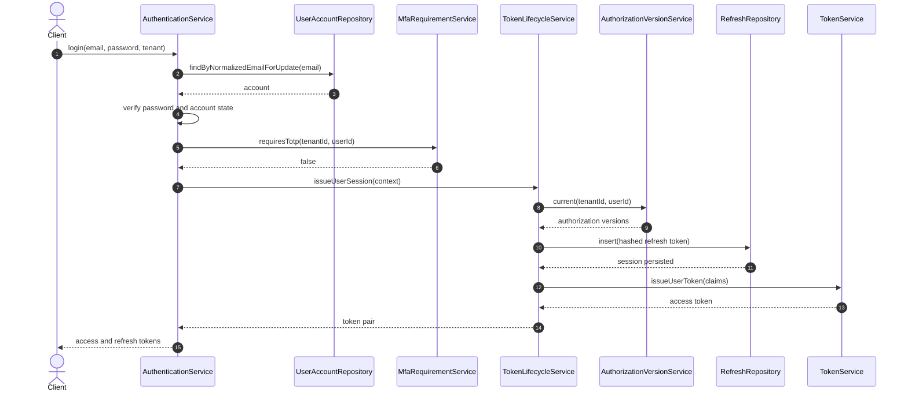
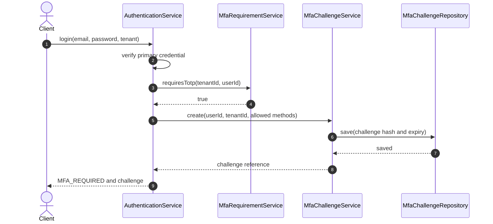
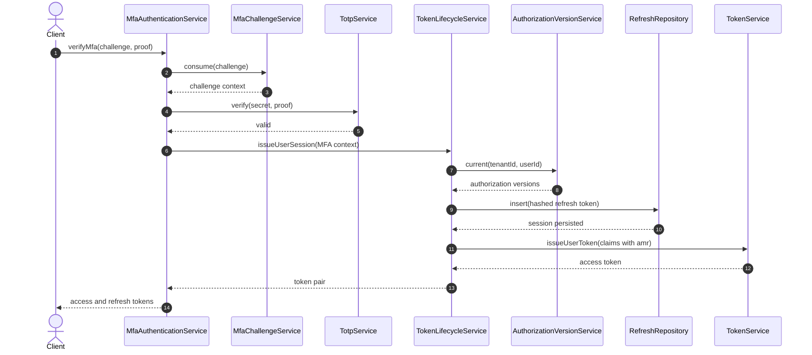
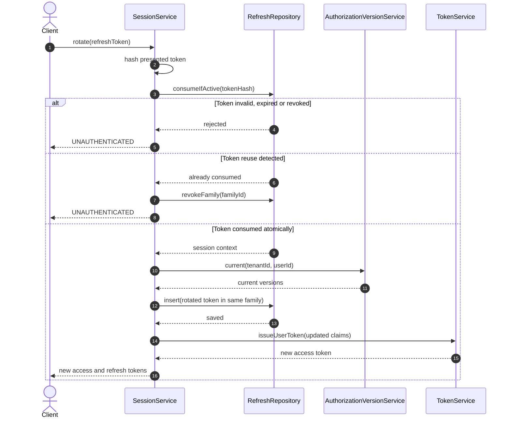
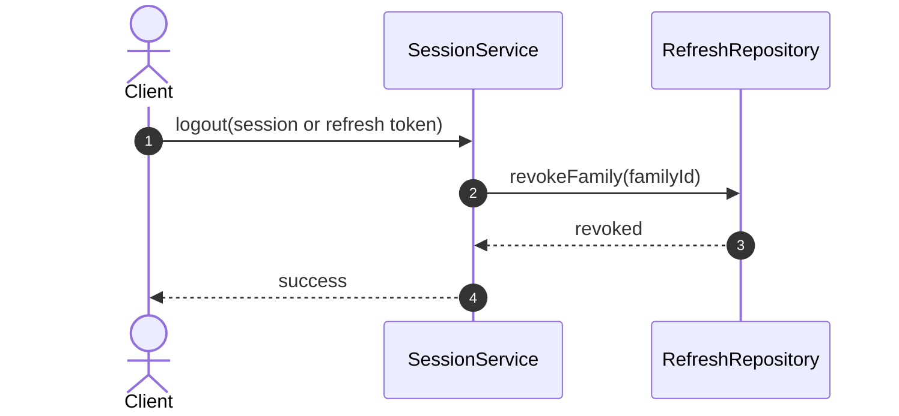
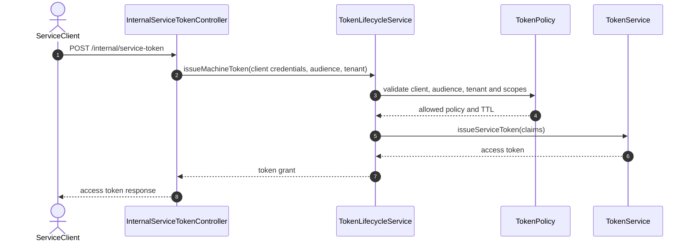
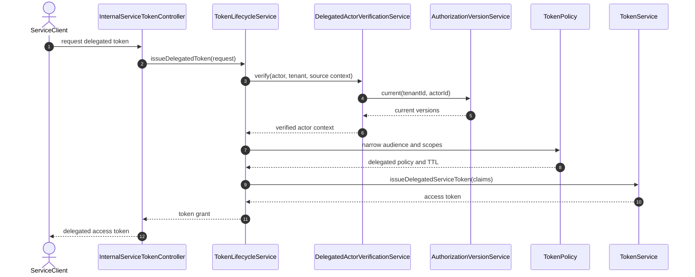
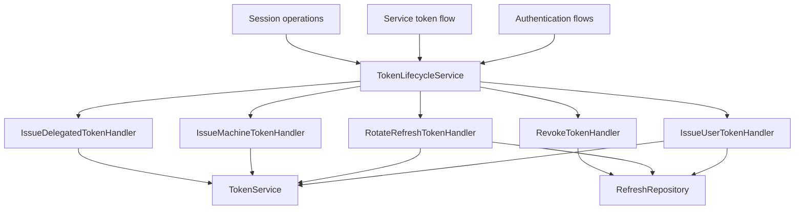

# Review Flow Identity Service

## 1. Mục đích

Tài liệu này review toàn bộ flow đã thu thập của Identity Service, tập trung vào:

- Làm sạch các flow bị phình do static analyzer.
- Phân biệt dependency tĩnh và lời gọi runtime thực tế.
- Xác định thành phần nên giữ, gộp, tách hoặc loại khỏi sơ đồ.
- Đánh giá việc cấp phát, làm mới, thu hồi và duy trì token.
- Đề xuất kiến trúc thống nhất token lifecycle.
- So sánh các phương án cải thiện và đưa ra lộ trình migration an toàn.

> **Giới hạn:** dữ liệu đầu vào là flow tự sinh ở cấp class/dependency. Một số quan hệ là suy luận, chưa chứng minh rằng chúng nằm trong cùng method call path hoặc transaction. Trước khi refactor phải đối chiếu source, test và runtime trace.

---

## 2. Kết luận nhanh

Flow hiện tại cho thấy Identity Service đã có những nền tảng tốt:

- Có `TokenService` làm điểm phát hành JWT.
- Có `RefreshRepository` để quản lý refresh-token state.
- Có `ServiceTokenService` cho machine-to-machine token.
- Có `DelegatedActorVerificationService` để kiểm tra actor khi phát delegated service token.
- Có `AuthorizationVersionService` để đưa version quyền vào token hoặc kiểm tra tính mới.
- Có outbox và integration event để truyền thay đổi authorization.
- Có lớp transport REST và gRPC tương đối tách khỏi repository.

Tuy nhiên, token lifecycle hiện bị phân tán giữa:

- `AuthService`
- `TokenService`
- `RefreshRepository`
- `ServiceTokenService`
- `DelegatedActorVerificationService`
- `AuthorizationVersionService`
- `AccountService`
- `AuthenticatorService`
- `CredentialAdministrationService`

Rủi ro chính là mỗi use case có thể tự hiểu khác nhau về:

- Khi nào được phát token.
- Claim nào phải có.
- Refresh token rotation được thực hiện thế nào.
- Khi nào phải revoke token/session.
- Authorization version được lấy và kiểm tra ở đâu.
- Delegation được kiểm tra ở đâu.
- Token audience được chọn như thế nào.

**Khuyến nghị tổng thể:** giữ `TokenService` là cryptographic issuer cấp thấp, nhưng tạo một tầng `TokenLifecycleService` hoặc các use-case handler thống nhất phía trên để quản lý policy, session, rotation, revocation, delegation và authorization version.

---

## 3. Vấn đề của flow tự sinh

### 3.1 Một controller/service bị biểu diễn như một use case duy nhất

Ví dụ `AuthController` bắt đầu từ:

```text
GET /.well-known/jwks.json
```

nhưng lại chứa toàn bộ:

```text
login
logout
register
rotate
verifyMfa
bootstrapSuperAdmin
beginRequiredTotpEnrollment
confirmRequiredTotpEnrollment
```

Đây không phải một sequence runtime. Đó là tổng dependency/call graph của cả class.

Tương tự:

- `IdentityAdministrationGrpcService` bắt đầu từ `listRoles` nhưng chứa toàn bộ mutation user, role và permission.
- `IdentityCredentialGrpcService` bắt đầu từ `getSecurityProfile` nhưng chứa change password, TOTP và reset MFA.
- `IdentityDirectoryGrpcService` bắt đầu từ `getPrincipal` nhưng chứa update profile và permission check.
- `PlatformAuthorizationAdministrationGrpcService` bắt đầu từ `listPlatformRoles` nhưng chứa create/grant/revoke.

### 3.2 Cạnh `injects` không phải runtime call

Loại khỏi sequence diagram:

```text
injects AuthService
injects TokenService
injects IdentitySettings
injects RefreshRepository
injects GrpcExceptionMapper
```

Các cạnh này chỉ nên xuất hiện trong component/dependency diagram.

### 3.3 Cạnh `queries Repository` bị trùng

Nếu đã có:

```text
AuthService -> UserAccountRepository: findByIdForUpdate
```

thì bỏ:

```text
AuthService -> UserAccountRepository: queries UserAccountRepository
```

### 3.4 Các sub-flow dùng chung bị lặp lại

Các flow sau xuất hiện nhiều lần:

- `IdentityIntegrationEventPublisher -> IdentityEventRecorder -> IdentityOutboxRepository`
- `AuthorizationMutationCoordinator -> AuthorizationVersionService`
- `AuthorizationMutationCoordinator -> AuthorizationInvalidationRecorder`
- `RefreshRepository -> RefreshJpaRepository`
- `GrpcRequestSecurity -> GrpcCallerProvider`

Nên tách thành sơ đồ cross-cutting riêng và chỉ dùng `Note` hoặc `ref` trong flow nghiệp vụ.

### 3.5 HTML entity làm Mermaid khó đọc hoặc parse lỗi

Thay toàn bộ:

```text
-&gt;&gt;  thành ->>
--&gt;&gt; thành -->>
```

Không dùng alias dễ xung đột như `Properties`. Dùng:

```mermaid
participant MfaConfig as MfaProperties
```

---

## 4. Phân loại thành phần: giữ, gộp, tách và ẩn khỏi flow

### 4.1 Nên giữ nguyên vai trò

#### `TokenService`

Nên giữ là thành phần phát hành/serialize/sign JWT ở cấp thấp:

- Tạo JWT header và claims.
- Chọn signing key/key ID.
- Ký token.
- Sinh JWKS/public key representation.
- Không tự quyết định business policy về login, MFA hoặc delegation.

#### `RefreshRepository`

Nên giữ là abstraction quản lý refresh session/token state:

- Insert refresh token/session.
- Tìm theo token hash.
- Consume/rotate atomically.
- Revoke family.
- Revoke user.
- Revoke user trong tenant.

`RefreshJpaRepository` là persistence detail, không nên xuất hiện trong use-case sequence trừ khi đang review repository implementation.

#### `AuthorizationVersionService`

Nên giữ làm nguồn authority cho authorization version:

- Đọc version hiện tại khi phát token.
- Tăng subject/tenant version khi quyền thay đổi.
- Hỗ trợ resource server phát hiện token stale.

#### `ServiceTokenService`

Nên giữ làm use case phát token machine-to-machine, nhưng cần dùng chung claim builder/policy với user token.

#### `DelegatedActorVerificationService`

Nên giữ riêng vì delegated token có security boundary khác machine token thuần túy.

### 4.2 Nên gộp về một policy/lifecycle boundary

Các quyết định phân tán sau nên được điều phối qua một boundary chung:

- Issue user token.
- Issue machine service token.
- Issue delegated service token.
- Rotate refresh token.
- Revoke session/family/user.
- Đọc authorization version.
- Chọn TTL, issuer và audience.
- Chọn claims theo token type.

Tên đề xuất:

```text
TokenLifecycleService
```

hoặc tách theo command rõ ràng:

```text
IssueUserTokenUseCase
RotateRefreshTokenUseCase
IssueServiceTokenUseCase
IssueDelegatedTokenUseCase
RevokeSessionUseCase
```

### 4.3 Nên tách khỏi `AuthService`

`AuthService` đang có dấu hiệu chịu quá nhiều trách nhiệm:

- Register.
- Login.
- Logout.
- Rotate refresh token.
- Verify MFA.
- Required TOTP enrollment.
- Bootstrap super admin.
- Gán role/membership khi đăng ký.
- Phát token.

Nên tách thành các application capability:

```text
RegistrationService
AuthenticationService
MfaAuthenticationService
SessionService
SuperAdminBootstrapService
```

`SuperAdminBootstrapService` đã tồn tại, vì vậy `AuthService.bootstrapSuperAdmin()` chỉ nên delegate rất mỏng hoặc bỏ hẳn khỏi public auth boundary nếu không cần.

### 4.4 Nên ẩn khỏi sơ đồ nghiệp vụ chính

Các thành phần sau có thể ẩn hoặc gom thành một participant:

- `IdentitySettings`
- `ServiceTokenSettings`
- `IdentityAdministrationProtoMapper`
- `IdentityProtoMapper`
- `GrpcExceptionMapper`
- `RefreshJpaRepository`
- `IdentityEventRecorder`
- `IdentityOutboxRepository`

Chỉ mở rộng khi review riêng configuration, transport mapping, persistence hoặc outbox.

---

## 5. Token taxonomy đề xuất

Identity Service nên định nghĩa rõ bốn loại token.

### 5.1 User access token

Đại diện người dùng đã xác thực.

Claims tối thiểu đề xuất:

```text
iss       issuer
aud       audience
sub       user/subject ID
tenant_id tenant hiện hành
sid       session ID
jti       token ID
iat       issued at
nbf       not before
exp       expiration
auth_time thời điểm xác thực chính
amr       phương thức xác thực, ví dụ pwd, totp, recovery_code
acr       assurance level nếu sử dụng
sv        subject authorization version
tv        tenant authorization version
```

Không nên nhét toàn bộ permissions vào token nếu permission thay đổi thường xuyên hoặc có số lượng lớn. Có thể dùng role/version và kiểm tra quyền tại Identity/authorization cache.

### 5.2 Refresh token

Nên là chuỗi opaque ngẫu nhiên, không phải JWT nếu không có yêu cầu đặc biệt.

Database chỉ lưu hash và metadata:

```text
id
family_id
session_id
user_id
tenant_id
token_hash
issued_at
expires_at
consumed_at
revoked_at
replaced_by
client_id
last_used_at
```

Yêu cầu:

- Rotation mỗi lần sử dụng.
- Consume atomically.
- Phát hiện reuse.
- Reuse làm revoke toàn family.
- Không log raw token.

### 5.3 Machine service token

Đại diện service client, không có actor người dùng.

Claims đề xuất:

```text
sub hoặc client_id = service client
actor_type = service
tenant_id
aud
jti
iat
exp
scope hoặc permissions phù hợp
```

TTL nên ngắn. Không dùng refresh token cho machine token thông thường; service client lấy token mới bằng client authentication.

### 5.4 Delegated service token

Đại diện service đang hành động thay mặt user.

Claims đề xuất:

```text
sub       actor người dùng
client_id service gọi
act       actor/service delegation claim hoặc cấu trúc tương đương
tenant_id
aud
jti
iat
exp
sv/tv     authorization version
scope     phạm vi thu hẹp
```

Delegated token phải có phạm vi không rộng hơn token/caller context nguồn.

---

## 6. Mô hình vòng đời token mục tiêu



### Ranh giới trách nhiệm

#### `TokenLifecycleService`

- Điều phối use case.
- Kiểm tra token type và grant type.
- Quyết định có session/refresh token hay không.
- Gọi authorization version.
- Gọi token policy và claim factory.
- Gọi `TokenService` để ký.
- Gọi repository để rotate/revoke.

#### `TokenPolicy`

- TTL theo token type/client.
- Audience allowlist.
- Scope allowlist.
- Yêu cầu MFA/assurance.
- Cho phép delegation hay không.
- Quy tắc refresh rotation/reuse.

#### `TokenClaimsFactory`

- Sinh claims chuẩn cho từng token type.
- Không truy cập repository.
- Không ký JWT.
- Có unit test snapshot/claim contract.

#### `TokenService`

- Ký và serialize token.
- Xuất JWKS.
- Không truy cập account/membership repository.
- Không tự thực hiện authorization business rule.

---

## 7. Flow đã làm sạch

### 7.1 JWKS

Flow JWKS không được kéo theo toàn bộ `AuthService`.



**Cải thiện:** cân nhắc tách thành `JwksController` để auth endpoints không bị trộn với key-discovery endpoint.

### 7.2 Login chưa yêu cầu MFA



### 7.3 Login yêu cầu MFA



Không phát access/refresh token đầy đủ trước khi MFA hoàn tất. Nếu cần token tạm thời, nó phải là token loại riêng, audience/phạm vi rất hẹp và TTL ngắn.

### 7.4 Verify MFA và phát token



### 7.5 Refresh rotation



### 7.6 Logout và revoke



Các mutation nhạy cảm có thể revoke theo phạm vi:

```text
change password       -> revoke all user sessions
reset/disable MFA     -> revoke all user sessions hoặc theo policy
account disabled      -> revoke all user sessions
membership disabled   -> revoke user sessions trong tenant
role/permission change -> tăng authorization version; tùy mô hình có thể không revoke refresh token
```

### 7.7 Machine service token



### 7.8 Delegated service token



---

## 8. Phương án 1: Service điều phối vòng đời token tập trung

### 8.1 Mô tả

Tạo `TokenLifecycleService` làm facade/application service duy nhất cho mọi nghiệp vụ token:

```text
AuthService / AuthenticationService
SessionService
ServiceTokenController
        |
        v
TokenLifecycleService
        |
        +-- TokenPolicy
        +-- TokenClaimsFactory
        +-- TokenService
        +-- RefreshRepository
        +-- AuthorizationVersionService
        +-- DelegatedActorVerificationService
```

API khái niệm:

```java
interface TokenLifecycleService {
    UserTokenGrant issueUserSession(UserAuthenticationContext context);
    UserTokenGrant rotateRefreshToken(String rawRefreshToken);
    ServiceTokenGrant issueMachineToken(ServiceTokenCommand command);
    ServiceTokenGrant issueDelegatedToken(DelegatedTokenCommand command);
    void revokeSession(String sessionId);
    void revokeFamily(String familyId);
    void revokeUser(String userId);
    void revokeUserInTenant(String tenantId, String userId);
}
```

### 8.2 Ưu điểm

- Một điểm thống nhất policy và token lifecycle.
- Dễ rà soát bảo mật.
- Dễ bảo đảm claim, TTL, issuer và audience nhất quán.
- Giảm logic token nằm rải rác trong `AuthService` và `ServiceTokenService`.
- Migration tương đối đơn giản vì có thể bọc quanh implementation hiện tại.
- Dễ thêm audit, metric và logging tập trung.
- Phù hợp với codebase hiện tại vì đã có `TokenService`, `RefreshRepository` và `AuthorizationVersionService`.

### 8.3 Nhược điểm

- Có nguy cơ trở thành “god service” nếu chứa mọi business rule.
- User token và service token có security semantics khác nhau, facade quá lớn dễ tạo coupling.
- Nhiều dependency trong một class nếu không tách policy/factory.
- Thay đổi một token type có thể ảnh hưởng regression token type khác.

### 8.4 Cách kiểm soát nhược điểm

- `TokenLifecycleService` chỉ điều phối, không tự ký JWT.
- Tách `TokenPolicy` theo token type.
- Tách `TokenClaimsFactory` theo token type.
- Các method dùng command/result rõ ràng.
- Không để controller gọi `TokenService` trực tiếp.
- Đặt test contract riêng cho user, machine và delegated token.

### 8.5 Mức phù hợp

**Phù hợp cao** nếu mục tiêu là cải thiện dần codebase hiện tại, ít gián đoạn và chưa muốn thay đổi deployment boundary.

---

## 9. Phương án 2: Tách use-case handler theo loại grant

### 9.1 Mô tả

Không tạo một facade lớn. Mỗi grant/lifecycle operation có handler riêng:

```text
IssueUserTokenHandler
RotateRefreshTokenHandler
IssueMachineTokenHandler
IssueDelegatedTokenHandler
RevokeSessionHandler
RevokeUserSessionsHandler
```

Các handler dùng chung hạ tầng:

```text
TokenService
TokenPolicyRegistry
TokenClaimsFactoryRegistry
RefreshRepository
AuthorizationVersionService
SigningKeyProvider
```

Ví dụ:

```java
interface IssueUserTokenUseCase {
    UserTokenGrant execute(UserAuthenticationContext context);
}

interface RotateRefreshTokenUseCase {
    UserTokenGrant execute(String rawRefreshToken);
}

interface IssueServiceTokenUseCase {
    ServiceTokenGrant execute(ServiceTokenCommand command);
}
```

### 9.2 Ưu điểm

- Mỗi class có trách nhiệm nhỏ và rõ.
- Dependency của từng handler ít hơn.
- Dễ unit test và threat-model từng grant type.
- User, machine và delegated token không bị trộn policy.
- Dễ thay thế hoặc chuyển riêng từng flow trong tương lai.
- Phù hợp với vertical slice/use-case architecture.

### 9.3 Nhược điểm

- Số lượng class/interface tăng.
- Có nguy cơ lặp code nếu shared policy/factory không thiết kế tốt.
- Khó nhìn “toàn bộ token lifecycle” nếu naming/package thiếu nhất quán.
- Migration cần sửa nhiều injection point hơn phương án facade.
- Cần discipline cao để controller không lách qua handler và gọi issuer trực tiếp.

### 9.4 Cách kiểm soát nhược điểm

- Dùng package thống nhất:

```text
identity.token.application.issueuser
identity.token.application.rotate
identity.token.application.issueservice
identity.token.application.revoke
```

- Dùng chung immutable value object cho token context.
- Dùng policy registry và claims factory dùng chung.
- Có architecture test cấm transport gọi `TokenService` trực tiếp.
- Có một tài liệu token lifecycle tổng hợp.

### 9.5 Mức phù hợp

**Phù hợp cao** nếu dự án dự kiến phát triển nhiều grant type, nhiều client/audience hoặc muốn tiến tới modular monolith/hexagonal architecture rõ ràng.

---

## 10. Phương án 3: Tách Token/Authorization Server thành module hoặc service chuyên trách

### 10.1 Mô tả

Tách hẳn chức năng OAuth/token issuance thành deployment/module chuyên trách. Identity domain giữ account, membership và authorization administration; token server lo protocol, grant, session và signing key.

```text
Identity Domain Service
    - account
    - membership
    - roles/permissions
    - MFA lifecycle

Authorization/Token Server
    - token endpoint
    - refresh rotation
    - service credentials
    - delegation
    - JWKS
    - key rotation
    - session/revocation
```

### 10.2 Ưu điểm

- Security boundary rõ nhất.
- Token protocol và key management được cô lập.
- Dễ scale token endpoint độc lập.
- Dễ áp dụng tiêu chuẩn OAuth/OIDC đầy đủ.
- Giảm coupling của token issuance với administration flow.
- Có thể thay bằng sản phẩm/authorization server chuyên dụng trong tương lai.

### 10.3 Nhược điểm

- Chi phí migration và vận hành cao nhất.
- Phải giải quyết consistency giữa account state, MFA, authorization version và token server.
- Tăng network dependency và failure mode.
- Cần cơ chế event/cache/lookup đáng tin cậy.
- Có thể quá mức cần thiết nếu quy mô hệ thống chưa lớn.
- Khó rollback nếu chuyển đổi một lần.

### 10.4 Mức phù hợp

Phù hợp khi:

- Có nhiều hệ thống/client độc lập.
- Cần OAuth/OIDC federation chuẩn.
- Có yêu cầu key management/HSM/compliance cao.
- Token throughput và lifecycle cần scale độc lập.
- Đội vận hành đủ năng lực quản lý thêm service critical.

Không nên là bước đầu tiên nếu mục tiêu hiện tại chỉ là làm sạch code và thống nhất lifecycle trong một Identity Service.

---

## 11. So sánh phương án

### Phương án 1: `TokenLifecycleService` tập trung

**Điểm mạnh:** migration nhanh, ít class hơn, policy tập trung, phù hợp code hiện tại.

**Điểm yếu:** nguy cơ god service và trộn policy giữa các token type.

**Chi phí:** thấp đến trung bình.

**Rủi ro migration:** thấp.

**Khuyến nghị:** tốt nhất cho giai đoạn trước mắt.

### Phương án 2: Use-case handler theo grant

**Điểm mạnh:** ranh giới rõ, test tốt, dễ mở rộng, tránh god service.

**Điểm yếu:** nhiều class, đòi hỏi kiến trúc và naming discipline.

**Chi phí:** trung bình.

**Rủi ro migration:** trung bình.

**Khuyến nghị:** phù hợp làm kiến trúc đích trong cùng service/module.

### Phương án 3: Token server riêng

**Điểm mạnh:** security boundary và khả năng chuẩn hóa/scale tốt nhất.

**Điểm yếu:** phức tạp vận hành, consistency và migration cao.

**Chi phí:** cao.

**Rủi ro migration:** cao.

**Khuyến nghị:** chỉ chọn khi có yêu cầu quy mô, compliance hoặc federation rõ ràng.

---

## 12. Khuyến nghị lựa chọn

### Khuyến nghị chính

Áp dụng lộ trình kết hợp:

1. **Ngắn hạn:** triển khai Phương án 1 để gom lifecycle và loại bỏ direct call tới `TokenService`.
2. **Trung hạn:** bên trong lifecycle boundary, dần tách thành các handler của Phương án 2.
3. **Dài hạn:** chỉ cân nhắc Phương án 3 khi có business/scale/compliance driver thực sự.

Kiến trúc chuyển tiếp:



Facade tạo đường migration ổn định, còn handler ngăn facade trở thành god service.

---

## 13. Thay đổi cụ thể theo component

### `AuthController`

**Giữ:** HTTP boundary.

**Bỏ khỏi cùng controller nếu có thể:** JWKS endpoint.

**Cải thiện:**

- Tách `JwksController`.
- Mỗi endpoint gọi đúng một application use case.
- Không gọi `TokenService` trực tiếp.
- Không tự xử lý refresh rotation.

### `AuthService`

**Hiện trạng suy luận:** quá nhiều trách nhiệm.

**Cải thiện:**

- Tách registration.
- Tách primary authentication.
- Tách MFA completion.
- Tách session rotation/logout.
- Không xử lý key/audience/signing trực tiếp.

### `TokenService`

**Giữ:** crypto/JWT issuer và JWKS.

**Lấy bỏ:**

- Bỏ repository lookup nếu có thể.
- Bỏ business authorization.
- Bỏ refresh persistence.
- Bỏ delegated actor verification.

**Thêm:**

- `TokenClaims` immutable input.
- Key rotation support.
- `kid` validation và active key selection.
- Unit test cho header/claims/signature.

### `RefreshRepository`

**Giữ:** session persistence abstraction.

**Cải thiện:**

- `consumeIfActive` phải atomic.
- Lưu token hash, không lưu raw token.
- Reuse detection.
- Family rotation.
- Revocation reason.
- Cleanup expired token.
- Index trên token hash, user, tenant, family và expiry.

### `ServiceTokenService`

**Cải thiện:**

- Chuyển orchestration vào `IssueMachineTokenHandler` và `IssueDelegatedTokenHandler` hoặc gọi qua lifecycle facade.
- Audience phải dựa trên allowlist.
- Secret validation dùng constant-time comparison hoặc password-hash/credential verifier phù hợp.
- TTL riêng cho machine/delegated token.
- Không cấp refresh token.

### `DelegatedActorVerificationService`

**Giữ riêng:** đây là trust boundary quan trọng.

**Cải thiện:**

- Xác minh account enabled/locked.
- Xác minh membership active.
- Xác minh tenant enabled.
- Xác minh source service được phép delegation.
- Thu hẹp scope/audience.
- Đưa subject/tenant authorization version vào kết quả.

### `AuthorizationVersionService`

**Cải thiện:**

- Tách read path `current()` và mutation path `increment...()` nếu dependency graph quá rộng.
- Không dùng lock/update repository trong read path.
- Trả một value object rõ ràng:

```text
AuthorizationVersionSnapshot
- subjectVersion
- tenantVersion
```

- Token issuance chỉ gọi read path.
- Role/permission mutation gọi increment path.

### `AccountService`, `AuthenticatorService`, `CredentialAdministrationService`

**Cải thiện:** không tự quản lý chi tiết token.

Các service này chỉ phát signal/session command:

```text
revoke all sessions for user
revoke sessions in tenant
issue session after successful authentication
```

### `IdentityIntegrationEventPublisher`

Không dùng integration event như cơ chế duy nhất để bảo vệ token đã phát. Authorization version hoặc introspection/cache validation phải xử lý khoảng trễ event.

---

## 14. Chính sách revoke đề xuất

### Password changed

- Revoke toàn bộ refresh-token family của user.
- Access token cũ hết hạn theo TTL hoặc bị vô hiệu sớm bằng authorization/session version.
- Ghi audit event.

### Account disabled

- Revoke toàn bộ refresh session.
- Tăng subject authorization/session version.
- Resource server từ chối token stale.

### Membership disabled/suspended

- Revoke session trong tenant.
- Tăng subject version trong tenant hoặc tenant-membership version.

### MFA disabled/reset

- Revoke toàn bộ session hoặc tất cả session không đáp ứng assurance policy.
- Tăng session/security version.
- Ghi audit event bắt buộc.

### Role/permission changed

- Tăng authorization version.
- Không nhất thiết revoke toàn bộ refresh session nếu token mới luôn lấy version mới và resource server kiểm tra stale version.
- Với quyền đặc biệt, có thể revoke tenant session theo policy.

### Service client secret rotated/disabled

- Ngăn phát token mới.
- Nếu cần immediate revocation, dùng client version/denylist hoặc TTL rất ngắn.

---

## 15. Consistency và transaction

### Refresh rotation

Các bước sau phải atomic:

```text
1. Lock/find refresh token active.
2. Đánh dấu consumed.
3. Phát hiện reuse.
4. Tạo refresh token thay thế.
5. Commit.
```

JWT access token có thể được ký trong hoặc sau transaction tùy thiết kế, nhưng không được trả cho client nếu refresh state chưa commit thành công.

### Login/MFA completion

- Challenge consume phải atomic.
- Không được dùng lại challenge.
- Chỉ phát token sau khi credential/MFA đã thành công.
- Refresh session insert phải thành công trước khi trả grant.

### Authorization mutation

- Business mutation, version increment và outbox record cần có consistency được định nghĩa rõ.
- Nếu cùng database, ưu tiên cùng transaction.
- Nếu khác database/service, cần saga/eventual consistency và bù trừ rõ ràng.

---

## 16. Security checklist

### Access token

- [ ] TTL ngắn.
- [ ] Có `iss`, `aud`, `sub`, `jti`, `iat`, `nbf`, `exp`.
- [ ] Có token type rõ ràng.
- [ ] Có tenant/session/version khi phù hợp.
- [ ] Resource server validate issuer, audience, signature và expiry.
- [ ] Không chấp nhận thuật toán từ token một cách không kiểm soát.

### Refresh token

- [ ] Opaque random token đủ entropy.
- [ ] Chỉ lưu hash.
- [ ] Rotate mỗi lần dùng.
- [ ] Consume atomically.
- [ ] Reuse làm revoke family.
- [ ] Không log raw token.
- [ ] Có absolute expiry và optional idle expiry.

### Service token

- [ ] Client credential không lưu plaintext nếu có thể.
- [ ] Audience allowlist.
- [ ] TTL ngắn.
- [ ] Không có refresh token.
- [ ] Scope tối thiểu.
- [ ] Có audit cho issuance failure bất thường.

### Delegated token

- [ ] Actor tồn tại và hoạt động.
- [ ] Membership và tenant hoạt động.
- [ ] Service được phép delegation.
- [ ] Scope chỉ giảm, không tăng.
- [ ] TTL không dài hơn source context.
- [ ] Có actor/client claims rõ ràng.

### Signing key

- [ ] Private key không nằm trong repository.
- [ ] Có key rotation.
- [ ] JWKS công bố cả active và retiring public key trong thời gian chuyển tiếp.
- [ ] `kid` duy nhất.
- [ ] Có quy trình emergency rotation.

---

## 17. Logging và metric

### Có thể log

```text
grantType
tokenType
clientId
tenantId
subjectId hoặc subjectPresent
audience
sessionId
jti
result
reasonCode
durationMs
```

Tùy chính sách dữ liệu, `subjectId`, `sessionId` và `jti` có thể cần hash/mask.

### Không log

```text
raw access token
raw refresh token
client secret
password
TOTP secret
TOTP code
recovery code
private key
```

### Metric đề xuất

```text
token_issue_total{type,result}
token_issue_duration
token_refresh_total{result}
token_reuse_detected_total
token_revoke_total{scope,reason}
service_token_issue_total{client,audience,result}
delegated_token_issue_total{client,audience,result}
authorization_version_stale_total
jwks_request_total
signing_key_age
```

---

## 18. Test plan

### Unit test

- Claim factory cho từng token type.
- TTL/audience/scope policy.
- Refresh rotation và reuse detection.
- Delegation scope narrowing.
- Authorization version snapshot.
- Error mapping không làm lộ secret.

### Integration test

- Login không MFA.
- Login yêu cầu MFA.
- MFA challenge hết hạn, sai nhiều lần và reuse.
- Refresh rotation thành công.
- Dùng lại refresh token cũ làm revoke family.
- Logout.
- Change password revoke session.
- Account disable revoke session.
- Membership disable chỉ revoke tenant tương ứng.
- Role/permission change làm token version stale.
- Machine token đúng/sai audience/client secret.
- Delegated token với actor disabled hoặc membership suspended.
- Key rotation trong thời gian token cũ còn hiệu lực.

### Architecture test

Nên có rule:

```text
Controller/gRPC service không gọi TokenService trực tiếp.
Domain không import Proto/HTTP DTO.
TokenService không import repository nghiệp vụ.
RefreshJpaRepository chỉ được dùng qua RefreshRepository implementation.
Administration service không tự phát token.
```

---

## 19. Lộ trình migration

### Giai đoạn 0: Khóa hành vi hiện tại

- Lập inventory endpoint/RPC/token grant.
- Ghi contract claims hiện tại.
- Thêm integration test cho login, refresh, service token và delegation.
- Thêm metric baseline.

### Giai đoạn 1: Làm sạch flow và dependency

- Tách từng endpoint/RPC thành sequence riêng.
- Bỏ `injects` và generic `queries` khỏi sequence.
- Tách JWKS endpoint khỏi `AuthController`.
- Tách read và mutation API của authorization version nếu cần.

### Giai đoạn 2: Tạo lifecycle boundary

- Thêm `TokenPolicy`.
- Thêm `TokenClaimsFactory`.
- Thêm `TokenLifecycleService` facade.
- Bọc `TokenService` và `RefreshRepository` hiện tại.
- Chuyển `InternalServiceTokenController` sang facade.

### Giai đoạn 3: Chuyển user authentication

- Chuyển login issuance sang facade.
- Chuyển MFA completion issuance sang facade.
- Chuyển rotate/logout sang facade.
- Cấm direct call từ controller/application service tới `TokenService`.

### Giai đoạn 4: Tách handler

- Tách issue user, rotate, machine, delegated và revoke handler.
- Giữ facade làm compatibility boundary.
- Giảm dependency của `AuthService`.

### Giai đoạn 5: Củng cố revocation/version

- Thêm refresh reuse detection.
- Chuẩn hóa revoke policy.
- Thêm version vào token.
- Resource server kiểm tra version/cache invalidation.
- Test event delay và out-of-order.

### Giai đoạn 6: Đánh giá service split

Chỉ đánh giá tách token server khi đã có:

- Stable contract.
- Test đầy đủ.
- Metric throughput/latency.
- Yêu cầu scale/compliance cụ thể.

---

## 20. Tiêu chí nghiệm thu

- [ ] Mỗi REST/gRPC endpoint có một application use case rõ ràng.
- [ ] Không controller nào gọi `TokenService` trực tiếp.
- [ ] User, service và delegated token dùng chung issuer/claim conventions.
- [ ] Policy khác nhau được tách theo token type.
- [ ] Refresh token rotate và detect reuse atomically.
- [ ] Revoke policy được tài liệu hóa theo mutation.
- [ ] Authorization version nằm trong token/context phù hợp.
- [ ] Outbox không phải cơ chế duy nhất để vô hiệu token.
- [ ] Không log secret/raw token.
- [ ] Có integration test cho toàn bộ critical token lifecycle.
- [ ] Mermaid sequence không chứa cạnh `injects`.
- [ ] Không có diagram vượt giới hạn đọc hợp lý.

---

## 21. Quyết định đề xuất

### Quyết định ngắn hạn

Chọn **Phương án 1** làm bước migration đầu tiên:

```text
TokenLifecycleService facade
+ TokenPolicy
+ TokenClaimsFactory
+ TokenService hiện tại
+ RefreshRepository hiện tại
+ AuthorizationVersionService hiện tại
```

### Kiến trúc đích trung hạn

Tiến hóa sang **Phương án 2** phía sau facade:

```text
IssueUserTokenHandler
RotateRefreshTokenHandler
IssueMachineTokenHandler
IssueDelegatedTokenHandler
RevokeSessionHandler
```

### Chưa khuyến nghị ngay

Chưa tách Token Server thành deployment riêng cho đến khi có yêu cầu rõ về:

- Scale.
- Federation/OIDC.
- Compliance.
- HSM/key custody.
- Nhiều client/domain độc lập.

Cách kết hợp này giảm rủi ro, không buộc big-bang refactor, đồng thời tạo đường nâng cấp rõ ràng nếu hệ thống phát triển lớn hơn.
