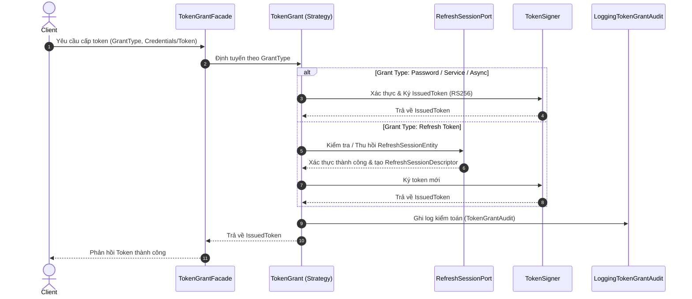
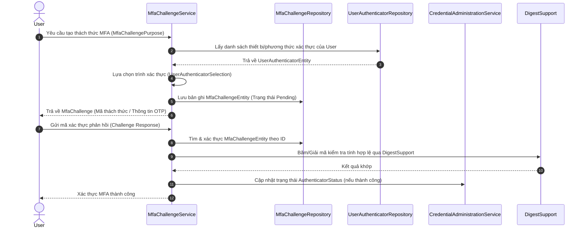
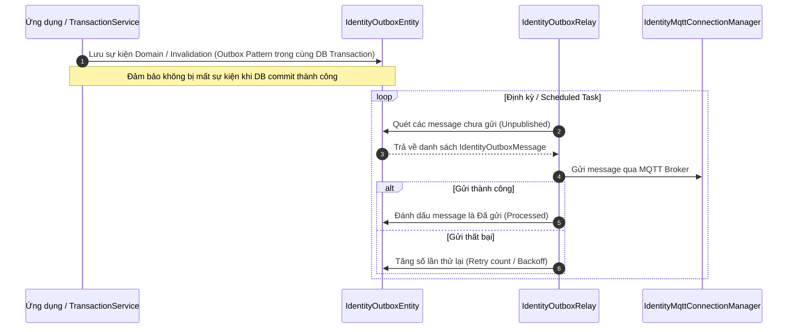
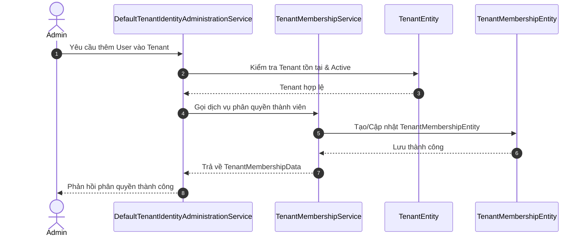

# Review Luồng Nghiệp Vụ — Identity Service

> ⚠️ **ĐÃ HỢP NHẤT VỀ MASTER CHECKLIST (2026-10-16):**  
> Tài liệu này chứa sơ đồ giải thích các luồng nội bộ (TokenGrantFacade, MFA Challenge, Outbox Relay, Tenant Membership). Toàn bộ kế hoạch cải tiến, tính năng đã xong và các đề xuất mở rộng đã được chuẩn hóa và hợp nhất vào [**Master Checklist Identity Service**](../../IDENTITY_BACKLOG_UPDATED.md).

---

## 1. Luồng Cấp Phát Token & Xác Thực (TokenGrantFacade & RefreshSession)
Luồng hiện trạng xử lý việc cấp phát token (Access/Refresh Token) qua các grant type và quản lý phiên.

- **Đã hoàn thành:** TokenGrantFacade tách biệt hoàn toàn logic kiểm tra lỗi cho từng Grant Type, tích hợp `TokenContext` hỗ trợ cờ `is_async = true`.
- **Đã hoàn thành:** Cơ chế chống Replay Attack (`REFRESH_TOKEN_REUSE`) thu hồi toàn bộ session family trong transaction độc lập `REQUIRES_NEW`.

---

## 2. Luồng Xác Thực Đa Yếu Tố (MfaChallengeService)
Luồng hiện trạng xử lý quy trình thử thách MFA (Multi-Factor Authentication) khi người dùng thực hiện các thao tác nhạy cảm hoặc đăng nhập tài khoản đặc quyền.

- **Đã hoàn thành:** Luồng TOTP độc lập bảo vệ bằng Challenge Token; mã hóa secret bằng AES-256 (`MfaEncryptionKeyProvider`); dọn dẹp định kỳ expired challenge.
- **Quyết định kiến trúc:** Không tích hợp WebAuthn / Biometric phức tạp để tránh over-engineering và phình to codebase.

---

## 3. Luồng Đồng Bộ Sự Kiện Bất Đồng Bộ (IdentityOutboxRelay & MQTT)
Luồng hiện trạng đảm bảo tính nhất quán dữ liệu (Transactional Outbox Pattern) kết hợp với MQTT.

- **Đã hoàn thành:** Xuất bản `DomainEvent` Protobuf (Lifecycle & Invalidation) lên MQTT topic `events/identity/authorization-invalidated`.

---

## 4. Luồng Quản Trị Tenant & Phân Quyền (TenantMembershipService)
Luồng quản lý thành viên thuộc Tenant và liên kết phạm vi nông trại.

- **Đã hoàn thành:** Phân tách rõ ràng giữa Account toàn cục, Profile và Tenant Membership; phân quyền toàn cục tuân thủ ADR-001.
