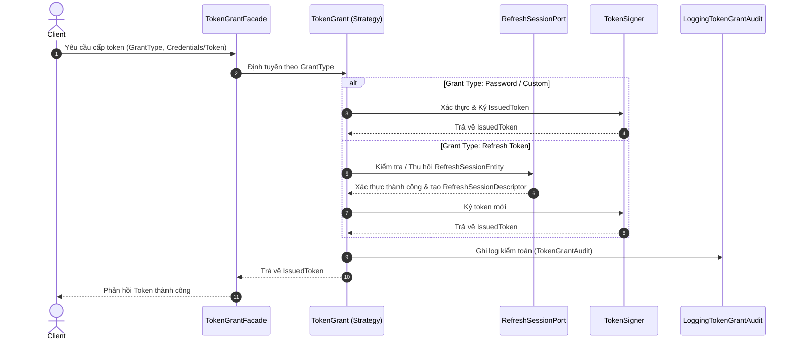
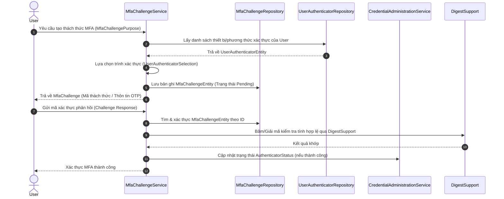
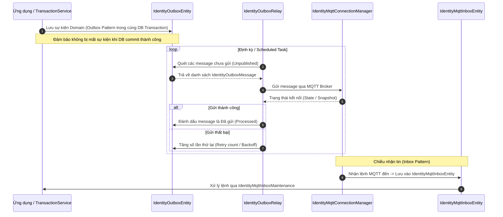
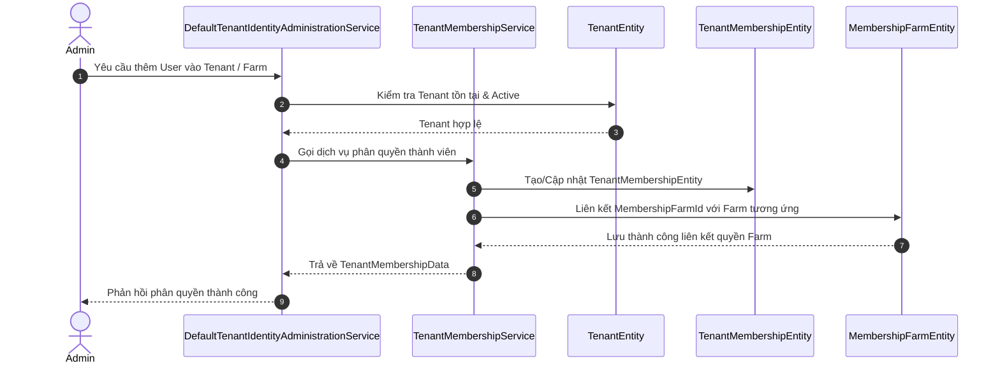

1. Luồng Cấp Phát Token & Xác Thực (TokenGrantFacade & RefreshSession)
   Luồng hiện trạng xử lý việc cấp phát token (Access/Refresh Token) qua các grant type và quản lý phiên.

Đoạn mã

🔍 Gợi ý cải thiện & Hoàn thiện:

Kiểm tra hiện trạng: Đảm bảo TokenGrantFacade tách biệt hoàn toàn logic kiểm tra lỗi (Exception Handling) cho từng Grant Type, tránh việc dồn quá nhiều logic vào một class.

Cải thiện: Thêm cơ chế Token Revocation Blacklist hoặc kiểm tra Session State nghiêm ngặt hơn tại RefreshSessionAdministrationService để phòng chống tấn công Replay Attack (đã có test RefreshReplayRevocationServiceTest, cần đảm bảo implement đúng chuẩn).

2. Luồng Xác Thực Đa Yếu Tố (MfaChallengeService)
   Luồng hiện trạng xử lý quy trình thử thách MFA (Multi-Factor Authentication) khi người dùng thực hiện các thao tác nhạy cảm hoặc đăng nhập.

Đoạn mã

🔍 Gợi ý cải thiện & Hoàn thiện:

Kiểm tra hiện trạng: MfaChallengeService đang gánh khá nhiều trách nhiệm (God class nhỏ: vừa chọn authenticator, vừa tạo challenge, vừa verify).

Cải thiện: Nên tách nhỏ UserAuthenticatorSelection thành một chiến lược (Strategy) riêng biệt để dễ dàng thêm các loại MFA mới (như WebAuthn, Biometric, Email OTP) mà không sửa đổi file MfaChallengeService quá lớn.

3. Luồng Đồng Bộ Sự Kiện Bất ĐỒng Bộ (IdentityOutboxRelay)
   Luồng hiện trạng đảm bảo tính nhất quán dữ liệu (Transactional Outbox Pattern) kết hợp với MQTT kết nối thiết bị.

Đoạn mã

🔍 Gợi ý cải thiện & Hoàn thiện:

Kiểm tra hiện trạng: Cần xem lại cơ chế Locking (như PESSIMISTIC_WRITE hoặc @Lock) trong IdentityOutboxRelay để tránh trường hợp nhiều instance của ứng dụng quét trùng lặp Outbox Message khi scale microservices/instances.

Cải thiện: Bổ sung cơ chế Dead Letter Queue (DLQ) hoặc bảng log lỗi riêng cho các message outbox bị lỗi quá số lần cho phép để tiện giám sát (Monitoring).

4. Luồng Quản Trị Tenant & Phân Quyền (TenantMembershipService)
   Luồng quản lý thành viên thuộc Tenant và phân quyền gắn với Farm (MembershipFarmEntity).

Đoạn mã

🔍 Gợi ý cải thiện & Hoàn thiện:

Kiểm tra hiện trạng: Đảm bảo các ràng buộc Unique Constraint giữa TenantMembershipEntity và MembershipFarmEntity được định nghĩa rõ ràng ở tầng Database Entity để tránh tạo trùng lặp quyền truy cập.

Cải thiện: Tách biệt rõ ràng giữa Tenant-Level Permission (Cấp độ công ty/tổ chức) và Farm-Level Permission (Cấp độ trang trại thực tế) trong các DTO phản hồi để UI dễ hiển thị.